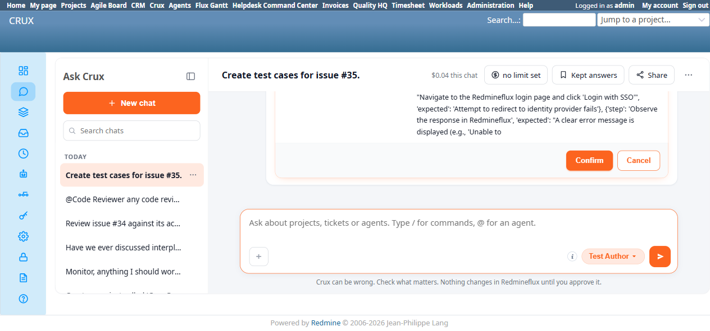
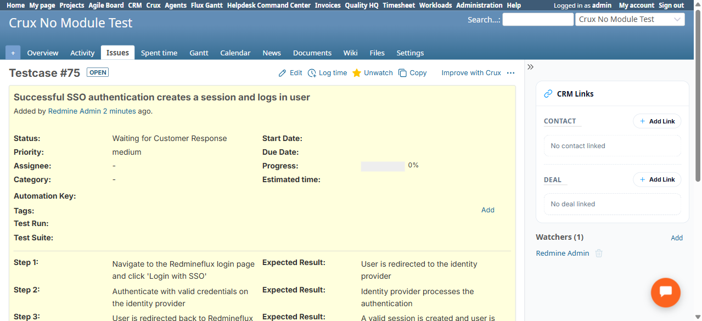

# Bug Report

- Bug ID: BUG-CRX-187
- Production Redmine Issue ID:
- Title: Test Author Agent creates all requested test cases in the wrong project ("Crux No Module Test" instead of the real target issue's own "Crux PM Agent Test Project"), and genuinely fails on 2 of 6 with a confusing "Step N failed: Testcase created" message
- Redmine version: 6.0-bookworm
- Plugin name: redmineflux_crux (Ask Crux chat UI, Test Author Agent)
- Plugin version: crux-core 0.130.0 (current local build, 2026-11-12)
- Environment: Local Docker, http://localhost:3015
- Browser: Chromium (Playwright)
- User role: admin
- Date: 2026-11-12

## Steps to reproduce

1. Fresh chat, Test Author pinned: "Create test cases for issue #35." (Issue #35 lives in project "Crux PM Agent Test Project".)
2. Agent produces a genuine 6-step confirm plan ("Plan / 6-step plan — Crux wants to make 6 changes. Nothing happens until you confirm."), each step a `redmineflux_testcases_management_create_testcase` call with real step/expected data derived from the issue's acceptance criteria.
3. Confirm.
4. Response: "Created 4 of 6" with 4 "✓ Testcase created" lines and 2 confusing "Step N failed: Testcase created: ..." lines (see below).
5. Native-verify via Redmine search for the created testcase titles.

## Expected result

- All created test cases should belong to the same project as issue #35 ("Crux PM Agent Test Project") — the agent's own confirm card did not show a Project field distinct from the issue's own context, so there is no reason to expect a different project.
- A "failed" step should either genuinely not create a record, or if it did partially succeed, the message should say so unambiguously — not simultaneously claim "failed" and "Testcase created" in the same line.

## Actual result

- All 4 successfully-reported test cases were created, but in the **wrong project**: native search confirms "Testcase #72: Login page displays 'Login with SSO' button" and "Testcase #75: Successful SSO authentication creates a session and logs in user" both live under project **"Crux No Module Test"**, not "Crux PM Agent Test Project" where issue #35 and all its real fixture data actually live. This is the same wrong-project-resolution defect class documented elsewhere this cycle (BUG-CRX-080/093/101/133/140), now confirmed on the Test Author Agent's testcase-creation path specifically.
- The 2 "failed" lines ("Step 5 failed: Testcase created: ...", "Step 6 failed: Testcase created: ...") are internally contradictory — the same sentence both claims failure and claims the testcase was created. Not independently verified which (if either) half is true for those 2 specific cases, but the message itself is a defect regardless: a result line must not simultaneously assert both outcomes.

## Evidence

### Screenshot

### Console / log

- Chat's own text: "✓ Testcase created: ... (tracker #4, project #13)" for 4 cases; "Step 5 failed: Testcase created: ..." / "Step 6 failed: Testcase created: ..." for the other 2 — project #13 resolves to "Crux No Module Test" natively, confirmed via direct issue URL (`/issues/75` renders "... - Crux No Module Test - Redmine").

## Duplicate check

- Duplicate found: No — same general wrong-project-resolution shape as the already-fixed/already-tracked BUG-CRX-080/093/101/133/140 family, but first instance on the Test Author Agent's testcase-creation tool specifically (a trigger path none of those prior fixes covered). The confusing "failed: ... created" message text is a separate, additional finding bundled into the same bug report since both surfaced in the same single incident on the same agent/tool.
