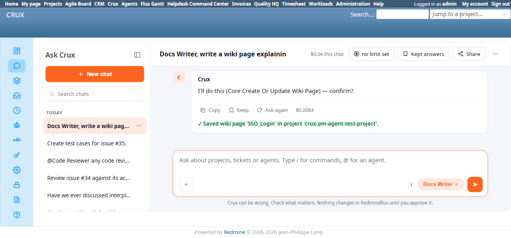

# Bug Report

- Bug ID: BUG-CRX-188
- Production Redmine Issue ID: #128281 (ztflux, flux.zehntech.com) — linked to Test Run #607 "Crux Run 2", Test Case #127775 (CRUX_AGENT_DOCS_WRITER), Environment "Window 11 + Chrome", assigned to Prashant Chaurasia
- Title: Docs Writer Agent's first wiki-save confirm card fabricates a truncated, nonexistent project identifier ("crux-pm-agent-test" instead of "crux-pm-agent-test-project"), causing an honest write failure on the very first attempt of a short (2-turn) chat — recurrence of BUG-CRX-140's root cause on a new agent, uncovered by that fix's verification scope
- Redmine version: 6.0-bookworm
- Plugin name: redmineflux_crux (Ask Crux chat UI, Docs Writer Agent)
- Plugin version: crux-core 0.130.0 (current local build, 2026-11-12)
- Environment: Local Docker, http://localhost:3015
- Browser: Chromium (Playwright)
- User role: admin
- Date: 2026-11-12

## Steps to reproduce

1. Fresh chat, Docs Writer pinned: "Docs Writer, write a wiki page explaining the new SSO login feature, from issue #35." (Issue #35 lives in project "Crux PM Agent Test Project", real identifier `crux-pm-agent-test-project`.)
2. Agent produces a grounded draft (no fabricated protocol/setup details this time -- BUG-CRX-167 appears fixed, not the subject of this report).
3. "Looks good, save it." Agent shows a genuine, real `Core Create Or Update Wiki Page` confirm card with real Confirm/Cancel buttons.
4. Inspect the confirm card's Project field before confirming.

## Expected result

The Project field should show the real project identifier/display name that the earlier `get_issue` call for #35 already resolved correctly -- `crux-pm-agent-test-project` or "Crux PM Agent Test Project" -- not a different, invented value.

## Actual result

The first confirm card's Project field showed **"crux-pm-agent-test"** -- a truncated, nonexistent identifier (confirmed via direct navigation: `/projects/crux-pm-agent-test` returns a genuine 404). Confirming produced an honest failure (no misleading checkmark): *"write failed: tool 'redmineflux_core_create_or_update_wiki_page' failed: ... Wiki page 'sso_login' not found."* Replying "That failed with 'Project not found.' Please retry the save." produced a second confirm card, this time correctly showing "Crux PM Agent Test Project" -- confirming succeeded and the page now genuinely exists at `/projects/crux-pm-agent-test-project/wiki/SSO_Login`.

This is the same root-cause shape as the closed/fixed BUG-CRX-140 (KB Agent write tools fabricating a corrupted project identifier on a later-turn confirm card, self-correcting on retry) -- but that fix (CRC-95) was verified and scoped only to the KB Agent's node/space tools, across a documented intermittent pattern that sometimes needed 5+ chat turns to reproduce. Here the corruption happened on the very first write attempt of a short, 2-turn chat (draft, then save) -- a faster and more consistent recurrence than BUG-CRX-140's own documented threshold, and on a different agent (Docs Writer) entirely.

## Evidence

### Screenshot

### Console / log

- First confirm card (verbatim): `Project: crux-pm-agent-test`, `Title: SSO_Login` -> *"write failed: tool 'redmineflux_core_create_or_update_wiki_page' failed: Error executing tool redmineflux_core_create_or_update_wiki_page: Wiki page 'sso_login' not found..."*
- Second confirm card, same chat, after a retry prompt (verbatim): `Project: Crux PM Agent Test Project` -> *"✓ Saved wiki page 'SSO_Login' in project 'crux-pm-agent-test-project'."*
- Native-verified: `/projects/crux-pm-agent-test` is a genuine 404; `/projects/crux-pm-agent-test-project/wiki/SSO_Login` genuinely renders the saved page.

## Duplicate check

- Duplicate found: No -- shares its exact root-cause shape with the closed/fixed BUG-CRX-140 (a later-turn write confirm card fabricating a corrupted project identifier instead of reusing the already-correctly-resolved value from earlier in the same chat, self-correcting on an explicit retry), but that fix's verification was scoped only to the Knowledgebase Agent's write tools (`create_space`/`update_space`/`delete_space`/`create_node`/`update_node`). This is the first reproduction on the Docs Writer Agent's `create_or_update_wiki_page` tool, and the first reproduction at only 2 chat turns (BUG-CRX-140's own documented pattern needed 5+ turns past its `HISTORY_WINDOW` to reproduce reliably before its fix). Filed as a new bug per the repo's established precedent for recurrences of a known root cause on an uncovered trigger path.
