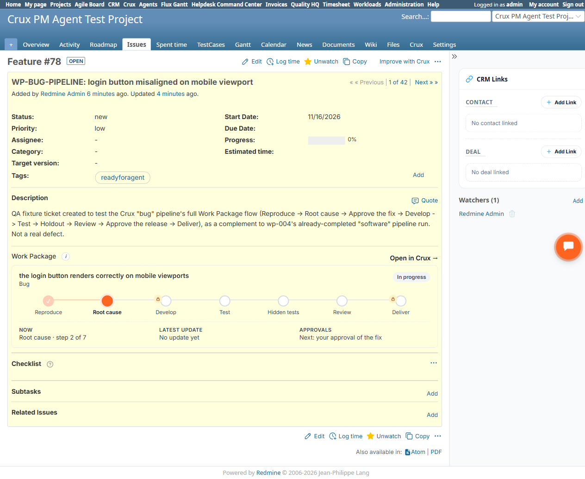
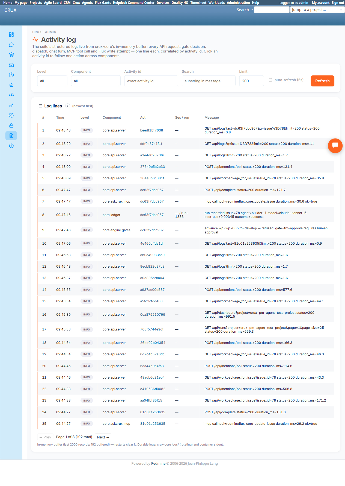

# Bug Report

- Bug ID: BUG-CRX-190
- Production Redmine Issue ID: <!-- not yet reported, pending approval -->
- Title: `crux_report_complete`'s `post_to_redmine: true` reports "Flux write: posted" (and the internal MCP log shows `ok=true`) but the Redmine ticket receives zero actual change — no journal entry, no `updated_on` bump
- Redmine version: 6.0-bookworm
- Plugin name: redmineflux_crux (Work Packages / governed write path, `crux_report_complete`)
- Plugin version: crux-core 0.130.0 (current local build, 2026-11-16)
- Environment: Local Docker, http://localhost:3015, via the local-only `redmineflux-local` MCP connection (crux-redmine6-mcp-1, localhost:8082 — NOT production)
- Browser: Chromium (Playwright) + direct MCP tool calls
- User role: admin (acting as agent `builder-1`)
- Date: 2026-11-16

## Steps to reproduce

1. Create a fresh ticket (#78), tag it `readyforagent`.
2. Via Ask Crux chat, create a Work Package for it using the `bug` pipeline with default autonomy
   (`execute-with-approval`, NOT suggest-only) — wp-005.
3. As agent `builder-1`, call `redmineflux_crux_claim_next_work` → claims #78 at stage `reproduce`.
4. Call `redmineflux_crux_report_complete` with `issue_id=78`, real tokens/cost, `outcome="success"`, a real
   artifact note, and **`post_to_redmine: true`**.
5. Repeat for the next stage (`root cause`) with a second, uniquely-markered artifact note
   (`UNIQUE-MARKER-RC-78-VERIFY-9f3a2b`), again with `post_to_redmine: true`.
6. After each call, check the ticket directly via `GET /issues/78.json?include=journals` and the Redmine UI's
   Notes/History tabs.

## Expected result

Per `redmineflux_crux_report_complete`'s own tool description: *"post_to_redmine: When true, also posts a real
result note to the Redmine ticket... refused outright, never silently skipped, if the current stage's write
isn't allowed."* Since wp-005 is `execute-with-approval` (not suggest-only), the write should be **allowed** and
a real note containing the artifact text should appear on ticket #78, and `updated_on` should advance past the
report's timestamp.

## Actual result

Both calls returned **"Recorded run run-NNNN for issue #78. Flux write: posted."** — claiming success, not a
refusal. Crux's own Activity Log (`/crux/admin/logs`) confirms the internal write attempt was made and reported
as successful: `mcp call tool=redmineflux_core_update_issue duration_ms=29.2 ok=true` for both runs (run-1385,
run-1386).

But `GET /issues/78.json?include=journals` immediately after **both** calls returns `"journals": []` — zero
notes, zero property changes — and `"updated_on": "2026-11-16T09:43:49Z"` **unchanged** across both calls (the
ticket's last real modification was from an unrelated tag update minutes earlier, not from either "posted"
write). The Redmine UI's Notes and History tabs for #78 show nothing at all. The second call's unique marker
text (`UNIQUE-MARKER-RC-78-VERIFY-9f3a2b`) does not appear anywhere on the ticket, in any journal, or via direct
API search — ruling out a UI-caching artifact.

This is a **misleading-success** defect: the tool, and the component it calls (`redmineflux_core_update_issue`),
both report a successful write, but the write never actually lands on the ticket. Reproduced twice, consistently,
with a unique marker on the second attempt specifically to rule out coincidence/caching.

Note: the companion suggest-only case was verified correct and NOT affected — wp-004 (suggest-only) correctly
refused all 3 `post_to_redmine: true` attempts with an honest `"Flux write: refused — work package 'wp-004' is
suggest-only — writes are never allowed"`, and no journal/updated_on change occurred there either, which is the
*correct* behavior for that case. This bug is specifically about the case where the write **should** be allowed
(`execute-with-approval`) and is reported as posted, but isn't.

## Evidence

### Screenshot

### Console / log

- Tool response (run-1385): `Recorded run run-1385 for issue #78.\nFlux write: posted.`
- Tool response (run-1386): `Recorded run run-1386 for issue #78.\nFlux write: posted.`
- Activity log line (run-1385, act `81d01a253635`): `mcp call tool=redmineflux_core_update_issue duration_ms=29.2 ok=true`
- Activity log line (run-1386, act `dc63f7dcc967`): `mcp call tool=redmineflux_core_update_issue duration_ms=30.6 ok=true`
- Direct API check after both: `curl .../issues/78.json?include=journals` → `"journals":[], "updated_on":"2026-11-16T09:43:49Z"` (unchanged from before either call)

## Duplicate check

- Duplicate found: No. This is a new root cause/entry point, not previously tested — every prior `post_to_redmine`
  test this cycle exercised only the suggest-only **refusal** path (correctly working, not this bug). This is the
  first time an `execute-with-approval` Work Package's `post_to_redmine: true` has been exercised and verified
  against the actual ticket state in this QA cycle. Related in spirit (misleading-success-claim family) to
  BUG-CRX-018/054/067/082/156/186, but those are all chat-confirm-card-level fabrications; this is a distinct
  mechanism — the server-side `report_complete` → internal `redmineflux_core_update_issue` call path itself
  silently no-ops while logging `ok=true`.
