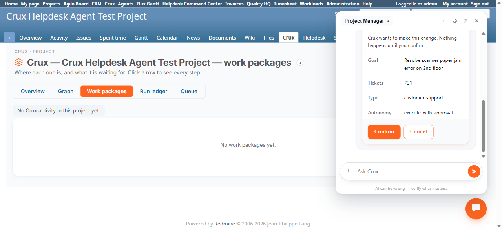

# Bug Report Template

- Bug ID: BUG-CRX-199
- Production Redmine Issue ID: #128837 (reported 2026-11-17, linked to Test Case #127938 / Run #607 / Environment "Window 11 + Chrome", marked Failed, assigned to Prashant Chaurasia)
- Title: Work Package confirm fails with "Ticket #N isn't visible to you" for a ticket the confirming user can clearly see and owns
- Redmine version: 6.0-bookworm
- Plugin name: redmineflux_crux
- Plugin version: 0.98.0
- Environment: localhost:3015 (local Docker)
- Browser: Chromium (Playwright MCP)
- User role: admin
- Date: 2026-11-17

## Steps to reproduce

1. Log in as `admin` on `http://localhost:3015`, go to Crux Helpdesk Agent Test Project (`crux-helpdesk-agent-test-project`, project id 12), open Ask Crux (Project Manager agent).
2. Send: "Create a work package for ticket #31 using the customer-support pipeline."
3. Confirm card appears correctly: `Goal: Resolve scanner paper jam error on 2nd floor`, `Tickets: #31`, `Type: customer-support`, `Autonomy: execute-with-approval` — proving the agent genuinely read the real ticket (#31, "Scanner not responding", confirmed via `redmineflux_core_get_issue(31)`: Project id 12, Assigned to Redmine Admin, Author Redmine Admin).
4. Click "Confirm".

## Expected result

- The Work Package is created and appears under `/projects/crux-helpdesk-agent-test-project/crux/work_packages`, since ticket #31 belongs to this exact project and is owned/authored by the confirming admin user — there is no plausible permission reason admin should be denied visibility of it.

## Actual result

- `POST /crux/ask/confirm` returns **400 Bad Request** with body:
  `{"ok":false,"error":"Ticket #31 isn't visible to you in Redmineflux, so the Work Package wasn't created. Remove it, or ask someone who can open it."}`
- The confirm card remains stuck in pending state after reload; `/crux/ask/confirm` was POSTed 3 separate times across repeated attempts (different fresh "Confirm" element refs each time, ruling out a stale-DOM/double-submit artifact) and failed identically all 3 times.
- Work Packages page continues to show "No work packages yet." — confirmed via direct navigation, not just the chat panel's own state.
- This directly contradicts the confirm card, which was itself built by reading the real ticket #31 data correctly (title/goal match exactly) — the create-time read path sees the ticket fine, but the confirm-time visibility check rejects it.

## Evidence

### Screenshot

### Retest screenshot (fill after fix is verified)

### Console / log

- Browser console: `[ERROR] Failed to load resource: the server responded with a status of 400 (Bad Request) @ http://localhost:3015/crux/ask/confirm`
- Request body: `{"session_id":"ses-485","proposal_id":"prop-511","decision":"confirm"}`
- Response body: `{"ok":false,"error":"Ticket #31 isn't visible to you in Redmineflux, so the Work Package wasn't created. Remove it, or ask someone who can open it."}`

## Duplicate check

- Duplicate found: No
- Existing bug reference (if duplicate): N/A — distinct from BUG-CRX-190/191 (those were about `report_complete`'s Flux-write silently not persisting, and a Pipelines defect respectively; this is a visibility-check false-negative at WP-creation confirm time, a different code path/symptom entirely).
