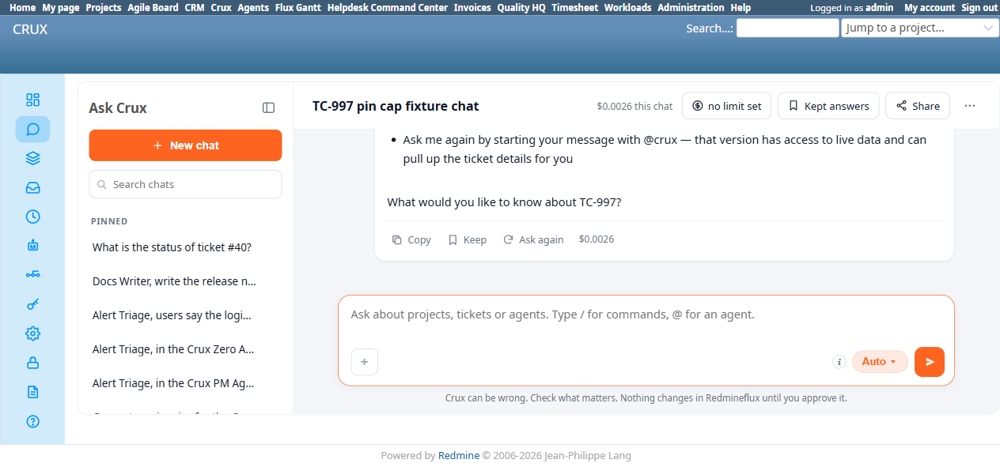

# Bug Report Template

- Bug ID: BUG-CRX-214
- Production Redmine Issue ID: #128994 (reported 2026-11-18 via report_defect, linked to Test Case #127943 / Run #607 / Environment "Window 11 + Chrome", assigned Prashant Chaurasia, category Crux Plugin)
- Title: Pinning a chat does not exempt it from the global "20 newest chats" retention — a pinned chat is silently evicted when an unrelated new chat is created, even though all 20 chats were pinned at the time
- Redmine version: 6.0-bookworm
- Plugin name: redmineflux_crux (Ask Crux — full page, chat list)
- Plugin version: crux-core 747af39
- Environment: localhost:3015 (local Docker)
- Browser: Chromium (Playwright MCP)
- User role: admin
- Date: 2026-11-18

## Steps to reproduce

Executing TC-CRX-997 (deferred, required 20 real pinned chats — built via this account's existing QA-cycle
chat history, which already had exactly 20 real chats, consistent with TC-CRX-1000's own "only 20 newest kept"
retention rule confirmed in the same pass):

1. Native ground truth before: sidebar showed exactly 20 chats total, newest-first, ending with "Create a work
   package for issue #116 using..." as the oldest of the 20.
2. Pinned all 20 existing chats one by one via each row's ⋯ menu → "Pin to top" (confirmed via DOM: all 20
   moved into a single "Pinned" group, no date groups left).
3. Created one brand-new, unrelated chat ("TC-997 pin cap fixture chat") via "New chat" + Send — this chat was
   never pinned.
4. Reloaded and re-checked the sidebar: now only **19** chats remain in the "Pinned" group — "Create a work
   package for issue #116 using..." (the oldest of the original 20, genuinely pinned in step 2) is **gone
   entirely**, replaced in the list by the new unpinned "TC-997 pin cap fixture chat" under "Today".

## Expected result

Per this TC's own expectation ("with 20 already pinned, attempt to pin a 21st — confirm the oldest pin is
dropped, or the new pin is refused — verify which behavior is real"), the only two legitimate outcomes anticipate
this happening as a direct consequence of a **21st pin attempt**. Separately, the entire point of a "Pin to top"
feature is to protect a chat from being lost to the ordinary date-based turnover that already affects every other
chat (per TC-CRX-1000's own documented "only 20 newest kept" rule) — a reasonable user, having pinned a chat
specifically to keep it available, does not expect it to vanish anyway because of unrelated activity elsewhere
in their chat list.

## Actual result

- No 21st pin was ever attempted. A completely ordinary, unrelated new chat was created — an action every user
  performs routinely, with no pin involved at all.
- That action alone caused the global "keep 20 newest" retention rule to evict the single oldest chat on the
  account — and that chat happened to be pinned. The retention rule does not appear to special-case pinned
  chats at all; it is counting and evicting from the same pool regardless of pin state.
- Net effect: pinning provides **no actual protection** from the account-wide 20-chat cutoff. A user who pins
  all 20 of their chats (or even just the oldest one) to make sure none of them disappear will still lose the
  oldest one the very next time they start any new, unrelated conversation.
- This is a more severe and more common-path defect than the TC's own narrower "21st pin" scenario describes —
  it doesn't require the user to ever approach a pin-specific limit at all.

## Evidence

### Screenshot

### Console / log

- Before: 20 chats listed, newest-first, oldest = "Create a work package for issue #116 using...".
- After pinning all 20 (confirmed via DOM — single "Pinned" group, 20 rows) and creating 1 new unrelated chat:
  sidebar shows 19 rows under "Pinned" (the #116 chat is absent from this list and from every other group) + 1
  new unpinned row ("TC-997 pin cap fixture chat") under "Today". Confirmed via a full page reload, ruling out
  a stale-DOM artifact.

## Duplicate check

- Duplicate found: No.
- Existing bug reference: First finding on the pin feature's interaction with the global chat-retention rule.
  Distinct from TC-CRX-1000's own retention-rule confirmation (that TC's own PASS — the 20-newest rule itself
  works correctly for ordinary, unpinned turnover) — this bug is specifically that pinning does not carve out
  an exemption from it.
