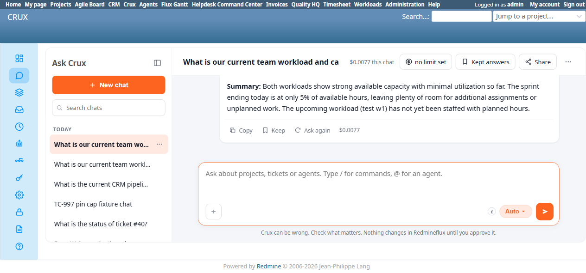

# Bug Report Template

- Bug ID: BUG-CRX-215
- Production Redmine Issue ID: <!-- pending report -->
- Title: Auto-mode routing sends a "team workload and capacity" question to Project Manager instead of Workload Agent, reproduced 2/2
- Redmine version: 6.0-bookworm
- Plugin name: redmineflux_crux (Auto routing)
- Plugin version: crux-core 747af39
- Environment: localhost:3015 (local Docker)
- Browser: Chromium (Playwright MCP)
- User role: admin
- Date: 2026-11-18

## Steps to reproduce

Executing TC-CRX-986 (deferred, required a broader Auto-routing sample beyond the already-filed
BUG-CRX-171/172/173 misroutes):

1. Fresh chat, Auto mode (no agent pinned): "What is our current team workload and capacity?"
2. Response answered from "PM — Project Manager" (initials + name shown in the message header), not Workload
   Agent — despite Workload Agent existing in this instance's agent list specifically described as "reports
   allocation, and reassigns, resizes, or splits it on request."
3. The answer itself used a real tool call ("Checked 1 thing" → "Workload capacity") and returned genuine,
   accurate data (real team "Crux Capacity Agent Test Team", real sprint names/dates/hours) — content is
   correct, only the routing is wrong.
4. Reproduced in a second fresh chat with the identical question — same result both times: answered by
   Project Manager, 2/2.

## Expected result

Per this TC's own expectation (look for misroutes beyond the 3 already filed) and the Workload Agent's own
documented specialty (allocation/capacity reporting), a question specifically about team workload and capacity
should route to the Workload Agent, not Project Manager — matching the same "topic-matching question routes to
the wrong real agent" shape already confirmed on 3 other domains (Root-Cause Analyst, Crux Guide, Code
Reviewer).

## Actual result

- Both attempts (2/2) routed to Project Manager instead of Workload Agent.
- Project Manager's answer content was accurate and well-grounded (via a genuine tool call), consistent with
  the already-documented pattern that PM's own answers tend to be reasonable even when it's the wrong agent for
  the question.
- This is a 4th instance of the same Auto-misrouting defect class as BUG-CRX-171/172/173, on a trigger/domain
  (Workload Agent) none of those three covered.

## Evidence

### Screenshot

### Console / log

- Attempt 1 (verbatim header): "PM Project Manager ▸ Checked 1 thing — Workload capacity — Your team (Crux
  Capacity Agent Test Team) has significant capacity available: ..."
- Attempt 2 (verbatim header, fresh chat): "PM Project Manager ▸ Checked 1 thing — Workload capacity — You have
  two active workloads in the Crux Capacity Agent Test Team: ..."
- Both used the real `Workload capacity` tool and returned genuine data for the real "Crux Capacity Agent Test
  Team" — content correct, agent wrong both times.

## Duplicate check

- Duplicate found: No.
- Existing bug reference: Same Auto-routing-miss shape as BUG-CRX-171 (Root-Cause Analyst), BUG-CRX-172 (Crux
  Guide), and BUG-CRX-173 (Code Reviewer) — all 3 misroute a topic-matching question to Project Manager instead
  of the correct specialist agent. This is a 4th, distinct instance on the Workload Agent's domain, found while
  executing the previously-deferred TC-CRX-986 (broader Auto-routing sample).
