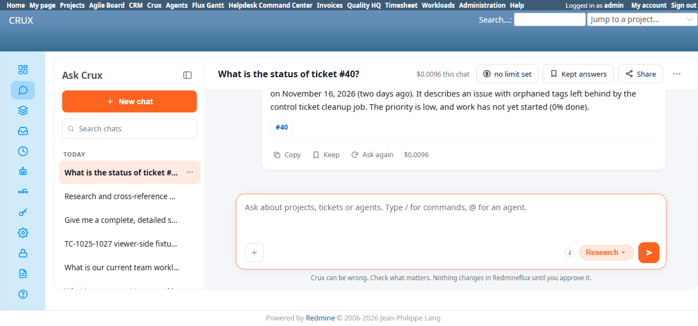

# Bug Report Template

- Bug ID: BUG-CRX-216
- Production Redmine Issue ID: #129011 (reported 2026-11-18 via report_defect, linked to Test Case #127940 / Run #607 / Environment "Window 11 + Chrome", assigned Prashant Chaurasia, category Crux Plugin)
- Title: An agent excluded via Settings → Chat agents remains the persisted picker selection and genuinely answers — the 3rd TC-CRX-984 "ignore condition" (excluded-by-setting) was never actually fixed by BUG-CRX-180
- Redmine version: 6.0-bookworm
- Plugin name: redmineflux_crux (Ask Crux — agent picker, Settings → Chat agents)
- Plugin version: crux-core 747af39
- Environment: localhost:3015 (local Docker)
- Browser: Chromium (Playwright MCP)
- User role: admin
- Date: 2026-11-18

## Steps to reproduce

Executing TC-CRX-905/906 (deferred, Platform Settings suite):

1. Earlier this cycle (a different suite's TC-981 test), the picker was set to "Research" as the active
   selection, which persists per-browser.
2. Settings → Chat agents: checked only "Project Manager" and "Docs Writer" (an explicit allow-list), leaving
   "Research" genuinely unchecked. Saved. Confirmed via DOM: only these 2 checkboxes are checked.
3. Opened a brand-new chat ("New chat" click, not just base-URL navigation) on `/crux/ask`. The agent picker
   button read **"Research ▾"** — the previously-persisted selection, not Auto/default — and opening the
   dropdown listed 4 entries: Crux (auto), **Research**, Project Manager, Docs Writer. Research was neither
   removed from the list nor marked excluded, despite not being in the current allow-list.
4. Sent a real message ("What is the status of ticket #40?") with "Research ▾" still showing as the active
   selection. The message was **not refused and did not fall back to Auto/default** — it was genuinely
   answered with real ticket data (a correct status summary of issue #40, via a real `Get issue` tool call).

## Expected result

Per TC-CRX-984 (3 documented "ignore" conditions for a persisted/URL-param agent selection: retired,
unavailable-missing-plugin, and **excluded by the Chat agents setting**) and the closed BUG-CRX-180 (which
established this exact defect class for the "Retired" condition), a persisted picker selection that is
currently excluded by the live Chat agents allow-list should fall back to Auto/the configured default —
exactly like the other two ignore conditions are supposed to.

## Actual result

- BUG-CRX-180's own retest (2026-11-11) explicitly checked only 2 of the 3 ignore conditions: "Retired" (via
  the picker/@-mention) and the `?agent=` URL param for a retired id. It never checked the "excluded by Chat
  agents setting" condition at all — this is a genuinely uncovered trigger path, not a regression.
- With that condition now exercised directly: the picker keeps a now-excluded agent as its active selection,
  continues to offer it in its own dropdown, and genuinely answers through it — none of the 3 behaviors
  (removed from list, marked unavailable, or silently falling back to Auto) that the "ignore" framing implies
  actually occurs for this specific condition.
- Net effect: an admin who deliberately restricts the picker to a small allow-list (e.g. to simplify the
  picker for end users, or to exclude an agent they don't want used) cannot actually stop a user whose browser
  already had a different agent selected from continuing to use it.

## Evidence

### Screenshot

### Console / log

- Settings → Chat agents, checked state (verified via DOM): only `project-manager` and `docs-writer`
  checkboxes checked; `research` genuinely unchecked.
- Fresh "New chat" picker dropdown (verbatim labels): "Crux (auto)", "Research", "Project Manager", "Docs
  Writer" — 4 entries, Research present despite exclusion.
- Sent message answered successfully (verbatim, relevant excerpt): "`#40 is currently waiting for customer
  response and is unassigned. The ticket is a bug in the Crux PM Agent Test Project...`" — a real, correct
  answer, not a refusal or fallback notice.

## Duplicate check

- Duplicate found: No.
- Existing bug reference: Same underlying defect class as the closed BUG-CRX-180 (a persisted/URL-param agent
  selection ignoring its own "should fall back to Auto" rule), but BUG-CRX-180's own fix and retest only ever
  covered the "Retired" and URL-param-for-a-retired-id conditions — the "excluded by Chat agents setting"
  condition (TC-CRX-984's 3rd documented case) was never exercised by that fix's verification. Filed as a new
  bug per this repo's established precedent for a recurrence on an uncovered trigger path (see
  BUG-CRX-185/203/204/205/211's own duplicate-check entries for the same reasoning pattern).
