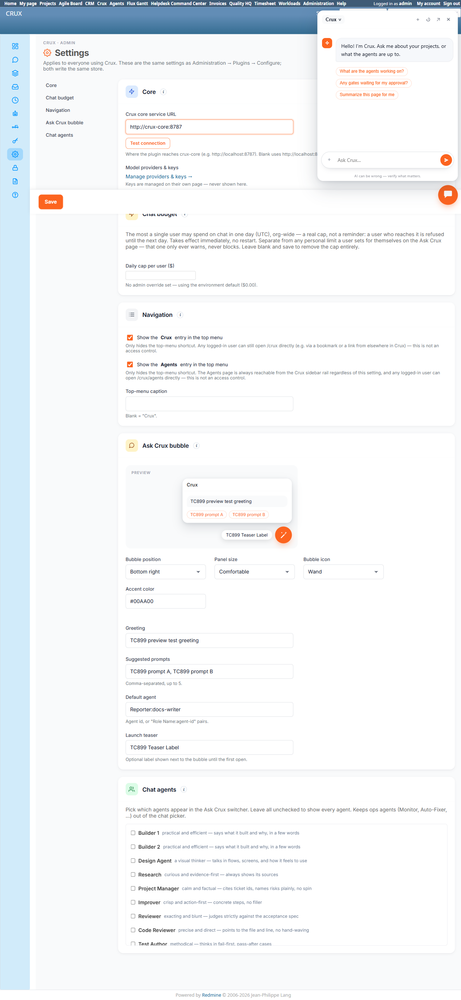

# Bug Report Template

- Bug ID: BUG-CRX-217
- Production Redmine Issue ID: <!-- pending report -->
- Title: Settings → Ask Crux bubble live preview does not reflect Accent color changes, unlike every other previewed field
- Redmine version: 6.0-bookworm
- Plugin name: redmineflux_crux (Settings → Ask Crux bubble preview)
- Plugin version: crux-core 747af39
- Environment: localhost:3015 (local Docker)
- Browser: Chromium (Playwright MCP)
- User role: admin
- Date: 2026-11-18

## Steps to reproduce

Executing TC-CRX-899 (deferred, Platform Settings suite):

1. On `/crux/admin/settings`, the "Ask Crux bubble" section shows a live "Bubble preview" panel alongside the
   fields, labeled as reflecting the result "as you type" (per the section's own info tooltip).
2. Changed each field in turn and checked the preview:
   - **Greeting** → changed to "TC899 preview test greeting" — preview's greet text updated immediately.
   - **Suggested prompts** → changed to "TC899 prompt A, TC899 prompt B" — preview's prompt chips updated
     immediately to exactly these 2 new labels.
   - **Launch teaser** → changed to "TC899 Teaser Label" — the new label appeared in the preview immediately.
   - **Accent color** → changed from the saved `#FC641F` to `#00AA00` (confirmed via the input's own `.value`)
     — the preview's button background and its own `--crux-accent` CSS custom property both remained exactly
     `#FC641F` / `rgb(252, 100, 31)`, never updating to the new green value, no matter how the change was
     triggered (`input`, `change`, `blur`, and a `keyup` event were all tried).
3. Bubble position, Panel size, and Bubble icon have no visual representation anywhere in this preview panel
   at all (it renders only the open chat panel's interior — greeting, chips, header label — never a mock of
   the floating launcher button itself) — these 3 fields' own "preview updates" claim could not be checked
   either way through this panel, since there's nothing in it that would ever reflect a launcher position or
   icon change.

## Expected result

Per this TC's own expectation and the section's own tooltip ("The preview shows the result as you type"),
every one of the 8 documented fields — including Accent color — should visibly update the preview panel
immediately, before Save.

## Actual result

- 3 of the 8 fields (Greeting, Suggested prompts, Launch teaser) are confirmed genuinely live-updating.
- **Accent color is confirmed NOT live-updating** — a real, reproducible gap: the preview keeps rendering the
  old saved accent color indefinitely, regardless of what the field is changed to, until the page is reloaded
  (i.e., until Save + reload, not merely "as you type").
- The other 3 fields (Bubble position, Panel size, Bubble icon) could not be confirmed either way, since the
  preview panel contains no element that would ever represent a launcher position or icon — not evidence of a
  separate defect by itself, but a gap in this TC's own own testability via the documented preview panel.

## Evidence

### Screenshot

### Console / log

- Accent color input `.value` after change: `"#00AA00"`.
- Preview's `.crux-bubble-preview-btn` computed `background-color`: `"rgb(252, 100, 31)"` (= `#FC641F`, the
  OLD saved value) — unchanged after the field edit, confirmed via `getComputedStyle`.
- Preview container's own `--crux-accent` CSS custom property: `"#FC641F"` — also unchanged.
- For contrast, the same session's Greeting/Suggested-prompts/Launch-teaser edits all genuinely appeared in
  the preview's text content immediately, confirming the live-preview mechanism itself works for text fields.

## Duplicate check

- Duplicate found: No.
- Existing bug reference: First finding on the Settings bubble-preview's field coverage — no prior bug in this
  suite or elsewhere this cycle has examined which specific fields the live preview actually reflects.
