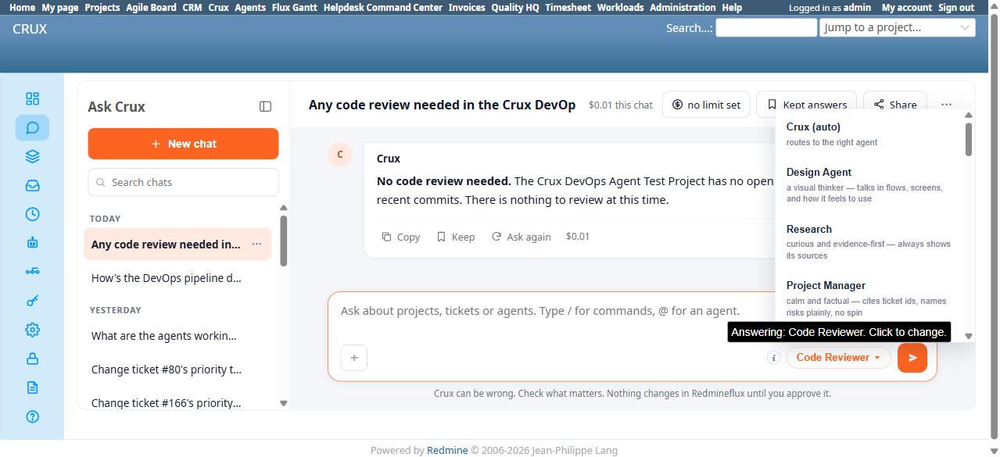

---
# Bug Report Template

- Bug ID: BUG-CRX-218
- Production Redmine Issue ID: <!-- not yet reported, pending approval -->
- Title: Agent picker's DevOps Agent short description still says "trigger a build on request" after CRC-116 expanded it to the whole DevOps plugin
- Redmine version: 6.0-bookworm (local Docker, `C:\crux-redmine`, localhost:3015)
- Plugin name: redmineflux_crux
- Plugin version: 0.98.0 (crux-core 1.15.0, mcp 1.0.11 — DevOps tool count now 68, RMCP-042/043)
- Environment: Local Docker QA stack
- Browser: Chromium (Playwright MCP)
- User role: admin
- Date: 2026-11-19

## Steps to reproduce

1. With the Redmineflux DevOps plugin now installed and migrated on this instance (newly enabled this session,
   per #128756/#128890), open Ask Crux (`/crux/ask`).
2. Click the agent picker ("Auto ▾" or whichever agent is currently pinned) to open the agent list.
3. Read the one-line description shown under "DevOps Agent" in the picker list.

## Expected result

- The picker's short description should reflect the DevOps Agent's real, current scope after CRC-116
  ("DevOps Agent covers the whole DevOps plugin", `agents/devops.md` frontmatter `description:` — builds,
  commits, pull requests, releases, environments and deployments, incidents, security scans and DORA metrics,
  with a discovery fallback for everything else).

## Actual result

- The picker still shows the old, pre-CRC-116 one-liner: **"DevOps Agent reads build and repo state, and can
  trigger a build on request"** — this undersells the agent badly. A user skimming the picker (the normal way
  to decide which agent to address) would reasonably conclude DevOps Agent only reads builds/repos and can
  trigger a build, and would not think to ask it about deployments, releases, incidents, security scans or
  DORA metrics — all of which it can genuinely do (live-verified this session: a real `deploy` proposal with
  an honest "waiting for approval" gate, a real `deployment_action: approve`, a real `create_incident` with a
  correct confirm card, and an honest discovery-backed answer for deployment freezes and software licenses,
  neither of which is even in the agent's static `allowed_tools`).
- This is a **documentation-lag bug, not a functional one** — the agent's actual behavior is correct and
  matches the full manifest; only the picker's separate short-description string (evidently stored/seeded
  independently of `agents/devops.md`'s own `description:` field, which already correctly says the fuller
  scope) was not updated when CRC-116 shipped.
- Same root cause likely affects other already-expanded agents (e.g. Code Reviewer, whose picker text still
  says "precise and direct — points to the file and line, no hand-waving" with no DevOps-dependency caveat
  despite DevOps now being installed) — not separately verified this session, flagged for a follow-up pass.

## Evidence

### Screenshot

### Retest screenshot (fill after fix is verified)

### Console / log

- Confirmed `agents/devops.md` frontmatter `description:` (the full manifest, read directly from
  `C:\crux-redmine\services\redmineflux-crux-core\agents\devops.md`) already says the correct, current scope —
  the mismatch is specifically in whatever separate string backs the picker's one-line blurb.

## Duplicate check

- Duplicate found: No
- Existing bug reference (if duplicate): —
