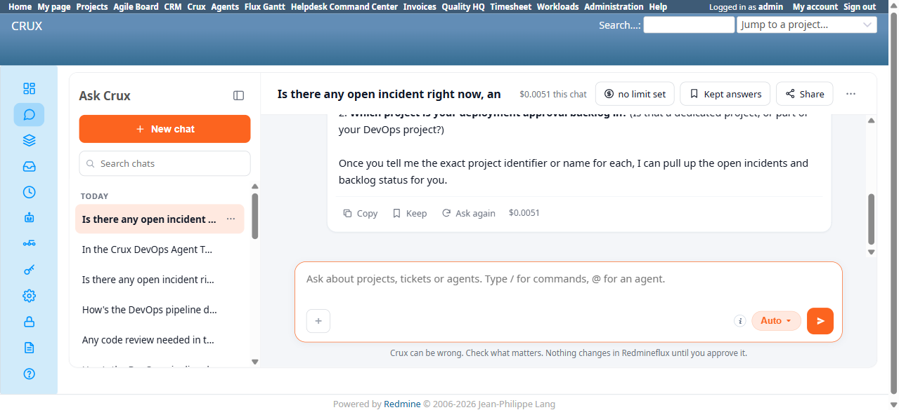

---
# Bug Report Template

- Bug ID: BUG-CRX-219
- Production Redmine Issue ID: <!-- not yet reported, pending approval -->
- Title: Auto-mode routing sends a project-less "open incident / deployment approval backlog" question to Agile Board Agent (Scrum Agent) instead of DevOps Agent, reproduced 2/2
- Redmine version: 6.0-bookworm (local Docker, `C:\crux-redmine`, localhost:3015)
- Plugin name: redmineflux_crux
- Plugin version: 0.98.0 (crux-core 1.15.0, mcp 1.0.11)
- Environment: Local Docker QA stack
- Browser: Chromium (Playwright MCP)
- User role: admin
- Date: 2026-11-19

## Steps to reproduce

1. In Ask Crux, start a fresh chat with the agent picker left on **Auto**.
2. Ask (no project named): *"Is there any open incident right now, and what's our deployment approval
   backlog looking like?"*
3. Repeat in a second, separate fresh chat with the exact same question.
4. Check which agent answered — both in the chat bubble's displayed agent name and in the Run Ledger
   (`/crux/runs`) for that run.

## Expected result

- Per ticket #128890's own acceptance criterion ("Given Auto, when a user asks a DevOps question, then it
  reaches the DevOps Agent"), both "open incident" and "deployment approval backlog" are unambiguously
  DevOps-plugin-domain terms (incidents and deployment approvals are both DevOps Agent tools —
  `list_incidents`, `list_deployments` — not Agile Board/Scrum tools). Auto should route this to **DevOps
  Agent** both times.

## Actual result

- **Both attempts** were answered by a different agent, not DevOps Agent:
  - Attempt 1: Run Ledger shows **Scrum Agent** handled it (avatar "SA").
  - Attempt 2: Run Ledger shows **Scrum Agent** again (avatar "SA"), but the chat bubble itself displayed the
    agent's name as **"Agile Board Agent"** (avatar "AB") — a secondary inconsistency: the same agent shows
    two different display names across the chat UI and the Run Ledger for the identical run. Not pursued
    further this session; flagged here for whoever retests, since it may be relevant to root-causing the fix.
- Both responses were content-wise reasonable in isolation (a genuine "which project do you mean?"
  clarifying question, citing real project names from `list_projects`) — the agent itself didn't fabricate
  anything. The defect is purely that the **wrong domain agent** answered at all; a project-named follow-up to
  the same ambiguous phrasing was asked separately in the same session and DevOps Agent answered correctly and
  accurately once the project was explicit (see `CRUX_AGENT_DEVOPS.md` TC-CRX-1084 for that confirming
  control case) — so the keyword-to-agent routing itself, not project-name resolution, is where this breaks.
- Same underlying defect class as the closed BUG-CRX-171/172/173/215 (Auto sends a domain-specific question to
  the wrong agent), but a **new domain (DevOps: incidents/deployment approvals) and a new wrong-target agent**
  (Agile Board/Scrum Agent, not Project Manager as in all four prior instances) — kept as its own bug per the
  repo's established new-trigger-path convention (same reasoning as BUG-CRX-185/205/215).

## Evidence

### Screenshot

### Retest screenshot (fill after fix is verified)

### Console / log

- Run Ledger (`/crux/runs`): two consecutive "just now" rows both attributed to **Scrum Agent**, both
  `status: success`, for the two reproduction attempts.

## Duplicate check

- Duplicate found: No (related class, new trigger path — see Actual result)
- Existing bug reference (if duplicate): BUG-CRX-171/172/173/215 (same class, different domain/target)
