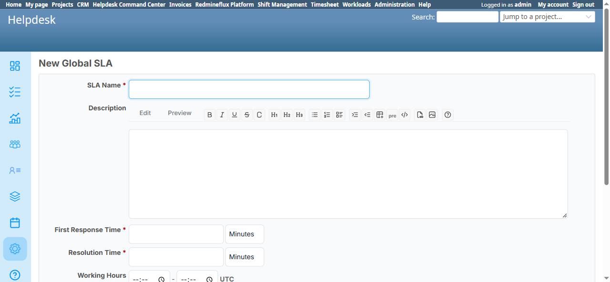

# Bug Report Template

- Bug ID: BUG-HLP-071
- Production Redmine Issue ID: #123756
- Title: SLA clock's holiday-skip logic completely ignores the "Recurring" flag — a recurring holiday only ever applies in the year it was originally created
- Redmine version: 6
- Plugin name: redmineflux_helpdesk
- Plugin version: current (2026-10-15)
- Environment: Local Docker (localhost:3013, `redmine6platform-redmine-1`)
- Browser: Chromium (Playwright MCP)
- User role: Admin
- Date: 2026-10-15

## Steps to reproduce

1. Create a Platform Holiday inside the active Holiday Scheme dated in a **past** year with **Recurring = Yes** (here: "TC-Recurring-Holiday-XMas", Start Date `12/25/2025`, Recurring "Repeats every year on this date").
2. Open a Global SLA's create/edit form (`/rf_helpdesk_global_slas/new`) with Working Hours set — confirm the Holiday picker offers "TC-Recurring-Holiday-XMas" as a selectable option (it does — the picker lists the holiday by name with no date, implying year-independent applicability).
3. Select this holiday on the SLA, set Working Hours/Working Days, Save.
4. Inspect the plugin's own SLA deadline calculator (`lib/redmineflux_helpdesk/sla_calculator.rb`) for how it decides whether a given date is a holiday for this SLA.

## Expected result

- Since the Holiday is marked Recurring and the SLA's Holiday picker offers it without any year qualifier, the SLA clock should skip this date in **every** year the holiday scheme stays active — matching the same "Recurring" promise the Holiday's own detail page states, and consistent with how Platform's own `HolidayEngine` (used elsewhere in this engagement, e.g. by Shift Management's Dashboard) correctly projects a recurring holiday into future years.

## Actual result

- `SlaCalculator#is_holiday?` does a literal date-range comparison only, with **no reference to the `recurring` flag at all**:
```ruby
def is_holiday?(date_time)
  return false if sla.holiday_ids_array.empty?
  date = date_time.to_date
  @holidays ||= sla.holidays.to_a
  @holidays.any? { |h| h.start_date <= date && h.end_date >= date }
end
```
  A holiday whose `start_date`/`end_date` are both `2025-12-25` (the original creation date, no end date given) can **never** match any date in 2026 or any later year — `h.start_date <= date && h.end_date >= date` is false for every date after 2025-12-25. This means a ticket's SLA deadline falling on `2026-12-25` (the holiday's recurring date) will **not** be skipped — the clock counts it as a normal working day, directly contradicting the Holiday's own "Recurring" setting and the Holiday picker's own framing (it offers the holiday with no year, implying it should apply every year).
- This is the exact same defect class as `BUG-SFM-002` (filed the same day against Shift Management's Calendar) — a second, independent place in this codebase where a feature ignores Platform's `recurring` flag and does a naive literal-date match instead of delegating to the shared recurrence logic.

## Evidence

### Screenshot



### Retest screenshot (fill after fix is verified)


### Console / log

- N/A — confirmed by reading `lib/redmineflux_helpdesk/sla_calculator.rb`'s `is_holiday?` method directly in the container (`redmine6platform-redmine-1`); the live UI-only check (offering the holiday regardless of year) made the source-level confirmation necessary rather than a pure black-box guess.

## Duplicate check

- Duplicate found: No
- Existing bug reference (if duplicate): —
