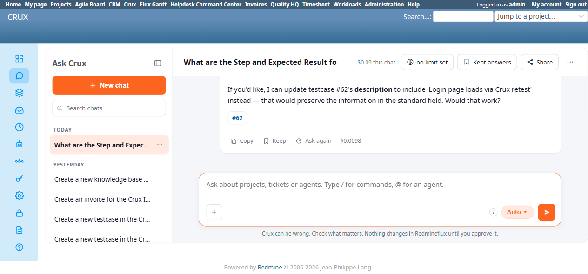

# Bug Report

- Bug ID: BUG-MCP-001
- Production Redmine Issue ID: #128136
- Title: `get_testcase`/`update_testcase` MCP tools still don't expose a testcase's Step/Expected Result rows,
  even though the Testcase Management plugin's own REST API now supports them (BUG-TCM-138 follow-up)
- Redmine version: 6.0-bookworm (local Docker instance, localhost:3015)
- Plugin name: Redmineflux MCP Server (BETA), Testcase Management tools (`testcases_management.py`)
- Plugin version: 0.0.0-dev
- Environment: Local — `http://localhost:3015`, Crux's Testcase Agent (talks to the local `redmineflux-mcp`
  server at `http://127.0.0.1:8082/mcp`)
- Browser: Chromium (Playwright MCP), via Ask Crux chat
- User role: admin
- Date: 2026-11-12

## Steps to reproduce

1. Context: BUG-TCM-138 ("An existing testcase's Steps and Expected Result can't be read or updated through
   the MCP or REST API") was fixed on the `redmineflux_testcase_management` plugin side — pulled `master`
   commit `9785d2c` ("Show and edit a test case's steps through the API..."), which adds `steps` to the
   `GET /get_testcase/:id.json` response and accepts a `steps` array on `PUT /edit_testcase/:id.json`.
   Independently re-verified this plugin-side fix directly against the fixed REST endpoints using an admin
   API key on this same local instance (localhost:3015, fixture issue #62): `GET /get_testcase/62.json` now
   returns `"steps":[{"id":3,"step":"...","expected":"..."}]`, and `PUT /edit_testcase/62.json` with a
   `steps` body genuinely updates the Expected Result (native-verified on `/issues/62`).
2. Per the user's request to specifically retest through Crux (the actual end-user-facing path, not raw
   curl), opened a fresh chat at `/crux/ask`, left it on "Auto" (routed to the Testcase Agent), and asked:
   *"What are the Step and Expected Result for testcase #62 in the Crux PM Agent Test Project?"*
3. Then asked in the same chat: *"Update testcase #62's Expected Result to 'Login page loads via Crux
   retest'."*

## Expected result

Since the underlying plugin REST API now supports reading and writing `steps`, the MCP server's
`redmineflux_testcases_management_get_testcase` and `..._update_testcase` tools should be updated to use it —
Crux's Testcase Agent should be able to both report back and change a testcase's Step/Expected Result rows
through natural-language chat.

## Actual result

- **Read**: the Testcase Agent's own trace shows it genuinely called the `Get testcase` tool (confirmed via
  the chat's "Checked 4 things" expandable: `Get testcase`, `List projects`, `Get issue`, `List custom
  fields`), but still answered: *"The custom fields in your Redmineflux instance don't include 'Step' and
  'Expected Result' fields... the system currently only has an 'Automation Key' custom field defined for
  issues, not Step or Expected Result fields. To capture testcase steps and expected results, you would need
  your Redmineflux admin to create those custom fields..."* — factually wrong (Step/Expected Result are a
  structured, built-in feature of this plugin, not custom fields, and have never needed to be), and it never
  surfaced the real step data even though the tool's HTTP call now receives it from the (fixed) API.
- **Update**: asked again in the same chat to update the Expected Result — the agent correctly looked up the
  testcase, then answered: *"'Expected Result' is a custom field in your Redmineflux instance, not a standard
  testcase field. The `update_testcase` tool I have access to can only modify: Subject, Description, Priority
  ID, Status ID, Attachments. To set a custom field like 'Expected Result,' you'll need to: 1. Use the
  Redmineflux web interface directly... 2. Or ask your Redmineflux admin to expose custom field updates
  through the plugin API"* — and then offered to write the new text into the Description field instead
  (exactly the same workaround the original BUG-TCM-138 report described teams being forced into).
- **Root cause, confirmed by reading the MCP server's own source**
  (`services/redmineflux-mcp/src/tools/testcases_management.py`):
  - `get_testcase`'s HTTP call (line ~206) already hits the fixed `/get_testcase/{id}.json` route and
    receives the `steps` array in its JSON response, but the function's own formatting code (lines ~228-238)
    only ever reads `status`, `priority`, dates and `description` — `issue.get("steps")` is never read or
    included in the tool's returned text at all.
  - `update_testcase`'s parameter signature (line ~436-444) is unchanged: `testcase_id`, `subject`,
    `description`, `priority_id`, `status_id`, `uploads` — there is still no `steps` parameter anywhere, so
    there is no way for the agent (or any MCP caller) to ever send a `steps` body to the now-fixed
    `PUT /edit_testcase/:id.json` endpoint.
- **Conclusion**: the Testcase Management plugin's own REST API fix (BUG-TCM-138, closed) is real and
  correct, but the separate `redmineflux-mcp` server codebase that Crux's Testcase Agent actually talks to
  was never updated to use it. From an end user's perspective (chatting with Crux, which is the documented,
  intended way to use this feature) the bug is **not fixed** — only a developer calling the REST endpoints
  directly would see the fix. BUG-TCM-138's own retest note already flagged this as a known, separate,
  out-of-scope follow-up per the plugin developer's comment on production issue #128057; this bug exists to
  track that follow-up itself, since it was left as a note rather than a tracked item.

## Evidence

### Screenshot

### Retest screenshot (fill after fix is verified)

### Console / log

- `get_testcase` tool source, `testcases_management.py` lines ~206-238: calls
  `client.get(f"/get_testcase/{testcase_id}.json")`, reads `issue.get('status')`, `issue.get('priority')`,
  `issue.get('start_date')`/`due_date`, `issue.get('description')` — no reference to `issue.get('steps')`
  anywhere in the function.
- `update_testcase` tool source, same file, lines ~436-494: parameter list is `testcase_id, subject,
  description, priority_id, status_id, uploads` — no `steps` parameter; `issue_data` dict built from only
  those fields is PUT to `/edit_testcase/{testcase_id}.json`.
- Crux chat trace (verbatim), Read: *"The custom fields in your Redmineflux instance don't include 'Step' and
  'Expected Result' fields... Testcase #62 exists in the Crux PM Agent Test Project and is a Testcase tracker
  type, but the system currently only has an 'Automation Key' custom field defined for issues..."*
- Crux chat trace (verbatim), Update: *"'Expected Result' is a custom field in your Redmineflux instance, not
  a standard testcase field. The `update_testcase` tool I have access to can only modify: Subject,
  Description, Priority ID, Status ID, Attachments."*

## Duplicate check

- Duplicate found: No
- Existing bug reference (if duplicate): N/A — checked `bugs/_duplicates.md` and `bugs/_index.md` for this
  plugin, no prior finding on `get_testcase`/`update_testcase` missing `steps` support. Related: BUG-TCM-138
  (`plugins/redmineflux_testcase_management_qa/bugs/closed/BUG-TCM-138.md`), closed as fixed on the plugin's
  REST API side — this bug tracks the separate MCP-tool-layer gap that TCM-138's own retest note flagged but
  did not open a tracked item for.

## Notes

- This is the MCP server (MCP code), a separate codebase/team from the Testcase Management plugin (TCM code)
  — the fix for this bug needs to land in `services/redmineflux-mcp`, not
  `plugins/redmineflux_testcase_management`.
- Minimal fix shape (not prescriptive, for context): `get_testcase` should append each
  `issue["steps"]` entry's Step/Expected text to its returned summary; `update_testcase` should accept an
  optional `steps` parameter (array of `{id?, step, expected}`, same shape `create_testcase` already uses)
  and forward it inside the `PUT /edit_testcase/:id.json` body's top-level `steps` key (or inside `issue`,
  per the controller's `steps_given` check — either location is accepted).
