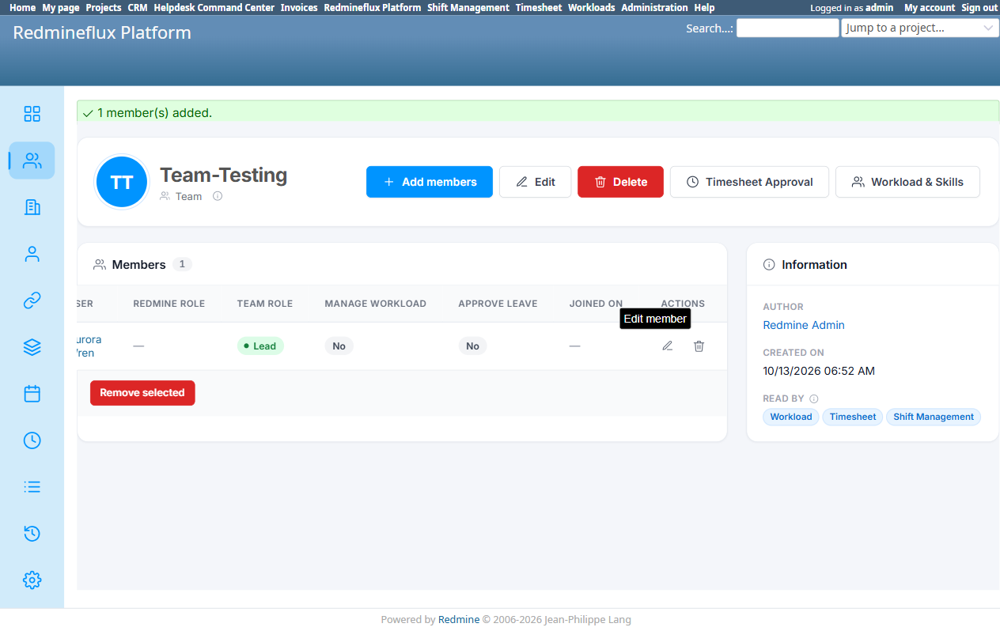

# Bug Report Template

- Bug ID: BUG-PLT-037
- Production Redmine Issue ID: #123283
- Title: Per-member "Team role" (Member/Lead) grants no permission by itself — confirmed live to leave "Approve leave" at "No" even when set to "Lead", making the field purely decorative and misleading next to the checkbox that actually controls leave-approval
- Redmine version: 6 (Rails 7.2.3.1)
- Plugin name: redmineflux_platform (shared `rf_team_memberships` table/UI — both Add Members and Edit Member dialogs on Platform's own Teams screen)
- Plugin version: `redmineflux_platform` branch, current tip
- Environment: `redmine-docker-6-platform`, `localhost:3013`
- Browser: Chromium (Playwright)
- User role: Admin
- Date: 2026-10-13

## Steps to reproduce

1. Create a Team (`PLT-QA-Team-Testing` used for this repro) from Platform's own Teams screen.
2. Click "Add members", select a user (e.g. Aurora Wren), set **Team role = "Lead"**, leave the "Approve leave" checkbox **unchecked**, submit.
3. Look at the resulting member row.

## Expected result

- Per the field's own stated purpose — the Add/Edit dialog's own tooltip reads *"Whether this person leads the team"* — a reasonable user would expect "Lead" to mean this person has leadership authority over the team, most obviously including the ability to approve the team's leave requests (this is literally what "Lead" meant in the pre-consolidation Shift Management screen this field replaced — see `BUG-PLT-014`). At minimum, the field should not coexist with an unrelated, silently-independent permission checkbox that contradicts it.

## Actual result

Confirmed live: a member added with **Team role = "Lead"** and the "Approve leave" checkbox left unchecked ends up with:
```
Team role:      Lead
Approve leave:  No
```
"Lead" grants **nothing** on its own — it is a pure label with no functional effect. The *only* thing that actually controls leave-approval ability is the separate "Approve leave" checkbox, which must be set independently. The dialog's own tooltip even states this directly: *"Whether this person leads the team. **Separate from the Redmine role above, which is what grants permissions.**"* — i.e. the field's own UI copy already concedes it is not a permission.

### Why this is worse than it looks

This is a direct continuation of `BUG-PLT-014` ("Team member Role is two disconnected columns"). That bug's fix did **not** consolidate the two role concepts — it just made both visible side-by-side on every screen. The result, confirmed here, is an admin can now see **both** a "Team role" column (Member/Lead) and an "Approve leave" column (Yes/No) on the same row, for the same member, and nothing requires them to agree. An admin who sets someone as "Lead" — the field whose entire name and historical meaning (in Shift Management, pre-consolidation) was "this person approves the team's leave" — has every reason to believe that alone is sufficient, and will not discover otherwise until a leave request actually goes unapproved.

### Root cause

`rf_team_memberships.role` (varchar, Member/Lead — Shift Management's original per-member field, now exposed on Platform's own Add/Edit dialogs too) and `rf_team_memberships.can_approve_leave` (boolean — the field that actually gates approval) are two independent columns with no relationship enforced between them, either in the UI (no auto-check/auto-disable) or in validation (no refusal of a Lead-with-approve-leave-false combination, if that combination is in fact never meant to occur).

## Evidence

### Screenshot



### Retest screenshot (fill after fix is verified)


### Console / log

- No error — this is a UX/data-model design defect, not a crash.

## Duplicate check

- Duplicate found: No — related to `BUG-PLT-014` (same two columns) but a distinct finding: BUG-PLT-014 was about the two columns disagreeing *across plugins*; this is about the "Team role" field being functionally inert *within Platform's own single screen*, confirmed by setting it and observing no effect on the actual permission.

## Recommendation (user-directed, 2026-10-13)

Retire the `role` (Member/Lead) column and its "Team role" field entirely from every screen (Platform, and anywhere else it is still exposed). Use **`can_approve_leave`** as the single, sole source of truth for "can this person approve this team's leave" — the same flag Workload and Timesheet already rely on. One-time data migration: for any existing row where `role='lead'`, set `can_approve_leave=true` so no team silently loses its approver when the field is removed. This removes one of the three overlapping "who leads/approves" concepts currently on this screen (see also `BUG-PLT-039` for the other two: the team-level `Team Lead` single-person field, and the member-table clutter this trio causes).

## Fix Verification (Retest 2026-10-15)

Retested live against the rebuilt `redmineflux_platform` environment (`redmine-docker-6-platform`, `localhost:3013`, fresh Docker image with the dev's fixes pulled in).

**Fix**: the per-member "Team role" (Member/Lead) dropdown documented above has been **removed entirely** from both the Add Members and Edit Member dialogs. In its place is a functional per-member "Approve leave" checkbox — the field this bug's own Recommendation named as the single source of truth.

**Retest steps**:
1. Created a new Team, "Team-Retest" (id 19), from Platform's own Teams screen.
2. Added member Aurora Wren with **Approve leave = Yes**.
3. Added member Autumn Grace as a plain member (Approve leave left unchecked), and assigned her the 2026 leave policy band `PLT-QA-fresher`.
4. Logged in as Autumn Grace and filed a Comp-Off leave request (leave id 4) — status Pending.
5. Logged in as Aurora Wren and opened the pending request: clicked **Approve** → confirmed the dialog → leave status changed from **Pending to Approved**.

No "Team role" field is present anywhere on either dialog any more, so the dead-label/contradicting-checkbox problem this bug reported no longer exists, and the "Approve leave" flag is now confirmed to be a real, working permission end-to-end (not just a checkbox with no observed effect).

**CONFIRMED FIXED.** Production issue #123283 synced: status In QA → Done, % done → 100.

Moving to **Closed**.

## Production report

Reported to production as **#123283**, linked to Testcase #121706 ("Entity CRUD and Field Validation") inside Run #586 ("Redmineflux Platform QA - Feature #120043"), Suite #397, environment `Win + Chrome + Ver6`. Assigned to Prashant Chaurasia. Priority: Medium | Defect Severity: Medium-severity | Defect priority: Medium | Defect Type: Functional.
