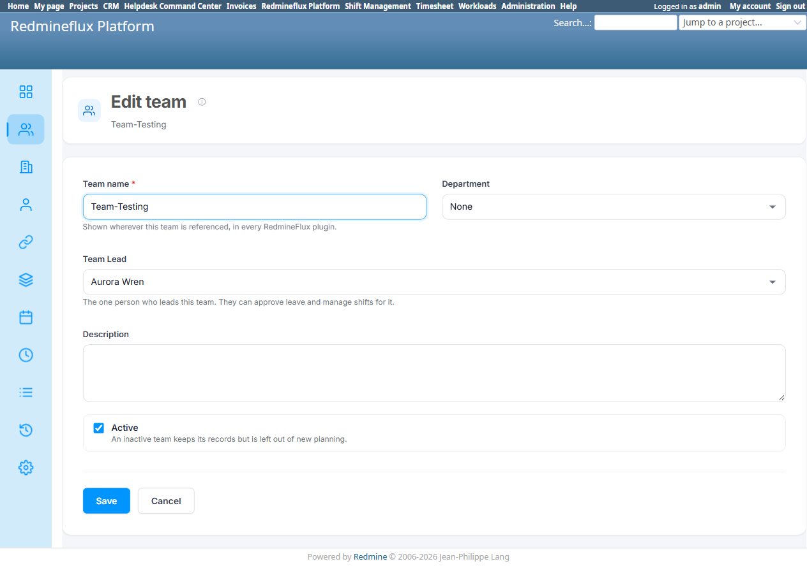
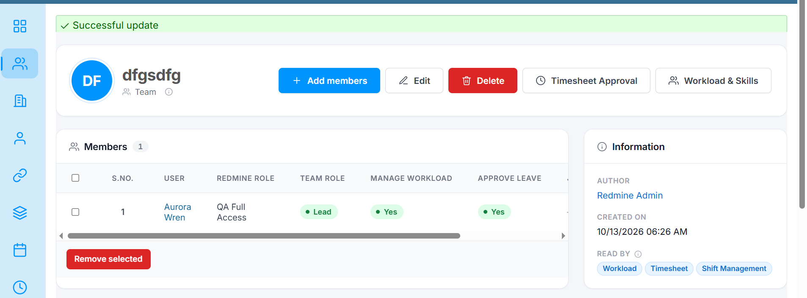

# Bug Report Template

- Bug ID: BUG-PLT-039
- Production Redmine Issue ID: #123285
- Title: Three separate, overlapping "who leads / who approves" concepts on the Team screen — team-level "Team Lead" single-person dropdown, per-member "Team role" (Member/Lead), and per-member "Approve leave" checkbox — plus a 9-column Member table that overflows horizontally at normal widths
- Redmine version: 6 (Rails 7.2.3.1)
- Plugin name: redmineflux_platform
- Plugin version: `redmineflux_platform` branch, current tip
- Environment: `redmine-docker-6-platform`, `localhost:3013`
- Browser: Chromium (Playwright)
- User role: Admin
- Date: 2026-10-13

## Steps to reproduce

1. Open "New team" (`/redmineflux_platform/teams/new`) — note the **"Team Lead"** field: a single-person dropdown, described as *"The one person who leads this team. They can approve leave and manage shifts for it."*
2. Create the team, then open its detail page and click "Add members" — note the **separate, per-member "Team role"** dropdown (Member/Lead) in the same dialog, with its own tooltip: *"Whether this person leads the team. Separate from the Redmine role above, which is what grants permissions."*
3. In the same dialog, note the **separate "Approve leave" checkbox** under Permissions.
4. Add 2–3 members and look at the resulting Member table.

## Expected result

- "Who leads this team" and "who can approve this team's leave" should each be represented by exactly **one** field, not up to three independent ones that can all disagree with each other.
- The Member table should be scannable without horizontal scrolling at a normal browser width.

## Actual result

**Three separate "leadership/approval" concepts confirmed to coexist, with no relationship enforced between any of them:**

| # | Concept | Scope | What it actually does |
|---|---|---|---|
| 1 | `Team.team_lead` ("Team Lead" dropdown on the team itself) | One person, team-wide | Per its own description, "can approve leave and manage shifts" — but this is a separate column from either of the two below; nothing ties it to the member-level flags. |
| 2 | `rf_team_memberships.role` ("Team role": Member/Lead) | Per member | Confirmed in `BUG-PLT-037` to grant **nothing** functionally — purely a label. |
| 3 | `rf_team_memberships.can_approve_leave` ("Approve leave" checkbox) | Per member | The only one of the three that actually gates anything (leave approval). |

A team can therefore have: a `team_lead` set to User A ("can approve leave"), a *different* member B marked "Team role = Lead" (which does nothing), and a *third* member C with "Approve leave" actually checked (the only one who really can). Three people, three different reasons to believe they're "the approver," only one of whom actually is — and nothing on screen reconciles this.

**Member table has 9 columns**, confirmed via live rendering: checkbox, S.No., User, Redmine role, Team role, Manage workload, Approve leave, Joined on, Actions. At a normal desktop width this requires horizontal scrolling to see the Actions column — confirmed in the user-supplied screenshot, where the table's own scrollbar is visible and "Approve Leave" sits at the very edge of the visible area. Several of the 9 columns duplicate information or are low-value for everyday scanning (S.No. is a plain row counter already available from the row's position; Team role is the field `BUG-PLT-037` shows does nothing).

## Additional observation — Team screen UI is inconsistent / due for a broader design pass

Beyond the three overlapping concepts and the 9-column overflow above, the Team screen's UI as a whole would
benefit from a dedicated design pass rather than only removing the 2 redundant fields:

- The "Team Lead" field, the "Add members" dialog's Team role/Approve leave/Manage workload checkboxes, and
  the Member table are three visually disconnected areas with no consistent grouping — a user has to piece
  together "who leads/approves this team" from three different parts of the screen rather than one clear
  section.
- Once `BUG-PLT-037`'s and this bug's own recommendations are applied (dropping "Team role" and the
  team-level "Team Lead" field), the Member table and the Add-member dialog should be visually redesigned
  together — not just shrunk from 9 to 7 columns — so that "Approve leave" and "Manage workload" read as the
  two actual per-member permissions they are, rather than two checkboxes buried among unrelated columns.
- This is a design-quality observation, not a separate functional defect — tracked here rather than as its
  own bug since it depends on the same two field removals this bug already recommends.

## Evidence

### Screenshot

### Retest screenshot (fill after fix is verified)

### Console / log

- No error — UX/information-architecture defect, not a crash.

## Duplicate check

- Duplicate found: No — related to `BUG-PLT-037` (per-member Team role vs. Approve leave) and `BUG-PLT-038` (redirect buttons), but this bug's specific finding is the **third**, team-level `team_lead` concept plus the table-layout consequence of all three/many fields being surfaced on one row.

## Recommendation (user-directed, 2026-10-13)

1. Drop the team-level `Team Lead` single-person field. A team's actual leave-approver(s) should be whichever member(s) have `can_approve_leave = true` — a team can genuinely have more than one approver (e.g. co-leads), which a single `team_lead` column cannot represent anyway.
2. Drop the per-member "Team role" (Member/Lead) field per `BUG-PLT-037`'s recommendation.
3. After both removals, the Member table drops to 7 columns (checkbox, User, Redmine role, Manage workload, Approve leave, Joined on, Actions) — re-measure against this repo's own phone-width/overflow standard (`PLATFORM_ENTITY_CRUD_AND_FIELD_VALIDATION.md` TC-PLT-135) once implemented, since removing 2 columns may resolve the overflow without any further layout change.

## Production report

Reported to production as **#123285**, linked to Testcase #121706 ("Entity CRUD and Field Validation") inside Run #586 ("Redmineflux Platform QA - Feature #120043"), Suite #397, environment `Win + Chrome + Ver6`. Assigned to Prashant Chaurasia. Priority: Low | Defect Severity: Low-severity | Defect priority: Low | Defect Type: Usability.
