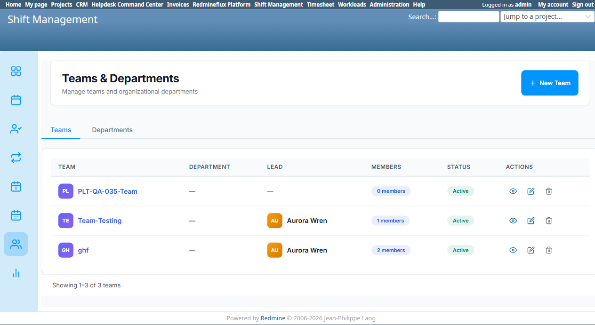

# Bug Report Template

- Bug ID: BUG-PLT-040
- Production Redmine Issue ID: #123286
- Title: Shift Management has its own standalone "Teams" list ("Teams & Departments" → Teams tab) duplicating Platform's own canonical Teams list, even though per-record View/Edit/Delete already correctly redirect to Platform
- Redmine version: 6 (Rails 7.2.3.1)
- Plugin name: redmineflux_shift_management (consumer of redmineflux_platform's Team entity)
- Plugin version: `redmineflux_shift_management` branch, current tip
- Environment: `redmine-docker-6-platform`, `localhost:3013`
- Browser: Chromium (Playwright)
- User role: Admin
- Date: 2026-10-13

## Steps to reproduce

1. Open Shift Management → "Teams & Departments" (`/shift_management/departments`, defaults to `?tab=teams`).
2. Compare its table (columns: Team, Department, Lead, Members, Status, Actions) against Platform's own Teams list (`/redmineflux_platform/teams`).
3. Click "View Team" / "Edit" / "Delete" on a row in Shift Management's list.

## Expected result

- Per the user/product-owner's consolidation direction (already applied to Team member management per `BUG-PLT-013`/`014`/`016`), a shared entity like Team should have exactly **one** list screen — Platform's own. A consumer plugin that needs to show teams should link to Platform's list, not maintain a second parallel one.

## Actual result

Shift Management renders its **own independent "all teams" list** at `/shift_management/departments?tab=teams`, showing the same 3 teams Platform's own Teams list shows ("PLT-QA-035-Team" — 0 members, "Team-Testing" — 1 member, Lead = Aurora Wren, "ghf" — 2 members). This is a second, parallel surface for the exact same data Platform already lists at `/redmineflux_platform/teams`.

**Partial mitigation already in place:** unlike Timesheet/Workload (`BUG-PLT-038`), Shift Management's own "View Team", "Edit", and "Delete" actions on this list all correctly route to Platform's own canonical `/redmineflux_platform/teams/<id>` pages rather than opening a duplicate detail/edit page — so there is no duplicate CRUD surface here, only a duplicate **list**.

## Evidence

### Screenshot

### Retest screenshot (fill after fix is verified)

### Console / log

- No error — UX/information-architecture defect, not a crash.

## Duplicate check

- Duplicate found: No — related to `BUG-PLT-016` (the general "every shared entity is re-implemented in 2-4 consumer plugins" finding) and `BUG-PLT-038` (Timesheet/Workload's duplicate Team *detail* pages), but this is the first confirmed instance of a duplicate Team **list** screen, and the first case found where a consumer plugin's per-record actions already correctly defer to Platform (a pattern other consumers should be brought in line with, rather than removing this redirect).

## Recommendation (consolidation direction, 2026-10-13)

Replace Shift Management's own "Teams" tab content with either (a) a direct link out to Platform's `/redmineflux_platform/teams`, or (b) if Shift Management needs an in-context view, keep rendering a read-only table sourced live from Platform's Team data (no independent list logic) — but remove View/Edit/Delete entry points that imply this is Shift Management's own screen, since they already redirect to Platform anyway.

## Fix Verification (Retest 2026-10-15)

Retested live against the rebuilt `redmineflux_platform` environment (`redmine-docker-6-platform`, `localhost:3013`).

**Fix**: `/shift_management/departments` (Shift Management's own "Teams & Departments" page, including its `?tab=teams` default) now **redirects entirely** to Platform's own Teams list (`/redmineflux_platform/teams`) — Shift Management no longer renders its own independent Teams table at all. The duplicate list this bug reported is gone; there is now exactly one list screen for Team, matching the Recommendation.

**CONFIRMED FIXED.** Production issue #123286 synced: status In QA → Done, % done → 100.

Moving to **Closed**.

## Production report

Reported to production as **#123286**, linked to Testcase #123276 ("Team Cross-Plugin Flow") inside Run #586 ("Redmineflux Platform QA - Feature #120043"), Suite #397, environment `Win + Chrome + Ver6`. Assigned to Prashant Chaurasia. Priority: Low | Defect Severity: Low-severity | Defect priority: Low | Defect Type: Usability.
