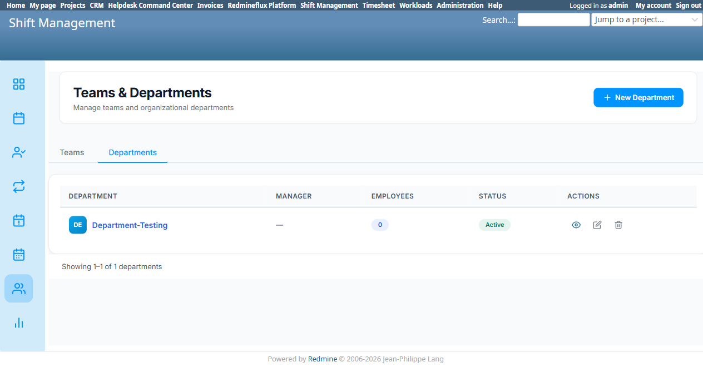
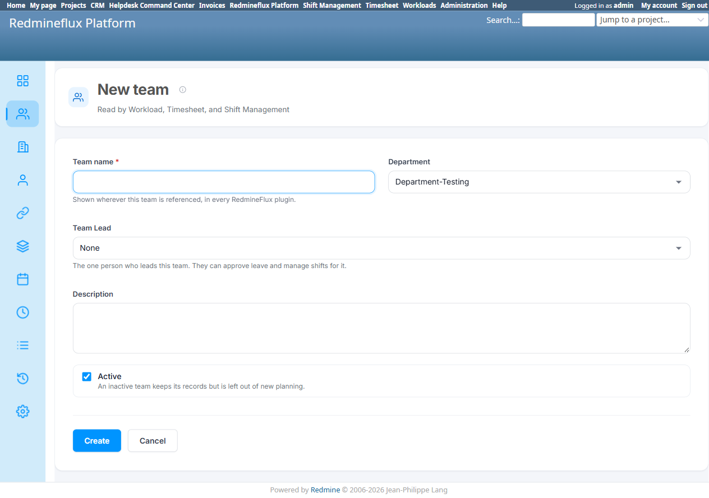
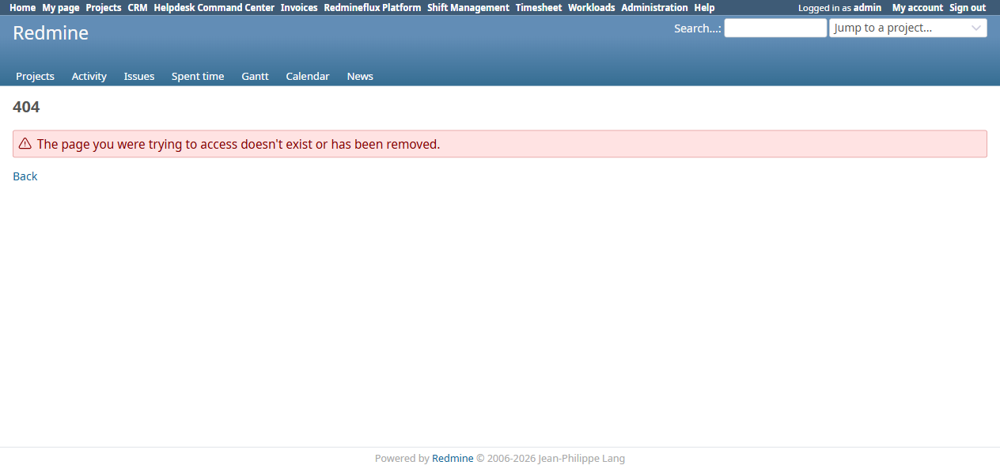

# Bug Report Template

- Bug ID: BUG-PLT-041
- Production Redmine Issue ID: #123287
- Title: "Department" is a shared entity consumed by Platform's own Team form, but Platform has zero management screen for it — Shift Management is the sole owner of Department CRUD, the inverse of Platform's own consolidation standard
- Redmine version: 6 (Rails 7.2.3.1)
- Plugin name: redmineflux_platform (consumer with no owning screen) / redmineflux_shift_management (sole CRUD owner)
- Plugin version: current tip, both plugins
- Environment: `redmine-docker-6-platform`, `localhost:3013`
- Browser: Chromium (Playwright)
- User role: Admin
- Date: 2026-10-13

## Steps to reproduce

1. Open Platform → "New team" (`/redmineflux_platform/teams/new`) — note the **"Department"** dropdown field, with only "None" selectable (no departments exist yet).
2. Open Shift Management → "Teams & Departments" → Departments tab (`/shift_management/departments?tab=departments`) → "Create Department" → create one (e.g. "Department-Testing").
3. Return to Platform's "New team" form and reload — the new department now appears in the "Department" dropdown.
4. Try to find a Platform-side screen to view/manage that Department record directly: there is no "Departments" link anywhere in Platform's own left-nav (Overview, Teams, Organizations, Contacts, Contact links, Holiday Schemes, Holidays, Leave Types, Leaves, Audit events, Platform Settings), and navigating directly to `/redmineflux_platform/list/departments` returns a 404.

## Expected result

- Per the product-owner's own stated standard for this plugin ("the records your plugins all work from... enter something once and it is the same everywhere" — Platform's own Overview page copy), any entity Platform's own forms consume as shared data should be **manageable from Platform**, the same way Team, Organizations, Contacts, Holiday Schemes, Holidays, and Leave Types all are. Department is consumed by Platform's Team form exactly like those are, so it should have the same kind of Platform-owned list/create/edit screen they do.

## Actual result

- Department data is created and owned **entirely** by Shift Management (`/shift_management/departments?tab=departments` — its own "New Department" modal with Name/Manager/Description/Active fields).
- Platform's own Team form silently reads this data (confirmed: a department created in Shift Management appears in Platform's dropdown without any refresh/sync action), but Platform provides **no** way to create, list, edit, or deactivate a Department itself — `/redmineflux_platform/list/departments` is a 404, and no nav link exists.
- This is the **inverse** of the duplication problem found in `BUG-PLT-016`/`037`/`038`/`039` (where multiple plugins each re-implement their own CRUD for the same entity): here, exactly one plugin (Shift Management) owns the only CRUD, while Platform — supposedly the consolidation owner of shared records — has a dependent field pointed at data it cannot itself manage. If Shift Management were ever uninstalled or its Departments tab were inaccessible to a given role, Platform's own Team form would have no way to add a new Department option.

## Evidence

### Screenshot

### Retest screenshot (fill after fix is verified)

### Console / log

- 404 on `/redmineflux_platform/list/departments` is the expected routing 404 for a non-existent controller action, not an application crash.

## Duplicate check

- Duplicate found: No — related to `BUG-PLT-040` (Shift Management's duplicate Teams list) since both concern Shift Management's "Teams & Departments" screen, but this is a structurally different defect (missing Platform-side ownership of a field Platform itself exposes, not a duplicate of something Platform already has).

## Recommendation (consolidation direction, 2026-10-13)

1. Add "Department" as a Platform-managed entity, following the exact same pattern as Team/Organizations/Holiday Schemes/Leave Types: a `redmineflux_platform/list/departments` list screen plus create/edit, with its own nav entry.
2. Migrate Shift Management's existing Department records into Platform's table (same migration shape as the Team/Organization consolidations already completed).
3. Shift Management's own "Departments" tab should then either be removed in favor of linking to Platform, or kept as a read-only view sourced from Platform's data — matching the recommendation already made for Shift Management's Teams tab in `BUG-PLT-040`.

## Fix Verification (Retest 2026-10-15)

Retested live against the rebuilt `redmineflux_platform` environment (`redmine-docker-6-platform`, `localhost:3013`).

**Fix**: `/redmineflux_platform/list/departments` now exists as a genuine Platform-owned screen, under a proper "Teams & Departments" tab in Platform's own nav — following the same pattern already used for Team/Organizations/Holiday Schemes, exactly per this bug's Recommendation #1. The 404 this bug originally reported is gone; Platform is now the owning screen for Department, not just a silent consumer of Shift Management's data.

**CONFIRMED FIXED.** Production issue #123287 synced: status In QA → Done, % done → 100.

Moving to **Closed**.

## Production report

Reported to production as **#123287**, linked to Testcase #123276 ("Team Cross-Plugin Flow") inside Run #586 ("Redmineflux Platform QA - Feature #120043"), Suite #397, environment `Win + Chrome + Ver6`. Assigned to Prashant Chaurasia. Priority: Medium | Defect Severity: Medium-severity | Defect priority: Medium | Defect Type: Functional.
