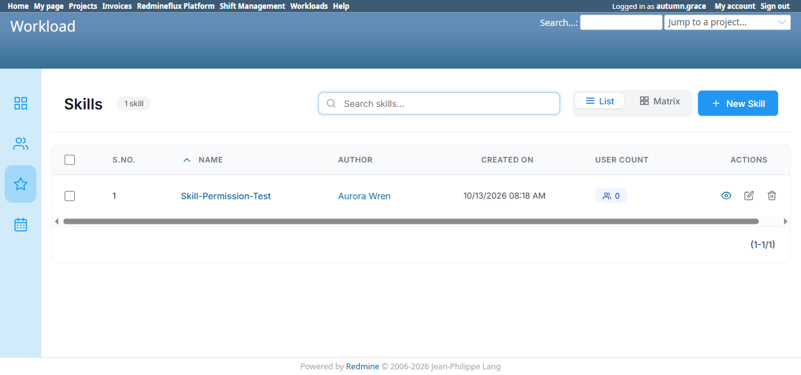
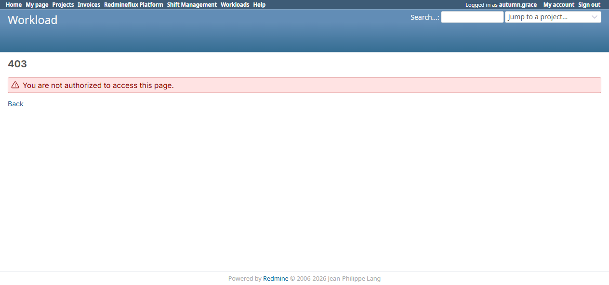
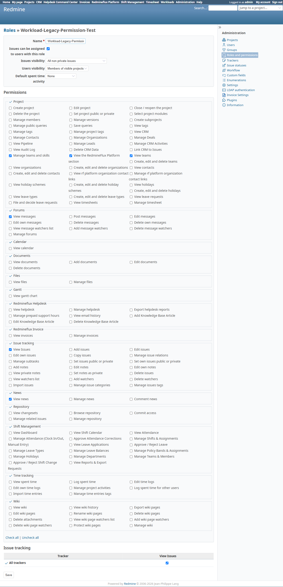

# Bug Report Template

- Bug ID: BUG-PLT-042
- Production Redmine Issue ID: #123288
- Title: Workload's own "Manage teams and skills" permission is completely dead — Skills management (`/rf_skills`) is actually gated by Platform's "Create, edit and delete teams" permission instead, with no dedicated Skills permission of its own
- Redmine version: 6 (Rails 7.2.3.1)
- Plugin name: redmineflux_workload (Skills feature) / redmineflux_platform (the permission actually doing the gating)
- Plugin version: current tip, both plugins
- Environment: `redmine-docker-6-platform`, `localhost:3013`
- Browser: Chromium (Playwright)
- User role: Admin (setup), two dedicated test roles (reproduction)
- Date: 2026-10-13

## Steps to reproduce

**Setup — two roles, both on project `PLT-DelCheck-Project`:**

1. **Role A — "Platform-Team-Permission-Test"**: `View the RedmineFlux Platform section` ✓, `View teams` ✓,
   `Create, edit and delete teams` ✓. Workload's `Manage teams and skills` left **unchecked**. Assigned to
   user `aurora.wren`.
2. **Role B — "Workload-Legacy-Permission-Test"**: Workload's `Manage teams and skills` ✓ only. Platform's
   three permissions above left **unchecked**. Assigned to user `autumn.grace`.

**Test 1 — Role A (Platform permission only, no legacy Workload permission):**

3. Log in as `aurora.wren`, open `/rf_skills`.
4. Click "New Skill", name it, click "Create".

**Test 2 — Role B (legacy Workload permission only, no Platform permission):**

5. Log in as `autumn.grace`, open `/rf_skills`.
6. Edit Role B to also add `View the RedmineFlux Platform section`, then `View teams` — retry `/rf_skills`
   after each addition.
7. Finally add `Create, edit and delete teams` to Role B and retry `/rf_skills` once more.

## Expected result

- Since Skills remains a Workload-owned feature (not migrated to Platform), access to `/rf_skills` should be
  controlled by a Workload-owned permission — either the existing `Manage teams and skills`, or a new
  dedicated `Manage skills` permission if Team and Skill authorization are meant to be split apart (matching
  the same split the product owner wants applied to Team vs. Department/other entities elsewhere in this
  audit).
- A user holding only the legacy `Manage teams and skills` permission should be able to manage Skills. A user
  who holds only Platform's Team permissions (and not this one) should **not** automatically gain Skills
  access as a side effect of a completely unrelated Team permission.

## Actual result

**Confirmed, live, with both directions of the test:**

- **Test 1:** `aurora.wren` (Role A: Platform's `View teams` + `Create, edit and delete teams`, **no**
  `Manage teams and skills`) got full, unrestricted access to `/rf_skills` — list, "New Skill" button, and
  successfully created a skill ("Skill-Permission-Test") with zero permission error.
- **Test 2:** `autumn.grace` (Role B: Workload's own `Manage teams and skills`, **no** Platform Team
  permissions) got a flat **403 Forbidden** on `/rf_skills`. Adding `View the RedmineFlux Platform section`
  — still 403. Adding `View teams` on top of that — still 403. Only once `Create, edit and delete teams` was
  also added did `/rf_skills` become accessible (200, full Skills UI).

**Conclusion:** `/rf_skills`'s actual authorization check is Platform's `Create, edit and delete teams`
permission, not Workload's own `Manage teams and skills` permission at all. The latter is now a completely
inert, non-functional permission — checking or unchecking it on any role has zero observable effect on
anything found so far (it does not gate Skills, and does not gate Team access either — Platform's own
permissions already do that, correctly, per the separate Team consolidation findings in this audit). This
also means the coupling is backwards from an information-architecture standpoint: a role given only
Team-management rights (intended to manage Team membership) silently also gets full Skill-management rights
it was never explicitly granted, while a role explicitly given the Skills permission gets nothing.

## Evidence

### Screenshot

### Retest screenshot (fill after fix is verified)

### Console / log

- 403 responses were clean Redmine authorization rejections (`HTTP status: 403 Forbidden`), not application
  errors — this is a permission-model defect, not a crash.

## Duplicate check

- Duplicate found: No — related to the same consolidation theme as `BUG-PLT-037`/`038`/`039`/`040`/`041`
  (Team/Department authorization not yet consistently owned by Platform), but this is the first finding that
  shows a **legacy permission has gone completely dead** rather than merely duplicated, and that Skills
  (which is supposed to stay in Workload) has been accidentally wired to Platform's permission instead of
  its own.

## Recommendation (per product owner's direction, 2026-10-13)

Per the user's explicit framing: if the Skills section stays in Workload (not moved to Platform), then
**Team management must use Platform's own permission** (already true, confirmed working correctly) **and
Skills management must use its own, Workload-owned permission** — not be silently piggybacked on Platform's
Team permission. Concretely:

1. Decide whether `Manage teams and skills` is revived as a genuine `Manage skills`-only permission (dropping
   "teams" from its scope, since Team is now Platform's domain) and wire `/rf_skills`'s controller to check
   it, or
2. Introduce a new dedicated permission (e.g. `manage_workload_skills`) and retire `Manage teams and skills`
   entirely, updating any role that currently has it checked (it is silently doing nothing for those roles
   today).
3. Either way, `/rf_skills` must stop checking Platform's `Create, edit and delete teams` permission — that
   coupling is accidental, not intentional design.

## Production report

Reported to production as **#123288**, linked to Testcase #123276 ("Team Cross-Plugin Flow") inside Run #586 ("Redmineflux Platform QA - Feature #120043"), Suite #397, environment `Win + Chrome + Ver6`. Assigned to Prashant Chaurasia. Priority: Medium | Defect Severity: Medium-severity | Defect priority: Medium | Defect Type: Security.
