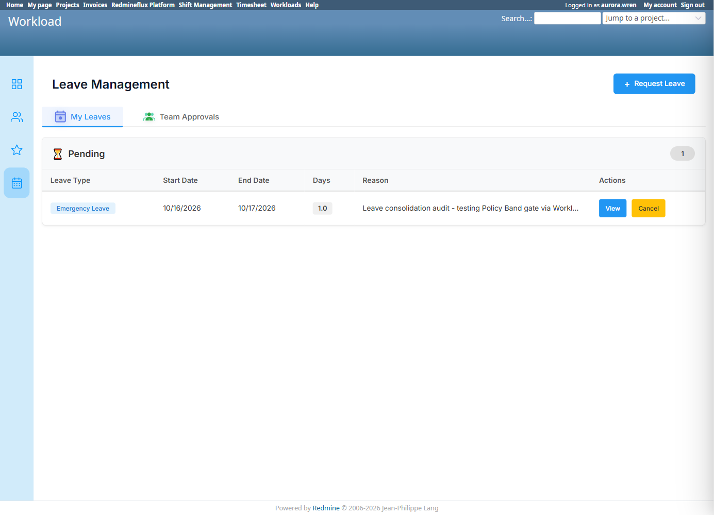

# Bug Report Template

- Bug ID: BUG-PLT-043
- Production Redmine Issue ID: #123304
- Title: Workload's "Apply Leave" has zero Policy Band enforcement — a user with no Policy Band assigned can still successfully submit any leave type, bypassing the gate Shift Management enforces for the same shared Leave entity
- Redmine version: 6 (Rails 7.2.3.1)
- Plugin name: redmineflux_workload (gap) / redmineflux_shift_management (where the gate exists) / redmineflux_platform (shared `rf_leaves` model)
- Plugin version: current tip, all three plugins
- Environment: `redmine-docker-6-platform`, `localhost:3013`
- Browser: Chromium (Playwright)
- User role: Test User (`aurora.wren`, no Leave Policy Band assignment)
- Date: 2026-10-13

## Preconditions

- At least one Leave Policy Band exists in the installation (confirmed: `PLT-QA-fresher`, Comp-Off 5d/year, assigned to `nova.starling` only).
- `aurora.wren` confirmed "Unassigned" on Shift Management's own Assign Leave Band screen (`/shift_management/leave?tab=assign`).

## Steps to reproduce

1. Log in as `aurora.wren` (no Policy Band assigned).
2. Open Workload's own Leave Management screen (`/rf_leaves`) and click "+ Request Leave".
3. Select "Emergency Leave" (a type **not** covered by any band `aurora.wren` could hold), set a date range, enter a reason, click "Request".

## Expected result

- Per the architecture already enforced in Shift Management (`BUG-PLT-036`'s fix): a user with no Policy Band assigned should not be able to apply for any leave type at all — the Policy Band is meant to govern which leave types an employee may use, and `rf_leaves` is explicitly documented as shared across Shift Management, Workload, and Platform's own screen. A gate that only works from one of three entry points onto the same shared record is not actually enforced.

## Actual result

The submission **succeeds** — confirmed live: the leave request is created with status "Pending" and appears under "My Leaves" → Pending (1). No error, no block, no indication that the Policy Band governance was ever consulted.

This is not a new defect in the sense of unexpected behavior — `BUG-PLT-036`'s own closure notes explicitly say *"Workload's Request Leave... still has no band awareness — matches the report's own stated scope (Workload has no band-awareness whatsoever — by design)"* and the dev who fixed BUG-PLT-036 flagged: *"if the Policy Band is meant to be the gate everywhere, that belongs on the shared model, not just Shift Management's screens."* This bug exists to make that explicitly-deferred gap its own tracked item, now that Team/Department's consolidation audit has established the same architecture standard should apply here: a governance rule on a shared entity should live on the shared model, not on one consumer plugin's controller.

## Evidence

### Screenshot

### Retest screenshot (fill after fix is verified)

### Console / log

- No error — the submission returns success, which is itself the defect (an ungoverned leave was accepted).

## Duplicate check

- Duplicate found: No — related to `BUG-PLT-036` (same root governance rule, same shared `rf_leaves` model) but that bug's own scope explicitly excluded Workload; this is the first time Workload's side of the same gap is independently tracked, prompted by the broader Leave consolidation audit (2026-10-13) that also produced `BUG-PLT-044`/`045`.

## Recommendation (consolidation direction, 2026-10-13)

Move the Policy Band gate (`leave_type_permitted?`/`refuse_leave_type`, currently only in Shift Management's `leave_controller.rb`) onto the shared `RedminefluxPlatform::Leave` model's own validation/callback, the same way leave balance accounting was already moved there in `BUG-PLT-036`'s fix. This way every consumer (Workload's controller, Platform's own New Leave Request form, and any future one) inherits the gate automatically instead of each needing its own copy — directly enabled by, and dependent on, resolving `BUG-PLT-044` first (Policy Bands need to be queryable from a place all three plugins can reach).

## Production report

Reported to production as **#123304**, linked to Testcase #123303 ("Leave Cross-Plugin Flow") inside Run #586 ("Redmineflux Platform QA - Feature #120043"), Suite #397, environment `Win + Chrome + Ver6`. Assigned to Prashant Chaurasia. Priority: Medium | Defect Severity: Medium-severity | Defect priority: Medium | Defect Type: Security.
