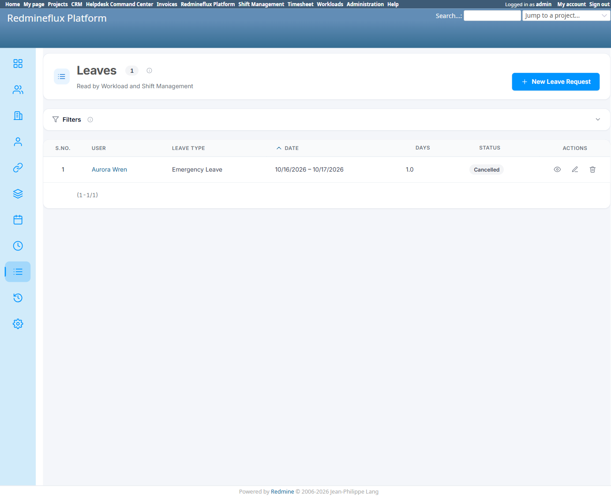
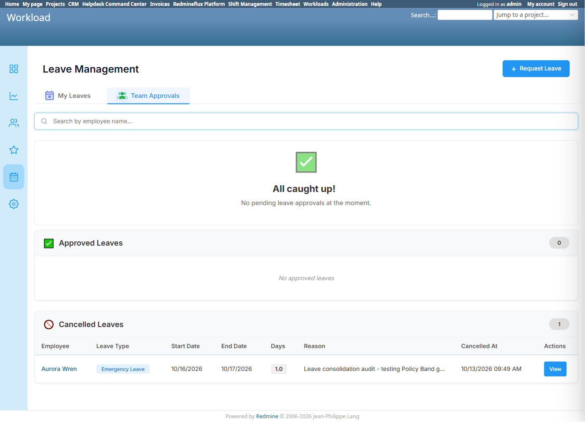
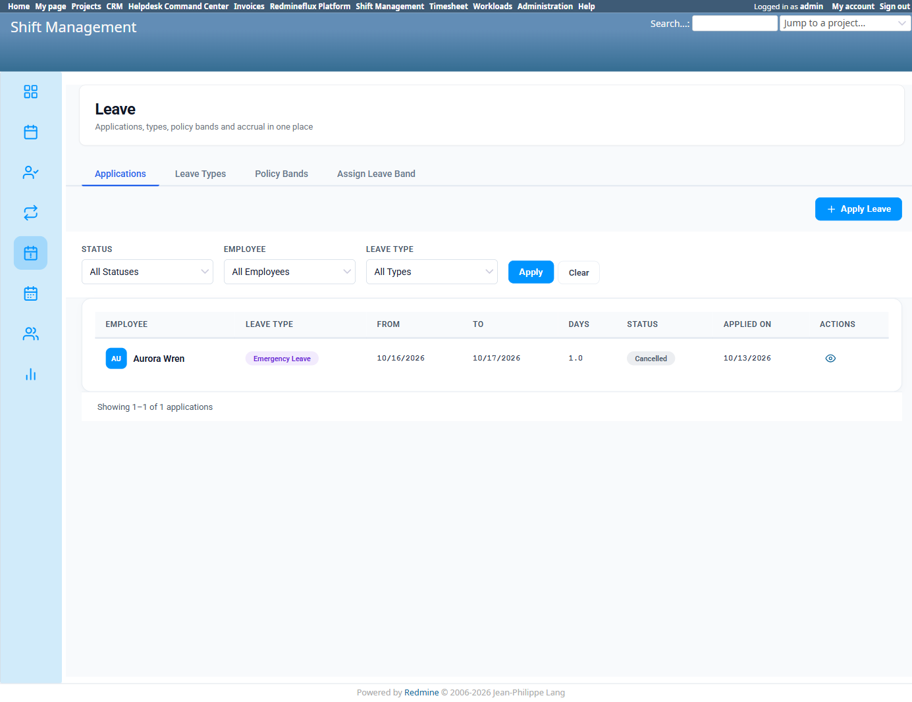

# Bug Report Template

- Bug ID: BUG-PLT-045
- Production Redmine Issue ID: #123306
- Title: Three independent "Apply Leave" screens and three independent approval surfaces exist for the single shared Leave entity, instead of one canonical Platform screen consumer plugins defer to
- Redmine version: 6 (Rails 7.2.3.1)
- Plugin name: redmineflux_platform / redmineflux_workload / redmineflux_shift_management
- Plugin version: current tip, all three plugins
- Environment: `redmine-docker-6-platform`, `localhost:3013`
- Browser: Chromium (Playwright)
- User role: Admin
- Date: 2026-10-13

## Steps to reproduce

1. Open Platform's own Leaves screen (`/redmineflux_platform/list/leaves`) — has its own "New Leave Request" and its own list with Status filter (Approved/Rejected/Cancelled).
2. Open Workload's own Leave Management screen (`/rf_leaves`) — has its own "+ Request Leave" drawer **and** its own "Team Approvals" tab (a full approval queue: pending count, "Approved Leaves" section).
3. Open Shift Management's own Leave screen (`/shift_management/leave`) — has its own "Apply Leave" button **and** its own "Applications" tab (Status/Employee/Leave Type filters, its own approval queue).

## Expected result

- Per the consolidation direction already applied (imperfectly) to Team: a shared entity like Leave should have exactly **one** canonical apply screen and **one** canonical approval surface — Platform's own. Consumer plugins that need an in-context entry point should link to Platform's screen (the way Timesheet's and Workload's own "Teams" nav links already correctly do for Team — see `PLATFORM_TEAM_CROSS_PLUGIN_FLOW.md` TC-PLT-238/239) rather than re-implement the full apply/approve flow natively.

## Actual result

All three plugins render **complete, independent** Leave UIs for the same shared `rf_leaves` records — confirmed via live screenshots of all three. Unlike Team (where Timesheet's and Workload's own "Teams" nav links at least correctly defer to Platform), **none** of the three Leave entry points defer to another — each is a first-class, native screen with its own apply action and its own approval queue.

This matters beyond pure duplication because the three screens do not enforce the same business rules — `BUG-PLT-043` is the direct, confirmed consequence: Shift Management's own Apply Leave enforces the Policy Band gate, Workload's does not, and Platform's own "New Leave Request" has not been verified either way in this session. A user (or an admin approving) gets a different set of rules depending on which of the three screens they happen to use for the exact same record.

## Evidence

### Screenshot

### Retest screenshot (fill after fix is verified)

### Console / log

- No error — UX/information-architecture defect, not a crash.

## Duplicate check

- Duplicate found: No — related to `BUG-PLT-016` (general finding), `BUG-PLT-038`/`040` (the same duplication class already found for Team), and `BUG-PLT-043` (one concrete consequence of this duplication: inconsistent Policy Band enforcement across the three screens). This bug is the Leave-specific instance of the architectural pattern, tracked separately since it spans all three plugins' own native screens rather than one redirect button.

## Recommendation (consolidation direction, 2026-10-13)

1. Designate Platform's own Leaves screen as canonical for both applying and approving — and, per `BUG-PLT-044`'s own recommendation, that canonical screen should itself be one unified "Leave" section (Leave Types + Leave requests + Policy Bands + Assign Leave Band together, tabbed the way Shift Management's own `/shift_management/leave` already does it well), not left split across Platform's current separate "Leave Types" and "Leaves" nav entries.
2. Replace Workload's and Shift Management's own native Apply/Approve UIs with either a direct link to Platform's screen, or an inline widget that reads live from Platform's data and routes the actual submission/approval through Platform's own shared logic (once `BUG-PLT-043`/`044`'s Policy Band consolidation is done) — not independently-implemented forms and queues.
3. Until this is done, any fix to one screen's business rules (e.g. Policy Band enforcement) must be manually replicated to the other two, which is exactly the maintenance risk `BUG-PLT-016` warned about generically and `BUG-PLT-043` now demonstrates concretely.

## Fix Verification (Retest 2026-10-15)

Retested live against the rebuilt `redmineflux_platform` environment (`redmine-docker-6-platform`, `localhost:3013`).

**Fix**: both `/shift_management/leave` and `/rf_leaves` now **redirect entirely** to Platform's own `/redmineflux_platform/list/leaves` — neither Shift Management nor Workload renders its own independent Apply/Approve Leave UI any more. Platform's own Leaves screen is now the one canonical apply-and-approve surface this bug's Recommendation called for.

**CONFIRMED FIXED.** Production issue #123306 synced: status In QA → Done, % done → 100.

Moving to **Closed**.

## Production report

Reported to production as **#123306**, linked to Testcase #123303 ("Leave Cross-Plugin Flow") inside Run #586 ("Redmineflux Platform QA - Feature #120043"), Suite #397, environment `Win + Chrome + Ver6`. Assigned to Prashant Chaurasia. Priority: Low | Defect Severity: Low-severity | Defect priority: Low | Defect Type: Usability.
