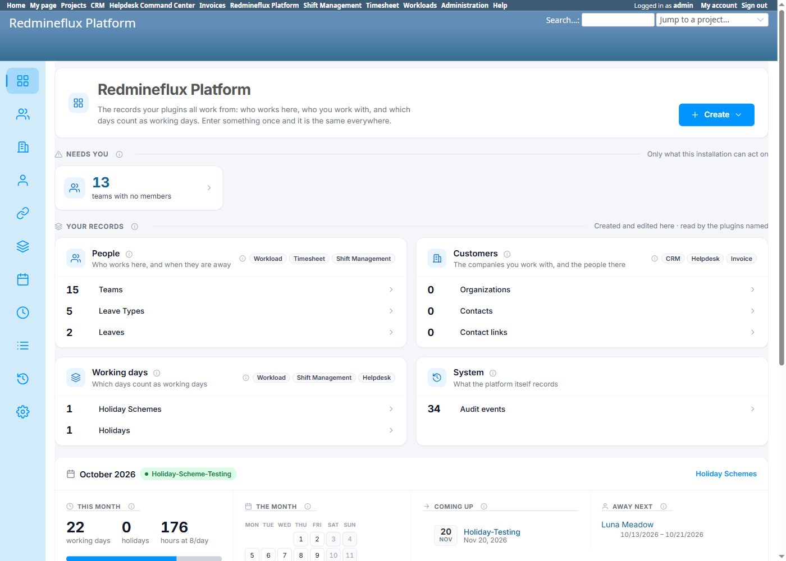
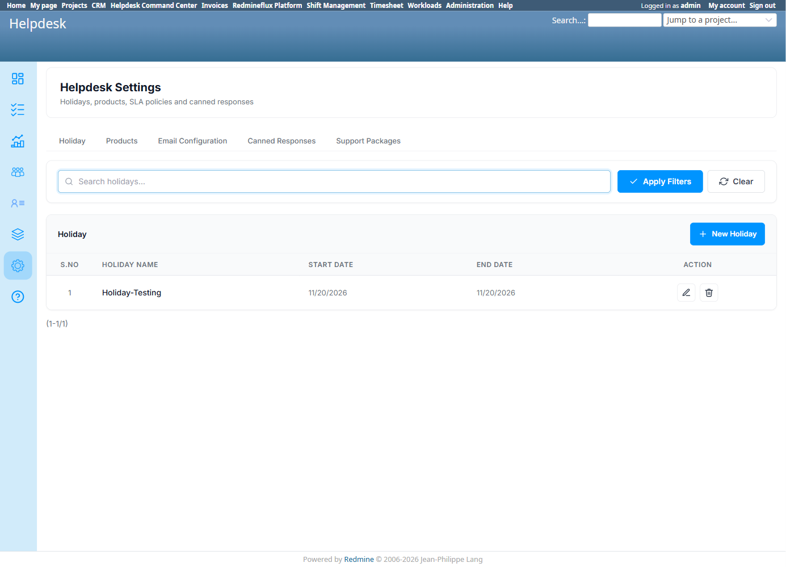
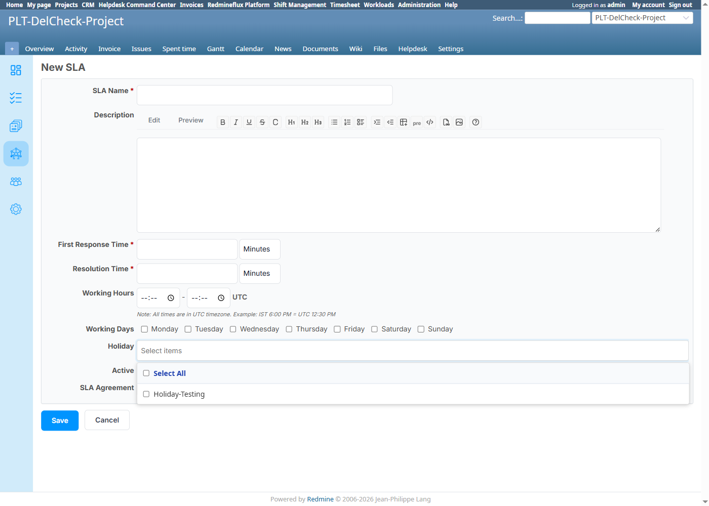
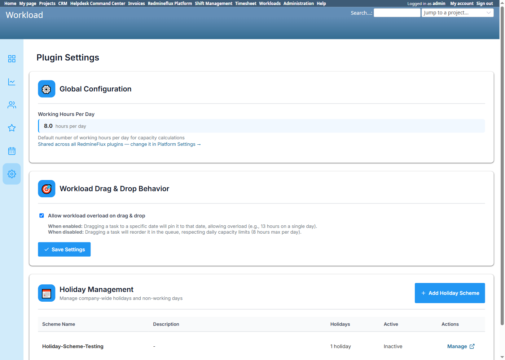

# Bug Report Template

- Bug ID: BUG-PLT-046
- Production Redmine Issue ID: #123344
- Title: Holiday Scheme and Holiday are split across two separate Platform nav sections instead of one (should exist ONLY in Platform, with zero Holiday-specific UI in any consumer plugin); Helpdesk still renders its own standalone, non-nested "Holiday" tab; and Helpdesk's SLA "Holiday" picker ignores Holiday Scheme active/inactive status entirely
- Redmine version: 6 (Rails 7.2.3.1)
- Plugin name: redmineflux_platform (nav structure) / redmineflux_helpdesk (standalone tab)
- Plugin version: current tip, both plugins
- Environment: `redmine-docker-6-platform`, `localhost:3013`
- Browser: Chromium (Playwright)
- User role: Admin
- Date: 2026-10-13

## Steps to reproduce

1. Open Platform's own nav (`/redmineflux_platform`) and note two separate top-level entries: "Holiday Schemes" (`/redmineflux_platform/list/holiday_schemes`) and "Holidays" (`/redmineflux_platform/list/holidays`) — two places to go for one concept.
2. Open Helpdesk → Helpdesk Settings → "Holiday" tab (`/rf_helpdesk/setting?tab=holidays`) — a flat list of individual Holiday records, with "New Holiday" deferring to Platform's `/redmineflux_platform/list/holidays/new`, but **no concept of Holiday Scheme shown anywhere on this tab** — holidays are not grouped/nested under their scheme here at all.
3. Compare against Workload's own equivalent (`/rf_settings` → "Holiday Management" widget): better than Helpdesk's (its own list defers to a "Manage" link into Platform, holidays nested under scheme), but **still renders its own embedded Holiday Scheme table at all** — per the user's explicit direction (2026-10-13), even this "Manage"-link pattern is not good enough: a consumer plugin should carry **zero** Holiday-specific UI, not even a read-only embedded list/shortcut widget — it should be entirely Platform's domain.
4. Open Helpdesk's SLA creation form (`Project → Helpdesk → SLA → New SLA`) and check its "Holiday" multi-select against the Holiday Scheme's own Active/Inactive status: create a Holiday under a scheme explicitly left **Inactive**, then check whether that holiday is still offered as a selectable option here.

## Expected result

- Per this session's very first consolidation example (given at the start of this multi-session effort): *"Helpdesk has a standalone 'Holiday' tab in its Settings; holidays should instead only be addable nested inside a Holiday Scheme, matching Workload's existing pattern — Helpdesk's standalone tab should be removed."* Holiday Scheme and Holiday should be managed from **one** place, with holidays nested inside their scheme — not as two independent flat lists.
- Per the same standard already recommended for Leave (`BUG-PLT-044`), Platform's own nav should not fragment one concept (Holiday Scheme + its Holidays) into two separate top-level sections either.
- **Per explicit user direction (2026-10-13): Holiday Scheme/Holiday management should exist ONLY in Platform — not in Workload, not in Shift Management, not in Helpdesk.** A "Manage" link or an embedded summary widget in a consumer plugin is still Holiday-specific UI living outside Platform; the standard is zero such UI anywhere else, not merely "defer the write."
- If a consumer plugin needs to select holidays for its own purpose (e.g. an SLA's clock-skip list), it should either let the user pick the **Holiday Scheme** itself (so it always reflects that scheme's current holidays and stays in sync automatically), or at minimum restrict the offered holidays to the currently **active** scheme only — never offer holidays from an inactive scheme as if they were in effect.

## Actual result

**Confirmed, live, two related findings:**

1. **Platform's own nav still has the fragmentation problem**, exactly like Leave Types/Leaves (`BUG-PLT-044`): "Holiday Schemes" and "Holidays" are two separate nav entries, not one unified section with Holidays nested under their owning scheme.
2. **Helpdesk's own "Holiday" tab is still a flat, standalone list** — not nested inside a Holiday Scheme — confirming the original request from the start of this testing cycle has not been addressed. "New Holiday" does correctly defer to Platform (same partial-mitigation pattern as `BUG-PLT-040`'s Team list and `BUG-PLT-044`'s Leave Types), so this is a duplicate **list**, not a duplicate **write path**.

**Partial positive finding on SLA integration, with one real defect found alongside it:** Holiday data is genuinely shared correctly at the data layer — created a Holiday via Platform's own screen ("Holiday-Testing", under scheme "Holiday-Scheme-Testing", **left Inactive**) and confirmed it immediately appears, with zero sync action, in Helpdesk's own SLA creation form (`Project → Helpdesk → SLA → New SLA`)'s "Holiday" multi-select field, which SLAs use to exclude days from their response/resolution clock. **However, "Holiday-Testing" was offered as a selectable option despite belonging to an Inactive scheme** — confirmed live via the Workload settings widget showing "Holiday-Scheme-Testing" as "Inactive" at the same time the holiday remained pickable in the SLA form. This contradicts the plugin family's own stated rule (per Shift Management's own documentation): *"Only one schema can be active organization-wide at any time... the active schema's holidays are the only ones used by attendance calculations, the dashboard, the shift calendar, and the Holiday report tab."* The SLA "Holiday" picker does not honor that rule at all — it offers holidays from every scheme regardless of active state, letting an SLA be configured against a holiday that may not even be part of the organization's current policy.

**On consumer-plugin UI presence**: Workload's and Shift Management's own Holiday-related screens both defer writes to Platform with no duplicate CRUD (Workload: an embedded Holiday Scheme list + "Manage" link; Shift Management: a direct nav link, no screen of its own at all) — better than Helpdesk's flat list, but per the stricter standard above, Workload's own embedded list is itself still Holiday-specific UI that shouldn't exist outside Platform at all, even as a read-only shortcut.

## Evidence

### Screenshot

### Retest screenshot (fill after fix is verified)

### Console / log

- No error — UX/information-architecture defect, not a data or crash issue.

## Duplicate check

- Duplicate found: No — related to `BUG-PLT-044` (same "fold into one section" recommendation, applied to Holiday instead of Leave) and to the original, not-yet-actioned consolidation example given at the very start of this testing cycle (Helpdesk's standalone Holiday tab). This is the first time that original example has actually been tested live and confirmed still unresolved, rather than only referenced in planning notes. The active/inactive-scheme bypass in the SLA Holiday picker is a new, distinct finding discovered while verifying the data-sharing claim — not previously tested or filed anywhere.

## Recommendation (consolidation direction, 2026-10-13)

1. On Platform, merge "Holiday Schemes" and "Holidays" into **one** "Holidays" section/nav entry, with Holidays nested inside their owning scheme (the same tabbed or drill-down pattern already recommended for Leave in `BUG-PLT-044`).
2. Remove Helpdesk's standalone, flat "Holiday" tab from Helpdesk Settings entirely — not replace it with a Workload-style embedded widget. Per explicit user direction, **no consumer plugin should carry any Holiday-specific UI at all** — not a duplicate list, not an embedded summary table, not even a read-only shortcut widget. If a consumer needs to get to Holiday management, a single plain link to Platform's own section is as far as it should go.
3. Apply the same standard to Workload's own `/rf_settings` "Holiday Management" widget — its embedded Holiday Scheme table should be replaced with a plain link into Platform, not kept as its own rendered list.
4. Fix the SLA "Holiday" picker to respect Holiday Scheme active/inactive status: either let the SLA form select the **Holiday Scheme** itself (so the SLA automatically uses whichever holidays that scheme currently defines, staying in sync as the scheme changes) rather than individual Holiday records, or at minimum filter the multi-select to only the holidays belonging to the currently **active** scheme.
5. No change is needed to the underlying data-sharing itself — `rf_holidays`/`rf_holiday_schemes` are already correctly shared; every fix here is about which UI is allowed to exist, and which records a consumer's own picker is allowed to offer.

## Production report

Reported to production as **#123344**, linked to Testcase #123343 ("Holiday Cross-Plugin Flow") inside Run #586 ("Redmineflux Platform QA - Feature #120043"), Suite #397, environment `Win + Chrome + Ver6`. Assigned to Prashant Chaurasia. Priority: Low | Defect Severity: Low-severity | Defect priority: Low | Defect Type: Usability.
