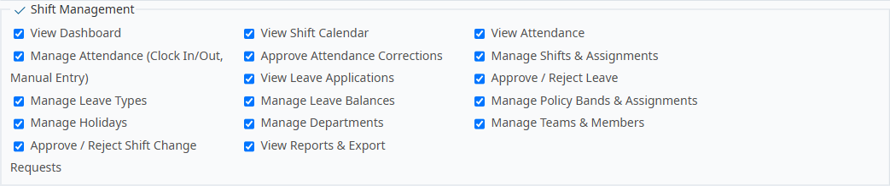

# Bug Report Template

- Bug ID: BUG-PLT-047
- Production Redmine Issue ID: #123347
- Title: Shift Management's own role-permission list still exposes 5 permissions for entities now owned by Platform — "Manage Teams & Members", "Manage Departments", "Manage Policy Bands & Assignments", "Manage Leave Types", and "Manage Holidays" — a second permission source for capabilities Platform's own permissions already govern
- Redmine version: 6 (Rails 7.2.3.1)
- Plugin name: redmineflux_shift_management (the 5 leftover permissions) / redmineflux_platform (should be the sole permission owner for these entities)
- Plugin version: current tip, both plugins
- Environment: `redmine-docker-6-platform`, `localhost:3013`
- Browser: Chromium (Playwright)
- User role: Admin
- Date: 2026-10-13

## Steps to reproduce

1. Open Administration → Roles and permissions → any role's edit page (`/roles/<id>/edit`).
2. Scroll to the "Shift Management" permissions group and read every checkbox.
3. Separately, scroll to the generic "Project" group (where Platform's own permissions are registered — confirmed during `BUG-PLT-042`'s investigation to sit outside any dedicated module fieldset) and compare against Platform's own "View teams"/"Create, edit and delete teams", "View holiday schemes"/"Create, edit and delete holiday schemes", "View holidays"/"Create, edit and delete holidays", "View leave types"/"Create, edit and delete leave types".

## Expected result

- Per the consolidation direction already established for Team (`BUG-PLT-040`/`041`/`042`), Leave (`BUG-PLT-044`/`045`), and Holiday (`BUG-PLT-046`), any entity now owned by Platform should have exactly **one** permission source governing who can manage it — Platform's own. A consumer plugin's role-permission list should not carry a second, independent permission for the same capability.

## Actual result

**Confirmed, live, via a full scan of every permission group on the role-edit page (not just the ones already suspected):** Shift Management's own "Shift Management" permission group still exposes exactly **5** permissions that duplicate a capability Platform's own permission set already governs:

| Shift Management's own permission | Duplicates Platform's own |
|---|---|
| `Manage Teams & Members` | "Create, edit and delete teams" (`View teams` for read) |
| `Manage Departments` | Recommended Platform ownership per `BUG-PLT-041`/`044` |
| `Manage Policy Bands & Assignments` | Recommended Platform ownership per `BUG-PLT-044` |
| `Manage Leave Types` | "Create, edit and delete leave types" |
| `Manage Holidays` | "Create, edit and delete holiday schemes" / "Create, edit and delete holidays" |

(`Manage Holidays` was not caught in this session's earlier, narrower note in `PLATFORM_MEMORY.md` — that note listed only 4; this full re-scan found a 5th.)

**Also confirmed by the same scan, as a scope boundary — not additional instances of this bug:**
- Workload's own legacy `Manage teams and skills` permission is the same class of issue, but already separately filed and confirmed dead as **`BUG-PLT-042`** — not re-filed here.
- CRM's `Manage Contacts`/`Manage Organizations` sit in the same generic "Project" permission group as Platform's own Contact/Organization permissions, but these are CRM's own long-standing, pre-consolidation permissions for CRM's own native screens — expected, documented, deliberate duplication per `PLATFORM_MEMORY.md`'s top-level note (Roadmap Step 5, "Consumer migration," not yet started) — not the same defect class as the 5 above, which are leftover gates for an entity whose actual CRUD now lives entirely on Platform. **Same end-state direction, different stage, not forgotten**: unlike Shift Management's 5 (whose screens already redirect to Platform, making the old permission a likely-dead leftover), CRM's own Organization/Contact screens do **not** redirect to Platform at all yet — `Manage Contacts`/`Manage Organizations` is still the only thing gating CRM's real, currently-functioning native screens, so it is not yet redundant with anything. **Once CRM's own Step 5 migration happens** (CRM's screens start deferring to Platform the way Shift Management's already do), `Manage Contacts`/`Manage Organizations` will become exactly this same kind of leftover orphan and should be retired the same way — flagged here so that follow-up isn't missed when CRM's migration eventually starts, not filed as a live defect today.
- Timesheet's own "Time tracking" permission group has no Team/Holiday/Leave-related permissions at all — no issue there.
- Helpdesk's own permission group (`View helpdesk`, `Manage helpdesk`, `Export helpdesk reports`, `Manage prepaid support hours`, `View email history`, Knowledge Base article permissions) exposes nothing granular for Organization/Holiday/SLA — those are gated by the single blanket `Manage helpdesk` permission, not a separate duplicating one.

Per the pattern already confirmed for Workload's analogous permission in `BUG-PLT-042` (toggling it has zero effect — Platform's own permission does the real gating instead), there is a real chance some or all of these 5 Shift Management permissions are similarly dead. `TC-PLT-280` (already written in `PLATFORM_TEAM_CROSS_PLUGIN_FLOW.md`, not yet executed) was written specifically to test `Manage Teams & Members` this way; the same live-test method should be applied to the other 4 before concluding they're dead too, rather than assuming it from the pattern alone.

## Evidence

### Screenshot

### Retest screenshot (fill after fix is verified)

### Console / log

- No error — permission-model architecture gap, not a crash.

## Duplicate check

- Duplicate found: No — supersedes the informal note already left in `PLATFORM_MEMORY.md` ("Two parallel permission systems..."), which flagged only 4 of these 5 permissions and had not yet been filed as a bug, per explicit user instruction to note it first and file later. This is that filing, corrected to the full count of 5 found on live re-verification. Related to, but distinct from, `BUG-PLT-042` (the analogous, already-confirmed-dead Workload permission).

## Recommendation (consolidation direction, 2026-10-13)

1. For each of the 5 permissions, confirm live (same method as `TC-PLT-280`, extended to all 5) whether it currently has any real effect, or whether — like Workload's `Manage teams and skills` — Platform's own permission has already silently taken over the actual gating.
2. Retire each permission once its entity's own Platform-consolidation work lands: `Manage Teams & Members` can likely be retired immediately (Team is already Platform's, per `BUG-PLT-040`/`041`); `Manage Departments` and `Manage Policy Bands & Assignments` should retire once `BUG-PLT-041`/`044` are fixed; `Manage Leave Types` and `Manage Holidays` should retire once Platform's own Leave Type and Holiday Scheme/Holiday ownership is confirmed complete (`BUG-PLT-044`/`046`).
3. Any role currently relying on one of these 5 permissions must be migrated to the equivalent Platform permission before retirement, so no existing role silently loses access.
4. Do not touch `Approve / Reject Leave`, `View Leave Applications`, `Manage Leave Balances`, `Approve Attendance Corrections`, `Approve / Reject Shift Change Requests`, or any of Shift Management's other genuinely exclusive permissions (Dashboard, Shift Calendar, Attendance, Shifts & Assignments, Reports) — these are correctly Shift-Management-owned and out of scope for this bug.

## Retest (2026-10-15) — NOT FIXED

Retested live against the rebuilt `redmineflux_platform` environment (`redmine-docker-6-platform`, `localhost:3013`).

Re-ran the same full scan of every permission group on the role-edit page (`/roles/permissions`) this bug's own original finding used. All 5 Shift Management permissions this bug names — **"Manage Teams & Members"**, **"Manage Departments"**, **"Manage Policy Bands & Assignments"**, **"Manage Leave Types"**, and **"Manage Holidays"** — are still present, unretired, exactly as originally reported.

The recommended retirement (per this bug's own Recommendation section — retire each permission once its entity's own Platform-consolidation work lands) has **not** landed, even though the underlying entities it depends on (Team, Department, Policy Bands, Leave Types, Holidays — `BUG-PLT-040/041/044/046`) have all now been confirmed fixed in this same retest session. The leftover-permission cleanup itself is still outstanding.

**Still NOT FIXED.** Production issue #123347 left as-is (not synced — a retest note was added to the production issue; status unchanged). Staying in `bugs/open/`.

## First correction (2026-10-15, later superseded below) — do not trust this section on its own

An earlier pass at this point concluded "Working as Designed, close as Won't Fix," reasoning that
`RedminefluxPlatform::SharedEntities.register_permission_door` meant the 5 old permissions were a *permanent*
design choice. **That conclusion was wrong** — reached without first reading the developer's own "In QA" journal
note on the production issue, which explains the actual fix and plan. See the real resolution below.

## Final resolution (2026-10-15) — CONFIRMED FIXED; old permissions are a deliberate, time-boxed transition aid, not permanent

Reading the developer's original "In QA" note (journal entry on #123347, 2026-10-13) made the actual fix and
intent explicit, which neither of this session's two live retest passes had checked for before today:

**What the fix actually was:** all 8 REST API controllers and 4 HTML gates that used to check the 5 old Shift
Management permissions were *repointed* to check Platform's own equivalent permissions instead
(`manage_teams` → `manage_rf_platform_teams`, etc.). A migration (`20261013120000`) granted every role that held
an old permission the new equivalent too, *before* any gate started asking for it, verified by the developer on
a probe role. Confirmed by 767 passing tests across both plugins.

**Why the old permissions are still visible and still work:** by deliberate choice, not oversight. The
developer's own words: *"The old permissions stay on their roles and stay registered for one release... They can
come out in a later release once this one has been deployed and the mapping has been seen to hold."* This is
exactly what `register_permission_door` implements — a time-boxed safety net so no role silently loses access
during the transition, not a permanent architecture decision. This is why the developer left the issue status at
**In QA** rather than Closed: the tester was meant to verify the *new* gate works, not to check whether the old
checkboxes had been deleted (they were never supposed to be, yet).

**Live-verified today, correctly this time** (the first attempt tested only half of this and drew the wrong
conclusion from it):

1. A role holding *only* the legacy `manage_teams` (no Platform permission at all) still gets full management
   access via the door — confirms the migration-safety net works.
2. A role holding *only* Platform's own new pair (`view_rf_platform_teams` + `manage_rf_platform_teams`, no
   legacy permission at all) **also** gets full management access — confirms the actual repoint fix works
   correctly and independently, exactly as the developer described.

Both (1) and (2) are expected to be true at the same time during this transitional release — that is the whole
point of the fix. Neither "the old checkboxes are still there" (this bug's and this session's earlier, mistaken
readings) nor "therefore nothing was fixed" nor "therefore this is permanent and not a bug" are correct framings.
The real, verifiable fact is: **the new permission pair now correctly and independently gates every repointed
entity, with zero existing role losing access** — which is exactly what this bug asked for.

**CONFIRMED FIXED.** The 5 old permissions remaining visible is an acknowledged, intentional, time-boxed part of
this same fix (per the developer's own stated plan to remove them "in a later release"), not a separate
outstanding defect to track here.

## Update (2026-10-15, later same day) — the "later release" landed; all 5 permissions now fully retired

Pulled the dev's own promised follow-up: migration `20261015120000_move_shared_permissions_onto_the_platform_again.rb`
unregisters all 5 legacy permissions (`manage_teams`, `manage_departments`, `manage_policy_bands`,
`manage_leave_types`, `manage_holidays`) from `Redmine::AccessControl` — `register_permission_door` calls for them
are fully removed from `platform_team_patch.rb`. As a migration-safety net for any role that came to hold one of
the five *between* the two releases (not just the ones already mapped by the first migration), this one restates
the same old→new permission mapping and grants the Platform equivalent to any role still missing it, so nobody's
access silently breaks the moment the doors close.

**Live-verified, both halves:**
1. `Redmine::AccessControl.permissions.map(&:name)` confirms all 5 names are gone — `rails runner` reports
   "unregistered (retired)" for each.
2. `/roles/permissions` (the exact screen this bug was originally filed from) now shows **zero** matches for
   "Manage Teams & Members", "Manage Departments", "Manage Policy Bands & Assignments", "Manage Leave Types", or
   "Manage Holidays" anywhere on the page — the checkboxes are gone, not just inert.
3. Two test roles from this same session's permission-CRUD testing (`PLT-DeptCRUD-LegacyOnly`,
   `PLT-TeamCRUD-LegacyOnly`), which held *only* the legacy permission and nothing else, were confirmed via
   `rails runner` to have been automatically granted the Platform equivalent (`view_rf_platform_departments` +
   `manage_rf_platform_departments`, and `view_rf_platform_teams` + `manage_rf_platform_teams` respectively) by
   this migration — live UI access for `summer.rain` (the user on the Dept-legacy-only role) confirmed unaffected,
   she still sees the full Departments screen. Zero access lost for any role across this transition.

This is the clean end state the original bug and its Recommendation asked for — not just the repoint fix
(confirmed earlier the same day), but the full retirement of the leftover permission surface, with the
migration-safety net now proven to work on a second release boundary too.

## Production report

Reported to production as **#123347**, linked to Testcase #123276 ("Team Cross-Plugin Flow", since `TC-PLT-280` lives in `PLATFORM_TEAM_CROSS_PLUGIN_FLOW.md`) inside Run #586 ("Redmineflux Platform QA - Feature #120043"), Suite #397, environment `Win + Chrome + Ver6`. Assigned to Prashant Chaurasia. Priority: Medium | Defect Severity: Medium-severity | Defect priority: Medium | Defect Type: Functional.

**Closed 2026-10-15** — status synced to production: Done, 100% (confirmed fixed — see Final resolution above).
An earlier same-day sync incorrectly set this to Won't Fix before the developer's own "In QA" note had been read;
corrected to Done once the actual fix was understood and properly verified.
