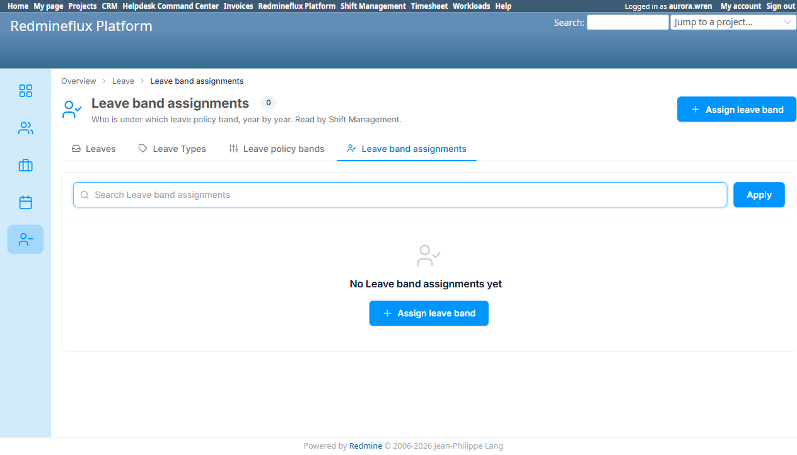
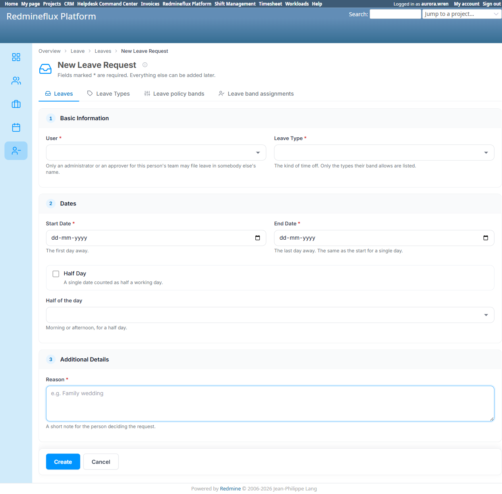
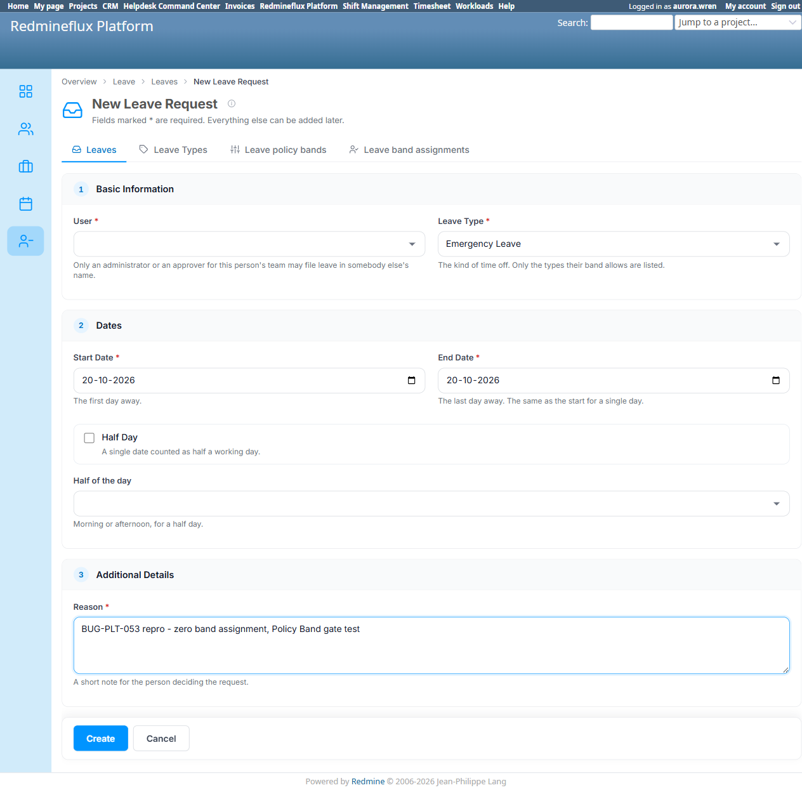
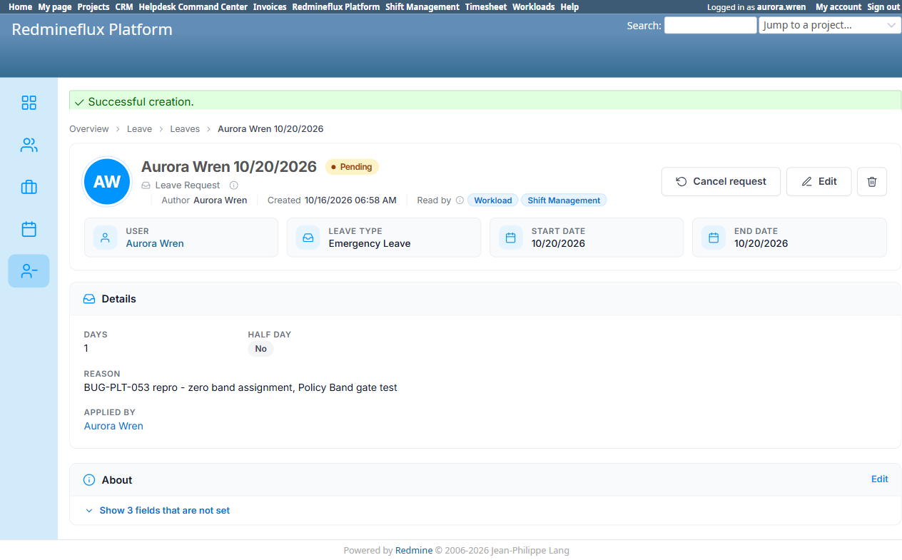

# Bug Report Template

- Bug ID: BUG-PLT-053
- Production Redmine Issue ID: #123786
- Title: Consolidated "New Leave Request" form has zero Leave Policy Band enforcement — a user with no band assigned can submit any existing Leave Type, a regression on the single form that replaced BUG-PLT-036/BUG-PLT-043's fixes
- Redmine version: 6
- Plugin name: redmineflux_platform
- Plugin version: current (2026-10-16)
- Environment: Local Docker (localhost:3013, `redmine6platform-redmine-1`)
- Browser: Chromium (Playwright MCP)
- User role: Non-admin test user (`aurora.wren`), zero Leave Policy Band assignment
- Date: 2026-10-16

## Steps to reproduce

1. Confirm the environment currently has **zero** `Leave band assignments` at all (`/redmineflux_platform/list/user_band_assignments` shows "0" / "No Leave band assignments yet") — so no user, including `aurora.wren`, is assigned to any Policy Band.
2. Log in as `aurora.wren` (a regular, non-admin user).
3. Navigate to `/redmineflux_platform/list/leaves/new` ("New Leave Request" — the single consolidated form that Platform's own screen now serves, with both Shift Management's `/shift_management/leave` and Workload's `/rf_leaves` redirecting to it since `BUG-PLT-045`'s fix).
4. Observe the "Leave Type *" dropdown: its own helper text reads "The kind of time off. Only the types their band allows are listed." It lists every currently-Active Leave Type in the system (`Comp-Off`, `Emergency Leave`) with no filtering — expected behavior for a zero-band user is either an empty list or a hard block, not the full unrestricted set.
5. Select "Emergency Leave", fill Start Date / End Date (`10/20/2026`) and Reason, and click **Create**.
6. Observe the submission succeeds outright — Leave #9 is created with Status **Pending**, Leave Type **Emergency Leave**, no error, no warning, no approval-time rejection.

## Expected result

- Per the form's own stated rule ("Only the types their band allows are listed") and the already-fixed, closed behavior on both predecessor screens (`BUG-PLT-036` for Shift Management, `BUG-PLT-043` for Workload), a user with **no** Leave Policy Band assigned should either see no selectable Leave Types, or be blocked from submitting any Leave Type at all, until a band is assigned.

## Actual result

- `aurora.wren`, with confirmed zero Leave Policy Band assignment (the entire environment currently has 0 band assignments of any kind), sees the full unrestricted list of Active Leave Types on the consolidated `/redmineflux_platform/list/leaves/new` form and successfully creates Leave #9 with "Emergency Leave" selected — no gate is enforced anywhere in the flow.
- Root cause (inferred from behavior — consistent with the fix history): `BUG-PLT-036` and `BUG-PLT-043` each fixed the Policy Band gate independently, inside the two old plugin-specific "Apply Leave" controllers/views (Shift Management's and Workload's). `BUG-PLT-045`'s consolidation replaced both of those forms with a single canonical one under Platform's own `EntitiesController`/Leave view — but the gate logic itself appears not to have been carried over into that new consolidated path, so the single remaining form has silently regressed back to the pre-fix behavior for every caller, not just one plugin.
- This is a more severe regression than either original bug: `BUG-PLT-036`/`BUG-PLT-043` each left one of three forms correctly gated at the time; this regression removes the gate from the one and only form that now exists.

## Evidence

### Screenshot

### Retest screenshot (fill after fix is verified)

### Console / log

- N/A — confirmed via live UI submission (200/redirect to the created record, Status "Pending"), cross-checked against the zero-band-assignment state of the environment and the form's own stated rule text.

## Duplicate check

- Duplicate found: No
- Existing bug reference (if duplicate): Related to, but not a duplicate of, the closed `BUG-PLT-036` (Shift Management) and `BUG-PLT-043` (Workload) — both of those were fixed and confirmed closed on 2026-10-15, against the old per-plugin forms. This is a new regression on the single consolidated form that `BUG-PLT-045` introduced afterward.

## Production report

Reported to production as **#123786**, assigned to Prashant Chaurasia, linked to Testcase **#123303** ("Leave Cross-Plugin Flow", `PLATFORM_LEAVE_CROSS_PLUGIN_FLOW.md`) inside Run #586 ("Redmineflux Platform QA - Feature #120043"), Suite #397, environment `Win + Chrome + Ver6` — testcase marked Failed. Verified visible in the run via `get_run_testcases`. Priority: Medium | Defect Severity: Medium-severity | Defect priority: Medium | Defect Type: Functional.

## Correction (2026-10-16, same day — narrowed scope after testing the assigned-band case)

At the user's request, the full Leave module (Apply/Cancel/Approve, Leave Type CRUD, Policy Band CRUD, Band
assignment CRUD) was retested end to end, including — for the first time — the case this bug's original
write-up never actually tried: **a user who DOES have a Policy Band assigned.**

Created Policy Band `QA-Band-EmergencyOnly` (allows only "Emergency Leave", not "Comp-Off") and assigned it to
`aurora.wren` for 2026. Result, tested live:

- **Submitting the disallowed type ("Comp-Off") as this banded user is correctly REJECTED** server-side, with an
  explicit inline error: *"Leave Type is not one your leave policy band (QA-Band-EmergencyOnly) allows"* — and
  the form, once re-rendered after the error, correctly narrows the Leave Type dropdown to only "Emergency
  Leave".
- **Submitting the allowed type ("Emergency Leave") as this banded user succeeds correctly** (Leave #10
  created, approved without issue).

**This means the Policy Band gate genuinely works at the validation layer for any user who has a band
assigned** — it was never "zero enforcement" in the way the original title claimed. The two defects that
actually exist, both confirmed, are narrower:

1. **The real bug (unchanged, still confirmed):** a user with **no band assignment at all** bypasses validation
   entirely — there is no "you have no band, contact HR" rejection the way a disallowed-type rejection fires for
   a banded user. The zero-band case and the banded-with-wrong-type case should both be rejected by the same
   rule; only the zero-band case silently isn't.
2. **A separate, less severe UX gap:** the Leave Type dropdown does not pre-filter to the current user's allowed
   types on initial page load — it always lists every Active Leave Type, for both zero-band and banded users
   alike, and only reveals the restriction via a validation error after a failed submit attempt. Since the
   server-side check does correctly catch a banded user's disallowed choice, this is cosmetic/UX for a banded
   user (extra round-trip, not a security gap) — it only becomes a real security gap in combination with defect
   1 above (a zero-band user, where no server check exists at all).

**Title stands as filed** (the zero-band bypass is real and still the core finding) but the "zero Leave Policy
Band enforcement" phrasing in the Expected/Actual sections above should be read as "zero enforcement
specifically for the no-band-assigned case" — enforcement for an assigned-but-wrong-type case works correctly.
Evidence for this correction: `TC-PLT-323-banded-user-disallowed-type-rejected.png`,
`TC-PLT-323-banded-user-allowed-type-succeeds.png`,
`BUG-PLT-053-banded-user-dropdown-also-unfiltered.png` (all in this bug's screenshot folder).

## Retest (2026-10-16) — CORE FINDING CONFIRMED FIXED; cosmetic dropdown gap split out as `BUG-PLT-056`

Dev pushed commit `d8a224d` ("Calendar and leave permissions take effect; no band blocks leave; one time-off
rule"), citing this bug by number in `leave.rb`'s own comments: `leave_type_is_one_the_band_permits` now returns
`errors.add(:base, no_band_message(user))` when `UserBandAssignment.band_for` finds no band for the user/year,
instead of silently returning (the original bypass).

**Retested live** with a freshly-confirmed zero-band user (`briar.sunset`, id 22 — confirmed via
`UserBandAssignment.pluck(:user_id).uniq` not containing her id, and holding full `view`/`manage` leave
permission via role `QA Full Access` so the permission layer doesn't mask the band check). Submitted
`/redmineflux_platform/list/leaves/new` with Leave Type "Emergency Leave", a valid date, and a reason — the
submission was **correctly refused** with the exact named error: *"No leave band is assigned to Briar Sunset.
Ask an administrator to assign one before requesting leave."* Confirmed via `rails runner` that **no** Leave
record was created for her (`Leave.where(user_id: 22).count` → `0`).

**The core, originally-filed defect — a zero-band user's submission silently succeeding with no gate at all — is
CONFIRMED FIXED.**

**The secondary, already-documented cosmetic gap is still present, unchanged**: the Leave Type dropdown on initial
page load still lists every Active Leave Type (including, in this retest, the new `PLT-FilterTest-LeaveType-Unpaid`
fixture) regardless of the viewer's band — it does not pre-filter, and the only signal a zero-band user gets is the
post-submit error. Since this item was always scoped in this bug's own 2026-10-16 Correction as a *separate*,
lower-severity defect from the core enforcement gap (which is now fixed), it has been split out and filed on its
own as **`BUG-PLT-056`** (Low) rather than keeping this now-fixed bug open for an unrelated cosmetic issue.

**Status: CORE FINDING CONFIRMED FIXED.** Moving to `bugs/closed/`. See `BUG-PLT-056` for the remaining dropdown
pre-filtering gap.
