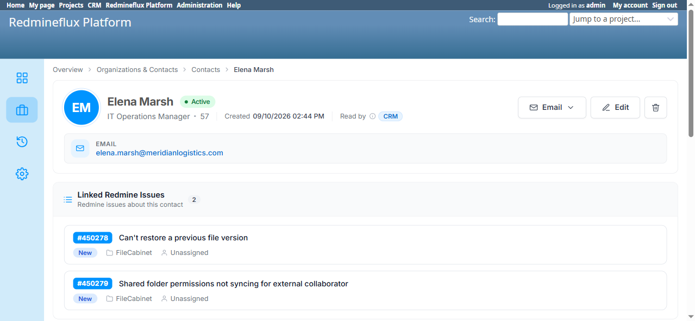
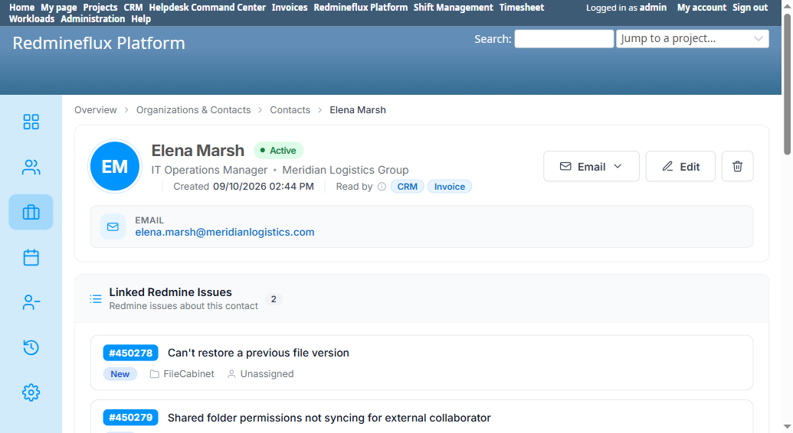

# Bug Report Template

- Bug ID: BUG-PLT-060
- Production Redmine Issue ID: #123491 (reused/repurposed ticket per explicit developer instruction — was previously an unrelated Agile Board feature ticket, tracker changed to Bug, subject/description replaced)
- Title: One-time CRM Company→Organization merge migration can never catch legacy companies created after it already ran once — real companies/contacts permanently orphaned, and the contact detail page shows the raw internal ID ("Organization: 57") instead of a safe fallback
- Redmine version: 6
- Plugin name: redmineflux_platform
- Plugin version: current branch HEAD, installed fresh on top of a real old production-style DB dump (`redmine_8090_2026-10-16.dump`) predating this install
- Environment: `redmine-upgrade-test` (localhost:3016) — a dedicated Postgres instance restored from a real old DB dump specifically to test the Platform/CRM upgrade-and-merge path, with `redmineflux_platform` and `redmineflux_crm` plugins freshly mounted and migrated on top of it
- Browser: Chromium (Playwright)
- User role: Admin
- Date: 2026-10-16

## Steps to reproduce

1. Restore a real old Redmine DB dump that already has `redmineflux_crm` installed and in use (with real rows in its legacy `rf_crm_companies` table), onto a fresh Postgres instance.
2. Mount `redmineflux_platform` (plus `redmineflux_crm`) and run `rake redmine:plugins:migrate` for the first time on this restored data.
3. Query the database directly: compare every row in the legacy `rf_crm_companies` table against `rf_organizations` by name.
4. Open the detail page of a Contact whose `company_id` points at one of the un-merged legacy companies (e.g. `/redmineflux_platform/list/contacts/124`).

## Expected result

- Every legacy CRM company present in the database at the time Platform is installed should end up represented in the consolidated `rf_organizations` table after migration — there should be no silent gap based on exactly when a row was created relative to the plugin's own install history.
- If a contact's organization reference genuinely cannot be resolved, the UI should show a safe, graceful fallback (e.g. blank, "—", or "Unknown organization") — never a raw internal database ID.

## Actual result

**Part 1 — real data orphaned, not a theoretical edge case.** Direct DB comparison found `rf_crm_companies` has 11 rows; only 9 have a matching row in `rf_organizations`. The 2 that don't — "Meridian Logistics Group" (legacy id 57) and "Atlas Workflow Partners" (legacy id 58) — both have `created_at` timestamps of **2026-09-10**, while the 9 that did merge correctly all have `created_at` of **2026-08-24** (every merged organization's `rf_organizations.source_crm_company_id` confirms this — it's set only for those 9, pointing at the matching legacy id). This dates precisely to the platform's own merge migration (`schema_migrations` shows Platform's migration series already recorded on this exact restored database, originating from 2026-08-24) — i.e. the one-time merge migration ran once on 2026-08-24, successfully merging whatever 9 companies existed in `rf_crm_companies` *at that moment*, and the 2 companies created afterward (2026-09-10) were never swept up, because the merge is a single `ActiveRecord::Migration` that only ever runs once per database (tracked in `schema_migrations`) and has no mechanism to catch legacy rows that show up later.
- Each of the 2 orphaned companies has exactly 1 real linked Contact (`rf_crm_contacts.company_id = 57` / `= 58`) — these are not dead, unreferenced rows; they are live data with real relationships that are now unreachable through Platform's consolidated model.

**Part 2 — the resulting broken display.** Opening the Contact detail page for one of these two contacts (Elena Marsh, linked to legacy company 57) shows, right in the page header: **"Organization: 57"** — the raw numeric foreign key, not a name, not a safe placeholder. The page's own "Other organizations" widget simultaneously says "Not linked to any other organization" (0), so the display logic is inconsistent even within the same page: one spot literally prints the broken ID, another correctly reports no resolvable link.

**Why this isn't just historical/already-fixed:** `BUG-PLT-006` (closed) fixed the merge migration's *dedup logic* (name-matching instead of only ID-matching) for data present *at the time the migration runs*. This finding is a different, broader architectural gap: **any one-time data migration, no matter how correct its own logic, cannot account for source-table rows that come into existence after it has already executed once** — and on a real production-style upgrade (install Platform, then continue using CRM's legacy screens for some period before the final cutover), that is exactly the kind of gap a real customer could hit silently, with no error, no warning, and a broken ID shown to the end user as the only visible symptom.

## Evidence

### Screenshot



### Retest screenshot (2026-10-17) — PASS



### Console / log

```
-- rf_crm_companies vs rf_organizations, by name
 id | legacy_name               | matched_in_rf_organizations
 48 | Atlas Logistics Inc.      | t   (rf_organizations.source_crm_company_id = 48, created_at 2026-08-24)
 ... (48-56, all 9 matched, all created_at 2026-08-24) ...
 57 | Meridian Logistics Group  | f   (created_at 2026-09-10 — AFTER the one-time merge ran)
 58 | Atlas Workflow Partners   | f   (created_at 2026-09-10 — AFTER the one-time merge ran)

-- contacts pointing at the 2 orphaned companies
 id  | first_name | last_name | email                                | company_id
 124 | Elena      | Marsh     | elena.marsh@meridianlogistics.com    | 57
 125 | Marcus     | Delgado   | marcus.delgado@atlasworkflow.io      | 58
```

## Duplicate check

- Duplicate found: No (related but distinct from `BUG-PLT-006`, which fixed the merge migration's dedup *logic* for data present at migration time — this is about data that didn't exist yet when the one-time migration ran)
- Existing bug reference (if duplicate): `BUG-PLT-006` (Closed) — same underlying merge mechanism, different root cause class

## Production report

Reported to production by **reusing and repurposing existing issue #123491** per explicit instruction from the developer (relayed by the user) — that issue had been mistakenly created under the Agile Board plugin (Tracker: Feature, unrelated Innoval Agile Board request). Tracker changed to Bug, subject and description replaced with this finding's content, category cleared (no Platform-specific category exists yet in `ztflux`), Defect Type/Severity/Priority custom fields set. Assignee unchanged (already Prashant Chaurasia). Not linked to a QA Run/Testcase, since this finding came from an ad-hoc upgrade-path verification environment (`redmine-upgrade-test`), not the standard `redmine-docker-6-platform` QA cycle.

## Retest (2026-10-17) — CONFIRMED FIXED

`git pull` on `redmineflux_platform` (commit `fbade94`, "Merge CRM companies left after the first merge; never show a raw id (BUG-PLT-060)") and `redmineflux_crm` (commit `695141d`, "Catch-up merge of companies left by standalone CRM") on `redmine v6 - platform`, then copied the updated plugin source into `redmine-upgrade-test` and restarted. New migrations `MergeCrmCompaniesCreatedAfterTheFirstMerge` (Platform, #49) and `MergeCrmCompaniesLeftByStandaloneCrm` (CRM) both ran clean, zero errors.

**DB confirmation**: `rf_organizations` now has rows for both previously-orphaned legacy companies — id 57 "Meridian Logistics Group" and id 58 "Atlas Workflow Partners", both with `source_crm_company_id` correctly set to their own id. Organization count went from 27 → 29. The legacy `rf_crm_companies` table itself no longer exists at all (the fix also finished dropping it once every row was confirmed merged, via an updated `021_drop_superseded_legacy_tables.rb`).

**UI confirmation**: Both previously-affected contacts now show the real organization name instead of the raw id — Elena Marsh's page reads "Organization: Meridian Logistics Group" (was "Organization: 57"), and Marcus Delgado's page reads "Organization: Atlas Workflow Partners" (was "Organization: 58"). No more raw internal IDs exposed anywhere.

Both the data-migration gap and the raw-id display defect are fully resolved. Moving to `bugs/closed/`.
