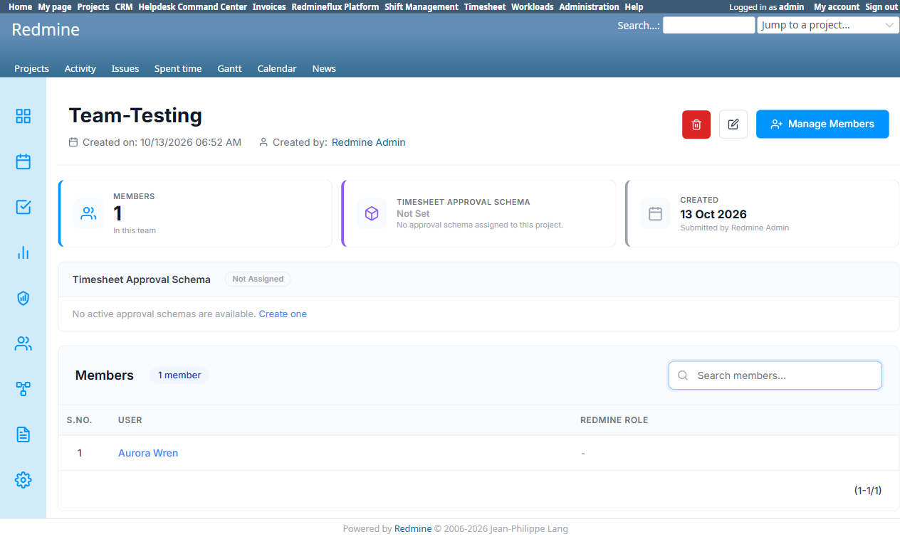
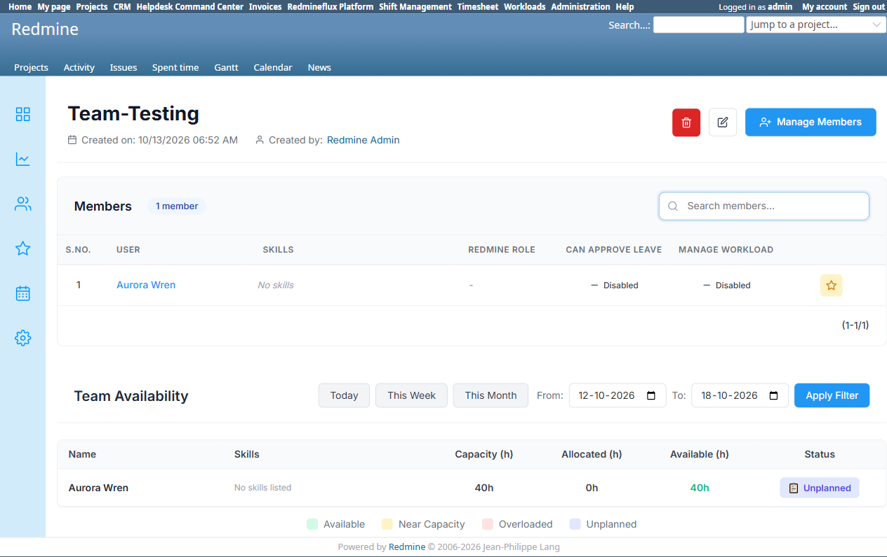

# Bug Report Template

- Bug ID: BUG-PLT-038
- Production Redmine Issue ID: (not yet reported — pending approval)
- Title: "Timesheet Approval" and "Workload & Skills" buttons on Platform's own Team page navigate away to a full duplicate Team-management screen in another plugin — instead of surfacing just the one relevant inline action (assign an Approval Schema / assign a Skill) — defeating the point of Platform being the canonical screen
- Redmine version: 6 (Rails 7.2.3.1)
- Plugin name: redmineflux_platform (the two buttons) / redmineflux_timesheet / redmineflux_workload (the pages they link to)
- Plugin version: `redmineflux_platform` branch, current tip
- Environment: `redmine-docker-6-platform`, `localhost:3013`
- Browser: Chromium (Playwright)
- User role: Admin
- Date: 2026-10-13

## Steps to reproduce

1. Open any Team's detail page on Platform's own screen (`/redmineflux_platform/teams/<id>`).
2. Click **"Timesheet Approval"**.
3. Separately, from the same Team page, click **"Workload & Skills"**.

## Expected result

- These two buttons exist specifically because Timesheet and Workload each read this shared Team for one specific piece of plugin-specific configuration (an Approval Schema; a Skill assignment). Clicking them should let the admin perform **that one action** without leaving Platform's canonical page — e.g. an inline panel/section on Platform's own Team page, or at most a focused modal — not take them to an entirely separate, full Team-management page.

## Actual result

**"Timesheet Approval" → `/timesheet/teams/<id>`** — confirmed live: this is Timesheet's own **complete Team detail page**, duplicating controls Platform's own page already has:
- Its own "Delete" button, "Edit" link (routes back to Platform's edit form), and "Manage Members" link (routes back to Platform's member list) — three controls that already exist on the page the admin just came from.
- Its own (empty) "Members" list with its own search box — a second, separately-rendered copy of the same member list.
- The one thing actually needed — "Timesheet Approval Schema" — appears buried further down the page as "Not Assigned", with no assignment control at all on this page; it only offers *"No active approval schemas are available. **Create one**"* linking out to a *third* page (`/approval_schemas/new`).

**"Workload & Skills" → `/rf_teams/<id>`** — confirmed live: this is Workload's own **complete Team detail page**, with the same duplication (own Delete/Edit/Manage Members, own Members list) plus a "Team Availability" widget. **Critically, this page has no Skills UI anywhere on it** — despite the button being labeled "Workload **& Skills**". Skill assignment lives entirely separately, under Workload's own global "Skills" catalog (`/rf_skills` — a flat list/matrix of skill *definitions*, not a per-member assignment screen reachable from here). An admin clicking "Workload & Skills" expecting to assign a skill to this team's member finds no path to do so from the page the button actually lands on.

### Why this matters

Both destinations are themselves instances of the exact duplication problem `BUG-PLT-016` already documents architecturally (Team independently re-implemented in 4 plugins) — these two buttons are Platform actively routing the admin *into* that duplication rather than around it. The admin came from Platform specifically because it is meant to be the one canonical screen; these buttons send them right back into the per-plugin screens the consolidation was supposed to replace, for a task (schema/skill assignment) that is not even Team-management, so there is no reason it should require Team-management controls (Delete/Edit/Members) to be duplicated on the way to it.

## Evidence

### Screenshot

### Retest screenshot (fill after fix is verified)

### Console / log

- No error — this is a navigation/UX design defect, not a crash.

## Duplicate check

- Duplicate found: No — related in spirit to `BUG-PLT-016` (architectural: every shared entity independently re-implemented per consumer plugin) but a distinct, concrete finding specific to these two cross-plugin action buttons on the Team page, not previously tested.

## Recommendation (user-directed, 2026-10-13)

Replace both buttons with inline sections on Platform's own Team page:
- A "Timesheet Approval Schema" field/dropdown directly on the Team page (assign an existing schema, or a link to create one if none exist) — no navigation away at all for the common case.
- A per-member "Skill" assignment directly in (or from) the Members table row — not a separate "go manage skills elsewhere" button.

This matches the same consolidation direction as `BUG-PLT-037`/`BUG-PLT-039`: Platform's Team page should be able to do everything relevant to a team without routing the admin through each consumer plugin's own duplicate screen.

## Production report

Not yet reported to production — pending approval per `REDMINEFLUX-MCP-SETUP.md` §4.
