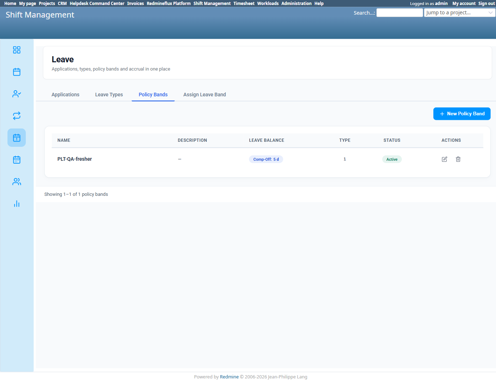
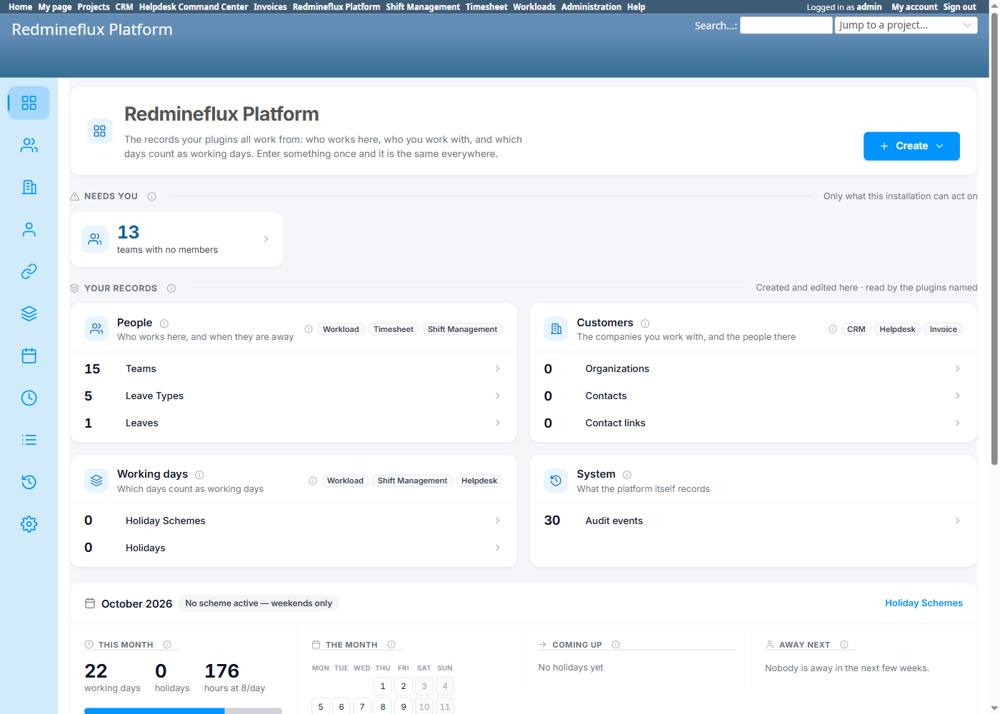

# Bug Report Template

- Bug ID: BUG-PLT-044
- Production Redmine Issue ID: (not yet reported — pending approval)
- Title: "Leave Policy Band" and "Assign Leave Band" have zero Platform representation — entirely owned and implemented by Shift Management, unlike every other Leave concept (Leave Type is at least partially shared); fix should also fold Leave Types/Leaves/Policy Bands into ONE Platform "Leave" section, not scatter them as separate nav entries
- Redmine version: 6 (Rails 7.2.3.1)
- Plugin name: redmineflux_shift_management (sole owner) / redmineflux_platform (should be the consolidation owner)
- Plugin version: current tip, both plugins
- Environment: `redmine-docker-6-platform`, `localhost:3013`
- Browser: Chromium (Playwright)
- User role: Admin
- Date: 2026-10-13

## Steps to reproduce

1. Open Platform's own nav (`/redmineflux_platform`) and inspect every entry: Overview, Teams, Organizations, Contacts, Contact links, Holiday Schemes, Holidays, Leave Types, Leaves, Audit events, Platform Settings — no "Policy Bands" or "Leave Bands" entry anywhere.
2. Open Shift Management → Leave → "Policy Bands" tab (`/shift_management/leave?tab=bands`) — a full, self-contained CRUD: "New Policy Band" button opens an in-page modal (not a link to any Platform URL), with its own Edit/Delete buttons also as in-page actions, not links out.
3. Open Shift Management → Leave → "Assign Leave Band" tab (`/shift_management/leave?tab=assign`) — a second, equally self-contained screen: its own "Assign Band to Users" modal, its own per-year Assigned/Unassigned/Total Users table.

## Expected result

- Per the same standard already applied to Team, Organizations, Holiday Schemes, and (partially) Leave Types, any entity that governs a shared, cross-plugin concept — here, which leave types an employee may use at all — should be owned and manageable from Platform, with Shift Management (and any other consumer) deferring to it.

## Actual result

Policy Bands and Assign Leave Band are **entirely** Shift-Management-owned: no Platform nav entry, no Platform route, and (unlike Leave Types' "New"/"Edit" links, which correctly point to `/redmineflux_platform/list/leave_types/...`) no deferred write path to Platform at all — Shift Management's own "New Policy Band"/"Edit"/"Delete" are genuine in-plugin actions with no Platform equivalent whatsoever.

This is a more complete version of the gap already found in `BUG-PLT-041` (Department): there, Platform at least *consumed* the data via a dropdown despite having no owning screen. Here, Platform doesn't even know Policy Bands exist — `rf_leaves`' own governance rule (which leave types a user may pick) is decided entirely inside one consumer plugin, which is exactly why `BUG-PLT-043` can happen: Workload has no way to even ask "does this user have a Policy Band, and what does it permit?" because that data and logic live nowhere Workload can reach.

## Evidence

### Screenshot

### Retest screenshot (fill after fix is verified)

### Console / log

- No error — architectural/ownership gap, not a crash.

## Duplicate check

- Duplicate found: No — related to `BUG-PLT-016` (general finding), `BUG-PLT-041` (Department, the closest analogous case) and `BUG-PLT-043` (the direct consequence of this gap), but this is the first finding specifically about Policy Band/Assign Leave Band having no Platform ownership at all.

## Recommendation (consolidation direction, 2026-10-13)

1. Add "Leave Policy Bands" and "Assign Leave Band" as Platform-managed entities, following the same pattern as Team/Organizations/Holiday Schemes: `redmineflux_platform/list/leave_policy_bands` (+ an assignment screen or section).
2. **Do not add these as yet another scattered top-level Platform nav entry.** Platform's current nav already fragments Leave across two separate items ("Leave Types" and "Leaves"); adding Policy Bands as a third separate entry repeats the same mistake. Instead, consolidate **Leave Types + Leaves + Policy Bands + Assign Leave Band into one single "Leave" section** on Platform — mirroring the tabbed layout Shift Management's own `/shift_management/leave` page already uses well (Applications / Leave Types / Policy Bands / Assign Leave Band as tabs under one heading). Everything to do with Leave should be one place to go, not four.
3. Migrate Shift Management's existing Policy Band and assignment records into Platform's tables.
4. Shift Management's own "Policy Bands"/"Assign Leave Band" tabs should then either redirect to Platform or become read-only views sourced from Platform's data, matching the pattern already recommended for Team (`BUG-PLT-040`) and Department (`BUG-PLT-041`).
5. This is also the prerequisite for fixing `BUG-PLT-043` cleanly — the gate can only be moved onto the shared `Leave` model once Policy Band data itself is reachable from that shared layer, not locked inside Shift Management's own tables/controllers.

## Production report

Not yet reported to production — pending approval per `REDMINEFLUX-MCP-SETUP.md` §4.
