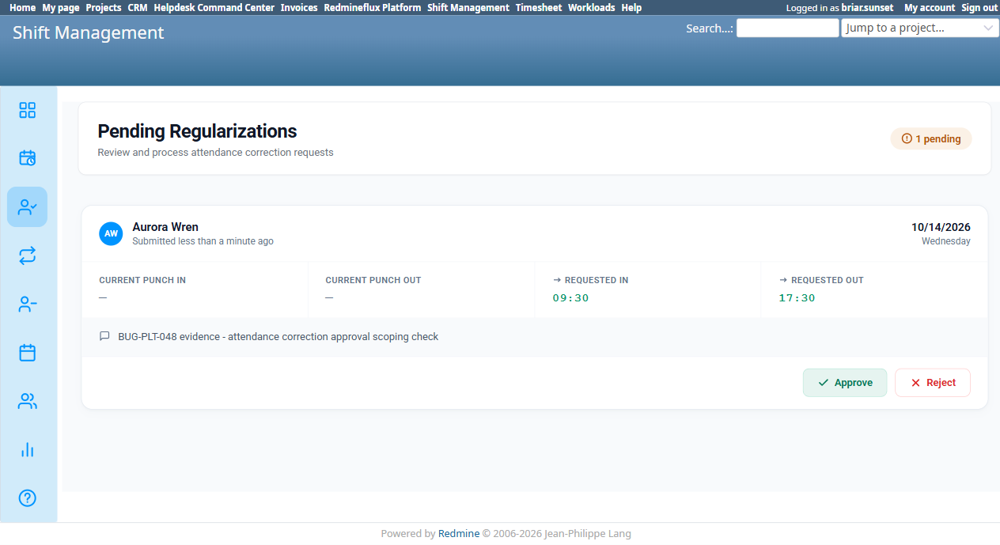

# Bug Report Template

- Bug ID: BUG-PLT-048
- Production Redmine Issue ID: <!-- filled after MCP report_defect/create_issue is approved and executed -->
- Title: Attendance correction (regularization) approval has no authorization scoping at all — any authenticated user can view and approve/reject any other employee's pending correction, regardless of team membership or approver status
- Redmine version: 6 (Rails 7.2.3.1)
- Plugin name: redmineflux_shift_management
- Plugin version: current tip (post BUG-PLT-037 fix)
- Environment: `redmine-docker-6-platform`, `localhost:3013`
- Browser: Chromium (Playwright)
- User role: Non-member (an unrelated employee with no relationship to the requester's team)
- Date: 2026-10-15

## Steps to reproduce

1. Log in as `aurora.wren` (member of Platform Team "Team-Retest"). Go to Attendance → pick a date with no
   attendance data → Regularize → submit a correction request (Punch In/Out + reason) → Submit.
2. Log out, log in as `briar.sunset` — a user with **no** relationship whatsoever to Aurora's team (not a member,
   not a lead, not an approver, not a department manager of any department Aurora's team belongs to).
3. Navigate to Shift Management → Attendance Corrections ("Pending Regularizations",
   `/shift_management/attendance_corrections`).

## Expected result

- Per the already-confirmed fix for `BUG-PLT-037` and the `lead_team_ids`/`TeamMembership.approvers`-based scoping
  used elsewhere in this controller family (`shift_change_requests_controller.rb` /
  `attendance_corrections_controller.rb`), only a user who is a designated **approver** (`can_approve_leave: true`)
  for the requester's own Platform Team should see that request in their Pending Regularizations queue, and only
  that user (or an admin) should be able to Approve/Reject it.

## Actual result

**Confirmed, reproduced twice independently** (once via `autumn.grace` — Team-Retest's own non-lead member with
`Approve leave: No` — and again via `briar.sunset`, a user with zero relationship to Team-Retest at all):

- Both users see Aurora Wren's pending attendance correction request in their own "Pending Regularizations" queue
  at `/shift_management/attendance_corrections`, with full detail (requested punch in/out, reason, submitter name).
- Both users have working **Approve** and **Reject** buttons for a request that is not theirs to approve.
- Clicking **Approve** as `briar.sunset` succeeds server-side: "Regularization request approved." — the request
  disappears from the pending queue and is processed, with no authorization check rejecting the action.

This is a **broken access control** defect, not merely a UI oversight: the backend action itself accepts the
approval from a completely unrelated, non-approver user. The "Pending Regularizations" list appears to show
**every** pending correction system-wide to **every** authenticated user with Shift Management access, with no
team/approver filter applied at all — unlike the Leave approval flow (confirmed correctly scoped earlier this
session, see `TC-PLT-278`/`TC-PLT-296` testing) and unlike the documented intent for this same screen.

This was originally investigated as part of `TC-PLT-296` (checking whether a Department's "Manager" field is an
inert label) — the department-manager angle turned out to be a red herring: a user with **no** department
relationship at all has the same unrestricted access, so this is a much broader scoping gap than the TC's original
question.

**Not yet verified, same risk suspected:** Shift Change Requests (`/shift_management/shifts?tab=shift_requests`)
use the identical `lead_team_ids` pattern in its own controller (per source review earlier this session) — no
pending shift-change request existed in the environment at test time to reproduce directly, but the shared
implementation makes it likely affected the same way. Flagged for follow-up, not asserted as confirmed.

## Evidence

### Screenshot

### Retest screenshot (fill after fix is verified)

### Console / log

- No client-side error — this is a server-side authorization gap. The approval POST returns a normal success
  response ("Regularization request approved.") instead of being rejected with a 403/redirect.

## Duplicate check

- Duplicate found: No — distinct from `BUG-PLT-037` (which was about the `can_approve_leave` flag not being
  granted correctly) and from `BUG-PLT-039`/`BUG-PLT-014` (UI/labeling overlap issues). This is the authorization
  check being entirely absent on this specific action, confirmed via two independent non-approver accounts.

## Recommendation

1. Apply the same `TeamMembership.approvers`/`lead_team_ids` scoping already used elsewhere in this controller
   family to both the index query (so a non-approver's queue doesn't list other teams' requests at all) and the
   approve/reject actions themselves (so even a direct POST from a non-approver is rejected server-side, not just
   hidden from the UI).
2. Audit `shift_change_requests_controller.rb` for the same gap given the shared implementation pattern, and
   confirm with a reproduction once a pending shift-change request can be created in a test environment.
3. Treat this as High severity: it is a real broken-access-control issue (any authenticated employee can approve
   or reject any other employee's attendance correction), not merely a convenience or labeling defect.
