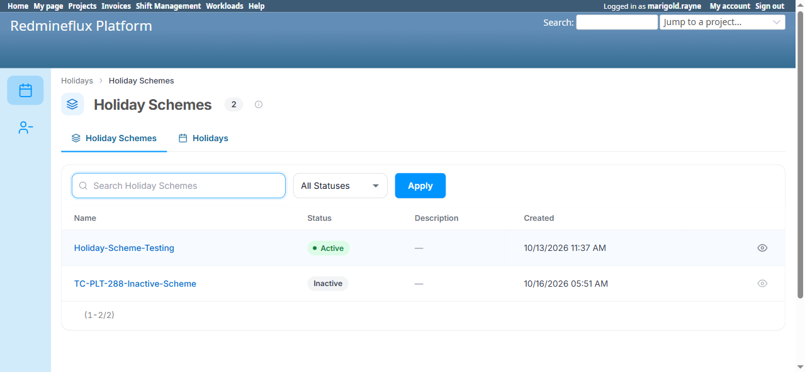
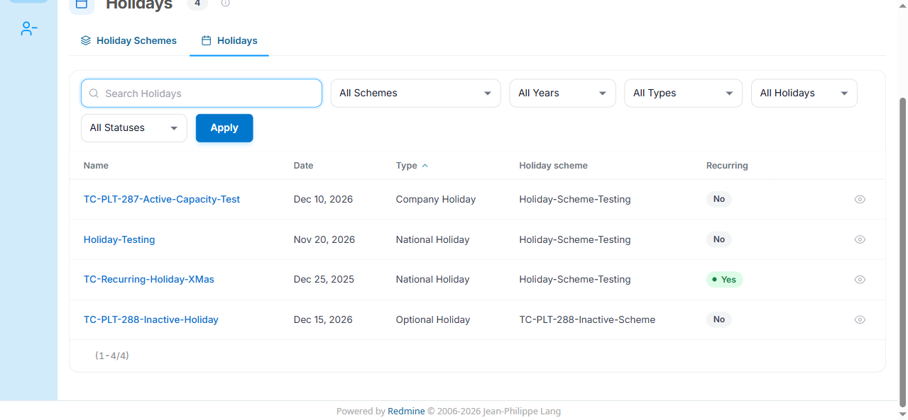
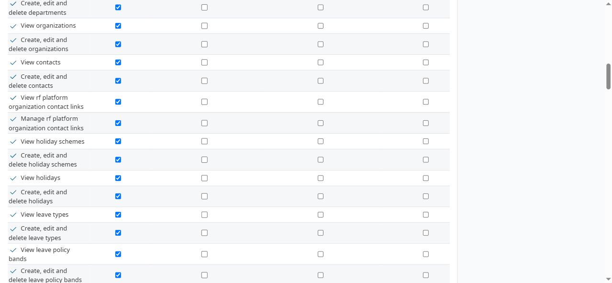

# Bug Report Template

- Bug ID: BUG-PLT-052
- Production Redmine Issue ID: #123775
- Title: "View holiday schemes" and "View holidays" permission checkboxes have no effect — both screens are viewable by every logged-in user regardless of role
- Redmine version: 6
- Plugin name: redmineflux_platform
- Plugin version: current (2026-10-16)
- Environment: Local Docker (localhost:3013, `redmine6platform-redmine-1`)
- Browser: Chromium (Playwright MCP)
- User role: Admin (setup), plus a genuinely zero-permission user and a single-permission test role
- Date: 2026-10-16

## Steps to reproduce

1. Open Administration → Roles and permissions → Permissions report. Confirm "View holiday schemes" and "View holidays" are shown as normal, unchecked checkboxes for the "Non member" role (and for any role that hasn't been explicitly granted them) — exactly like every other `rf_platform` permission (Teams, Leave Types, Organizations, Contacts).
2. Log in as a user with **zero** `rf_platform` permissions at all (no project membership carrying any of them) — confirmed here with `marigold.rayne`, whose nav doesn't even show "Redmineflux Platform".
3. Navigate directly to `/redmineflux_platform/list/holiday_schemes` and `/redmineflux_platform/list/holidays`.
4. Separately, create a role with only `view_rf_platform` + `view_rf_platform_holiday_schemes` (nothing else) and confirm the same for `/redmineflux_platform/list/holidays` (a *different* entity's screen) from that account.

## Expected result

- Per the Permissions report's own presentation, a user without "View holiday schemes" / "View holidays" granted should get a 403 on the corresponding screen, the same way they correctly do for Teams, Leave Types, Organizations, and Contacts when those permissions aren't granted.

## Actual result

- `marigold.rayne` (zero `rf_platform` permissions, confirmed via her own nav missing "Redmineflux Platform" entirely) can open both `/redmineflux_platform/list/holiday_schemes` and `/redmineflux_platform/list/holidays` directly and sees the full, real list — identical to what an admin sees. Teams (`/redmineflux_platform/teams`) correctly returns 403 for the same user.
- A dedicated test role with **only** `view_rf_platform_holiday_schemes` granted (not `view_rf_platform_holidays`) can also open `/redmineflux_platform/list/holidays` and see the full list — a cross-entity leak, on top of the base issue.
- Root cause (confirmed from source): `lib/redmineflux_platform/shared_entities.rb` declares both `holiday_schemes` (line ~2143) and `holidays` (line ~2251) with `open_to_all: :view`, which makes `Entry#visible_to?` return `true` unconditionally for any logged-in user before it ever consults `view_permission` (`EntitiesController#authorize_view`/`#find_entry`). This is a deliberate mechanism for genuinely per-user-scoped data (`leaves` is also `open_to_all`, intentionally — see below), but Holiday Schemes/Holidays are shared, unscoped reference data with no per-user filtering, so `open_to_all` here means literally every user sees the identical full list the permission checkbox implies only some roles should.
- **Confirmed NOT a bug for the adjacent `leaves` entity** (also `open_to_all: true`): `marigold.rayne`'s own Leaves list correctly shows "0 — No Leaves yet", scoped to her own requests only, with no "Whose" filter to broaden it (unlike an approver's view, which has "Everything I can see / My own requests / Waiting for my decision / Everyone I approve for"). Leave's open-access is deliberately scoped per-record and matches its own documented intent ("every employee files their own leave" — redmineflux_shift_management/redmineflux_workload both historically required no permission for this). Holiday Schemes/Holidays have no such per-record scoping, so the same mechanism produces a real over-exposure there instead.
- Net effect: the Permissions report actively misleads an administrator — unchecking (or never checking) "View holiday schemes"/"View holidays" for a role looks like it restricts access, but has zero actual effect for either screen.

## Evidence

### Screenshot

### Retest screenshot (fill after fix is verified)

### Console / log

- N/A — confirmed via live access (200 OK with real content, not a UI-hidden-but-server-blocked case) cross-checked against `shared_entities.rb` source (`open_to_all: :view` declarations) and the Permissions report's own checkbox state.

## Duplicate check

- Duplicate found: No
- Existing bug reference (if duplicate): — (historically, `PLATFORM_PERMISSIONS_AND_ACCESS.md` TC-PLT-137/204/205 recorded these same screens correctly 403ing for a zero/narrow-permission user on 2026-09-30, against a different environment/commit — this is a behavior change since then, not a previously-known issue)

## Production report

Reported to production as **#123775**, linked to Testcase #121705 ("Permissions and Access", `PLATFORM_PERMISSIONS_AND_ACCESS.md`) inside Run #586 ("Redmineflux Platform QA - Feature #120043"), Suite #397, environment `Win + Chrome + Ver6` — testcase marked Failed. Assigned to Prashant Chaurasia. Priority: Medium | Defect Severity: Medium-severity | Defect priority: Medium | Defect Type: Functional.
