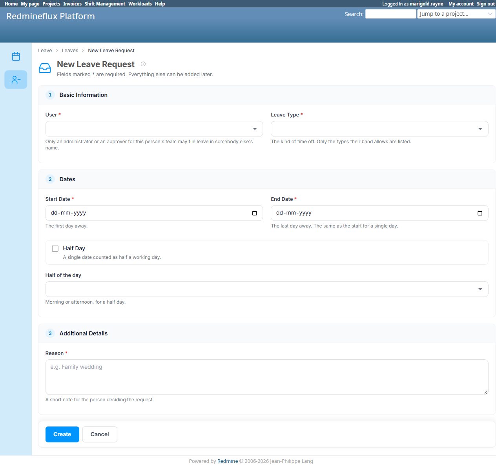

# Bug Report Template

- Bug ID: BUG-PLT-054
- Production Redmine Issue ID: #123795
- Title: "File and decide leave requests" (`manage_rf_platform_leaves`) permission has zero effect — a genuinely zero-permission user can fully file a leave request, same `open_to_all` root cause as `BUG-PLT-052`
- Redmine version: 6
- Plugin name: redmineflux_platform
- Plugin version: current (2026-10-16)
- Environment: Local Docker (localhost:3013, `redmine6platform-redmine-1`)
- Browser: Chromium (Playwright MCP) + direct `rails runner` service-level verification
- User role: Genuinely zero-permission user (`marigold.rayne`, no `rf_platform` permissions of any kind, no project showing "Redmineflux Platform" in her own nav)
- Date: 2026-10-16

## Steps to reproduce

1. Confirm `marigold.rayne` has **zero** `rf_platform` permissions — her own nav has no "Redmineflux Platform" entry at all (same account already used and confirmed in `BUG-PLT-052`).
2. Confirm via source (`rails runner`) that she does not hold `manage_rf_platform_leaves` ("File and decide leave requests"): `u.allowed_to?(:manage_rf_platform_leaves, nil, global: true)` → `false`.
3. Log in as `marigold.rayne` and navigate directly to `/redmineflux_platform/list/leaves/new` ("New Leave Request").
4. Fill out and submit the form (Leave Type, Start/End Date, Reason).

## Expected result

- Per the Administration → Roles → Permissions report, which lists "File and decide leave requests" as a normal, independently-togglable permission for this entity (exactly like "View holiday schemes" did before `BUG-PLT-052`), a user who does not hold it should not be able to open or submit the New Leave Request form.

## Actual result

- `marigold.rayne` opens `/redmineflux_platform/list/leaves/new` with no 403, fills it out, and successfully creates **Leave #12** ("Marigold Rayne 10/26/2026", Emergency Leave, Pending) — despite confirmed-zero `manage_rf_platform_leaves`.
- **Root cause, confirmed from source** (`lib/redmineflux_platform/shared_entities.rb`, `Entry#manage?`):
  ```ruby
  def manage?(user = User.current)
    return false if admin_only?
    return false unless visible_to?(user)
    return true if user.respond_to?(:admin?) && user.admin?
    return true if @open_to_all == true
    return false unless user.respond_to?(:allowed_to?)
    ...
  end
  ```
  The `leaves` entity is declared `open_to_all: true` in `shared_entities.rb` ("Every employee files their own leave"). `manage?` short-circuits to `true` the moment `@open_to_all == true`, **before it ever consults `manage_permission` (`manage_rf_platform_leaves`) at all**. This is the exact same defect shape `BUG-PLT-052` found in `visible_to?` for Holiday Schemes/Holidays (`open_to_all: :view` bypassing `view_permission`) — here it is `manage?` being bypassed by `open_to_all: true` instead.
- **Confirmed via direct service call** (not just the live UI): `entry.manage?(marigold_rayne)` → `true`, while `marigold_rayne.allowed_to?(:manage_rf_platform_leaves, nil, global: true)` → `false`.
- **Important scope note, to avoid over-filing**: this is specifically about the generic `manage?` gate used for reaching/using the New Leave Request form at all. It is **not** the same as `can_be_approved_by?` (which governs approving/rejecting *someone else's* leave, and was separately confirmed working-as-intended in the same session's TC-PLT-328 investigation, including a deliberately-honoured alternate path via Shift Management's legacy `approve_leave`). This bug is narrower: the permission that is supposed to gate *filing your own leave at all* has no effect, full stop — every logged-in user can always file their own leave, with or without this permission ever being granted. Per the entity's own code comment ("Every employee files their own leave") this may well be the *intended end-state behavior* for one's own leave — but if so, the checkbox should not exist on the Permissions report implying otherwise, exactly the same user-facing contradiction `BUG-PLT-052` already flagged for Holiday Schemes/Holidays.

## Evidence

### Screenshot



### Console / log

```
marigold.rayne allowed_to?(manage_rf_platform_leaves): false
entry.manage?(marigold.rayne): true
entry.open_to_all: true
```
Leave #12 created live in the browser as confirming end-to-end proof, not just the service-level check.

## Duplicate check

- Duplicate found: No (but same root-cause *class* as `BUG-PLT-052` — `open_to_all` bypassing a permission check before it is ever consulted. `BUG-PLT-052` is scoped to Holiday Schemes/Holidays' `visible_to?`/view permission; this is Leave's `manage?`/manage permission — a different entity, different method, different permission, filed separately per this repo's own convention of one bug per confirmed distinct defect instance.)
- Existing bug reference: `BUG-PLT-052` (open) — same architectural pattern, worth fixing together if the dev addresses the `open_to_all` short-circuit mechanism generically.

## Production report

Reported to production as **#123795**, assigned to Prashant Chaurasia, linked to Testcase **#123303** ("Leave Cross-Plugin Flow", `PLATFORM_LEAVE_CROSS_PLUGIN_FLOW.md` — the suite TC-PLT-330 actually lives in) inside Run #586 ("Redmineflux Platform QA - Feature #120043"), Suite #397, environment `Win + Chrome + Ver6` — testcase marked Failed. Verified visible in the run via `get_run_testcases`. Priority: Low | Defect Severity: Low-severity | Defect priority: Low | Defect Type: Functional.
