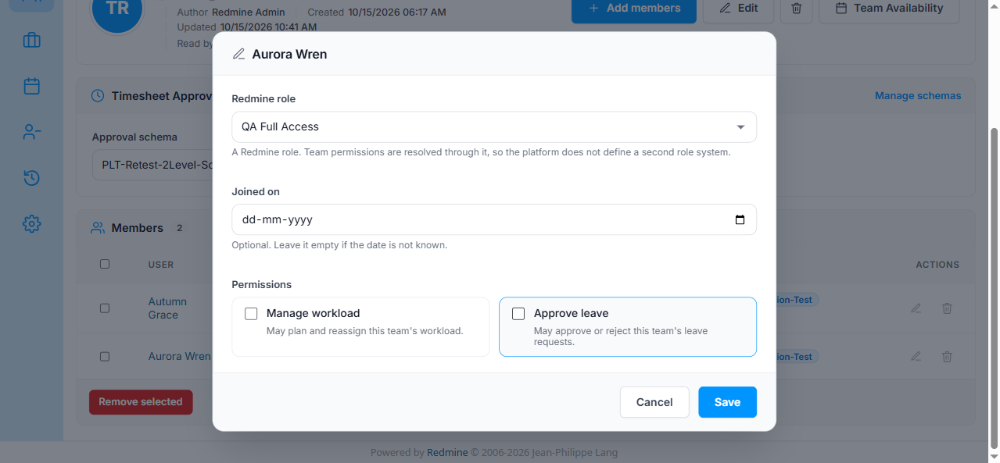
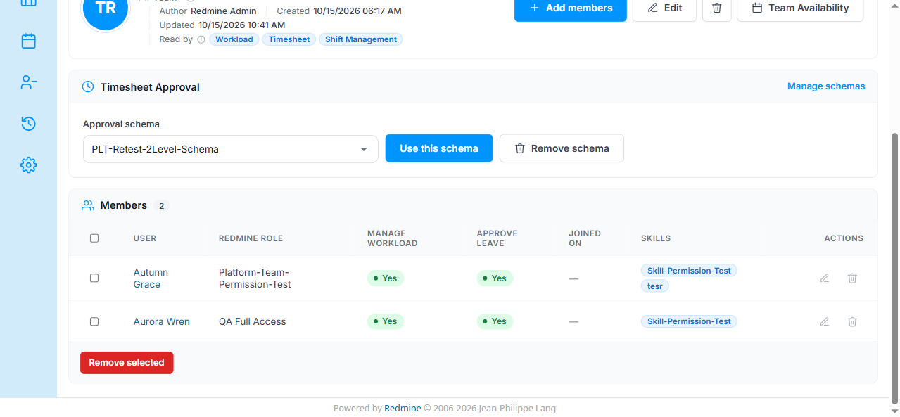

# Bug Report Template

- Bug ID: BUG-PLT-058
- Production Redmine Issue ID: #123877
- Title: Team member's "Manage workload" / "Approve leave" permission checkboxes cannot be unchecked via Edit member — reports "Successful update" but silently retains the old checked value
- Redmine version: 6
- Plugin name: redmineflux_platform
- Plugin version: current branch HEAD (redmine-docker-6-platform, rebuilt 2026-10-15)
- Environment: `redmine-docker-6-platform` (localhost:3013)
- Browser: Chromium (Playwright)
- User role: Admin (reproduced as `admin`; originally noticed by the tester mid-session)
- Date: 2026-10-16

## Steps to reproduce

1. Log in as Admin, go to `Redmineflux Platform` → `Teams & Departments` → open team **Team-Retest** (`/redmineflux_platform/teams/19`), which has member **Aurora Wren** with "Manage workload" = Yes and "Approve leave" = Yes.
2. Click the member row's "Edit member" button to open the "Aurora Wren" edit dialog.
3. Uncheck the "Manage workload" checkbox, then uncheck the "Approve leave" checkbox (both visibly become unchecked in the dialog — confirmed via screenshot).
4. Click "Save".

## Expected result

- The page shows "Successful update", and the Members table row for Aurora Wren now shows "No" / "No" for "Manage workload" / "Approve leave", matching what was unchecked in the dialog.

## Actual result

- The page does show "Successful update.", but the Members table row for Aurora Wren still shows **"Yes" / "Yes"** for both "Manage workload" and "Approve leave" — identical to before the edit. Re-opening the Edit member dialog confirms both checkboxes are back to checked. The uncheck action is completely silently lost; there is no error, no validation message — the UI reports success for a change that never actually took effect.
- This reproduces the issue the tester found manually (editing Aurora Wren's permissions in this same Team-Retest team, screenshot provided) before losing the browser session.
- Likely root cause (not yet confirmed in source): an unchecked HTML checkbox submits no form field at all, and the update action likely only sets `manage_workload`/`can_approve_leave` to `true` when the param is present, never explicitly setting `false` when the param is absent — so unchecking either box has no server-side effect.

## Evidence

### Screenshot

### Retest screenshot (fill after fix is verified)

### Console / log

- No console errors observed. Server responded with a normal 200/"Successful update." flash — this is a silent data-persistence defect, not a client-side JS failure.

## Duplicate check

- Duplicate found: No
- Existing bug reference (if duplicate): N/A — checked `bugs/_duplicates.md` and `bugs/_index.md`; `BUG-PLT-037`/`BUG-PLT-014` are related (same two columns) but about the field granting no permission / being disconnected, not about edits failing to persist. This is a new, distinct defect (write path, not read/grant semantics).

## Production report

Reported to production as **#123877**, linked to Testcase #121706 ("Entity CRUD and Field Validation") inside Run #586 ("Redmineflux Platform QA - Feature #120043"), Suite #397, environment `Win + Chrome + Ver6` — testcase marked Failed. Assigned to Prashant Chaurasia. Priority: Medium | Defect Severity: Medium-severity | Defect priority: Medium | Defect Type: Functional.
