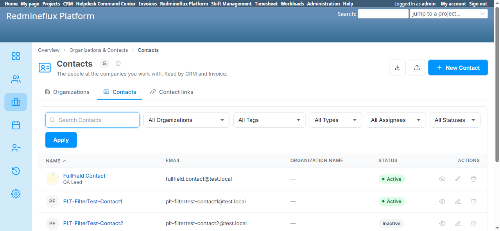
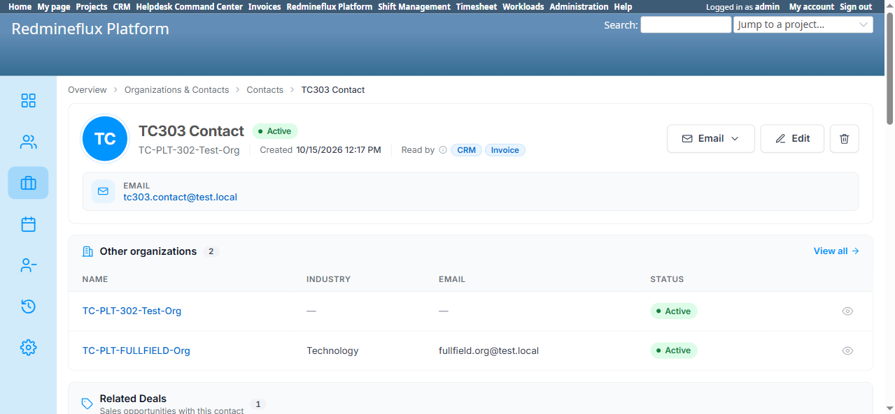

# Bug Report Template

- Bug ID: BUG-PLT-059
- Production Redmine Issue ID: #123882
- Title: Contacts list page's "Organization name" column always shows "—" even for contacts with a real linked organization — the detail page and CSV export both correctly resolve it
- Redmine version: 6
- Plugin name: redmineflux_platform
- Plugin version: current branch HEAD (redmine-docker-6-platform, rebuilt 2026-10-15)
- Environment: `redmine-docker-6-platform` (localhost:3013)
- Browser: Chromium (Playwright)
- User role: Admin
- Date: 2026-10-16

## Steps to reproduce

1. Go to `Redmineflux Platform` → `Organizations & Contacts` → `Contacts` (`/redmineflux_platform/list/contacts`).
2. Note the "Organization name" column for every row — e.g. "FullField Contact" (linked to `TC-PLT-FULLFIELD-Org`) and "TC303 Contact" (linked to `TC-PLT-302-Test-Org`).
3. Open either contact's own detail page (e.g. `/redmineflux_platform/list/contacts/2` or `/3`).
4. Separately, export the Contacts list to CSV (`Export` button) and check the `company_id` column for the same rows.

## Expected result

- The list page's "Organization name" column shows the linked organization's name for any contact that has one, matching what the contact's own detail page and the CSV export (`company_id`) both already confirm.

## Actual result

- The "Organization name" column shows **"—" for every single contact row**, including ones with a confirmed, real organization link:
  - "FullField Contact" — list shows "—", but the detail page's header reads "Organization: TC-PLT-FULLFIELD-Org", and the CSV export has `company_id=4` for this row.
  - "TC303 Contact" — list shows "—", but the detail page's header reads "Organization: TC-PLT-302-Test-Org", and the CSV export has `company_id=2` for this row.
  - A contact created via CSV Import with `company_id=2` set (`TC-PLT-ImportTest NewContact`) also immediately shows "—" in the list despite its own detail page correctly showing "Organization: TC-PLT-302-Test-Org" right after import.
- This isn't limited to imported records — it reproduces on contacts created well before this session (pre-existing fixtures), so it is a structural defect in the list's own column, not an import-path issue.
- Likely root cause (not yet confirmed in source): the list's "Organization name" column appears to read a separate, never-populated `company_name` string field (also always empty in the CSV export, confirmed on every row regardless of `company_id`) instead of resolving the real `company_id` foreign key to the linked Organization's name — the same "two fields instead of one resolved value" shape as other bugs already found in this plugin (e.g. `BUG-PLT-014`'s two disconnected role columns).

## Evidence

### Screenshot

### Retest screenshot (fill after fix is verified)

### Console / log

- No console errors — this is a data-resolution defect in the list column, not a JS failure.
- CSV export excerpt (`contacts_2026-10-16.csv`): `company_id` is populated (`4`, `2`, `2`) for 3 of the 5 exported contacts, but `company_name` is blank on every row, including those with a real `company_id` — confirming the display logic is reading the wrong/unpopulated field.

## Duplicate check

- Duplicate found: No
- Existing bug reference (if duplicate): N/A — found while testing Export/Import on Organizations and Contacts per the user's direct request; not previously documented in `PLATFORM_MEMORY.md` or any closed bug.

## Production report

Reported to production as **#123882**, linked to Testcase #121706 ("Entity CRUD and Field Validation") inside Run #586 ("Redmineflux Platform QA - Feature #120043"), Suite #397, environment `Win + Chrome + Ver6` — testcase marked Failed. Assigned to Prashant Chaurasia. Priority: Medium | Defect Severity: Medium-severity | Defect priority: Medium | Defect Type: Functional.
