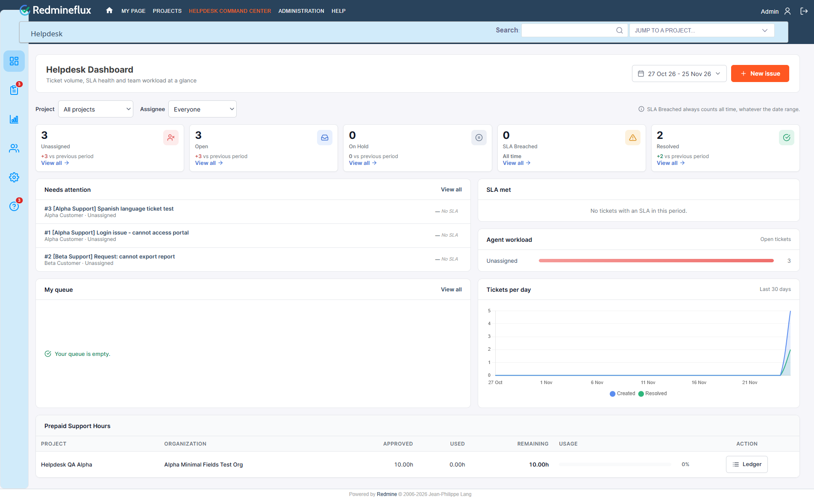

# Bug Report

- Bug ID: BUG-RSC-005
- Production Redmine Issue ID: <!-- #NNNN on flux.zehntech.com, filled after MCP report_defect/create_issue is approved and executed -->
- Title: The plugin's own "Auto-install theme on plugin load" never runs — `config/initializers/theme_installer.rb` is never required by `init.rb`, so the Scarlet theme never appears in Theme dropdown without manually running `rake redmineflux_scarlet:install_theme`
- Redmine version: 6 (local Docker, `helpdesk-redmine6`)
- Plugin name: redmineflux_scarlet
- Plugin version: `development` branch (co-installed alongside redmineflux_helpdesk), commit as of 2026-11-25
- Environment: Local (`http://localhost:3019`, container `helpdesk-redmine6-redmine-1`)
- Browser: Chromium (Playwright MCP)
- User role: Administrator (admin)
- Date: 2026-11-25

## Steps to reproduce

1. Fresh-install or fresh-rebuild a Redmine 6 instance with `redmineflux_scarlet` plugin source present in `plugins/`, run `bundle install` + `rake redmine:plugins:migrate` + restart (the normal install sequence — no manual theme step performed).
2. Go to Administration → Settings → Display → Theme dropdown.
3. Also checked: `themes/` directory on disk (`ls themes/`) — contains only the stock `README`, no `redmineflux_scarlet` subfolder.
4. Also checked server logs around every boot for the installer's own expected output (`"Redmineflux Scarlet: Installing companion theme..."` / `"✗ Failed to install theme"`) — neither line appears anywhere, not even the failure branch.

## Expected result

Per the plugin's own `config/initializers/theme_installer.rb` (comment: "Auto-install theme on plugin load") and the README text it itself generates on a successful install ("This theme was automatically installed by the redmineflux_scarlet plugin"), the companion `themes/redmineflux_scarlet/` folder should be created automatically the first time the plugin boots, with zero manual steps — making "Redmineflux scarlet" immediately available in the Theme dropdown after a normal plugin install.

## Actual result

The theme is **never auto-installed** on any boot — the `themes/redmineflux_scarlet/` folder is simply never created, and "Redmineflux scarlet" never appears in the Theme dropdown, regardless of how many times the container is restarted.

Root-caused via source: `config/initializers/theme_installer.rb` wraps its entire auto-install logic in a `Rails.application.config.after_initialize do ... end` block — but this file is a plain file sitting in the plugin's own `config/initializers/` folder, and Redmine/Rails does **not** auto-load arbitrary files from a plugin's `config/initializers/` the way it does for the main application's own `config/initializers/`. Confirmed via `grep -n -i "theme_installer\|after_initialize" init.rb` — the plugin's `init.rb` has its own two `after_initialize` blocks for unrelated setup, but contains **zero** reference to `theme_installer.rb` — nothing ever `require`s it. The file is dead code: Ruby never parses or executes it at all.

This explains why the installer's own log lines (both the success path's `"Redmineflux Scarlet: Installing companion theme..."` and the failure path's `"✗ Failed to install theme: ..."`) are completely absent from every server log checked across multiple container boots — the method body genuinely never runs, not even far enough to hit its own `rescue` branch.

The plugin does ship a working manual fallback, `rake redmineflux_scarlet:install_theme` (`lib/tasks/install_theme.rake`), which was run directly this session and worked correctly: created `themes/redmineflux_scarlet/{stylesheets,images,favicon}`, after which the theme appeared correctly in the dropdown, could be selected and saved, and the accent colour genuinely switched to orange on the Helpdesk dashboard (nav link + primary button) as documented. A subsequent `rake assets:precompile` + restart was also required to clear two secondary 404s (the theme's own `application.css` and `favicon.png` under `/assets/themes/redmineflux_scarlet/...`) — those cleared cleanly once precompiled, so they are a normal consequence of this being a from-scratch disk install rather than a second defect.

Net effect: on every real first-time install (exactly the scenario a customer or a fresh QA environment hits), Scarlet is **invisible and unusable** unless whoever installed it happens to know to run an undocumented-in-the-UI rake task manually. Nothing in the user guide, plugin description, or Configure page mentions this requirement.

## Evidence

### Screenshot

After the manual rake-task workaround — theme active, accent colour correctly orange (nav link + primary button):



### Console / log

```
# themes/ directory before the manual rake task:
$ ls -la themes/
total 16
drwxr-xr-x 2 redmine redmine 4096 ... .
drwxr-xr-x 1 redmine redmine 4096 ... ..
-rw-r--r-- 1 redmine redmine   30 ... README
# (no redmineflux_scarlet subfolder)

# init.rb has no reference to the installer file:
$ grep -n -i "theme_installer\|after_initialize" init.rb
26:Rails.application.config.after_initialize do
74:Rails.application.config.after_initialize do
# (neither block is the theme_installer.rb file; it is never required)

# Full boot-log search across every container restart this session, zero matches either way:
$ docker compose logs redmine | grep -i "installing\|failed to install\|Redmineflux Scarlet:"
(no output)
```

After running `bundle exec rake redmineflux_scarlet:install_theme` manually:
```
Installing RedmineFlux Scarlet theme...
  Creating default theme structure...
✓ Default theme structure created at: /usr/src/redmine/themes/redmineflux_scarlet
✓ Favicon copied to theme directory

Theme installation complete!
Go to Administration > Settings > Display and select 'Redmineflux Scarlet' theme.
```
— theme then appeared in the dropdown correctly, selecting and saving it worked, and the Helpdesk dashboard's accent colour switched to orange as documented.

## Duplicate check

- Duplicate found: No (checked `bugs/_index.md` and `bugs/_duplicates.md` in this folder). Related in subject area but a distinct root cause from BUG-RSC-001 (a specific `activity.css` 404 on an already-installed theme on a different, pre-existing Forge environment) — this bug is about the theme never getting installed in the first place on a fresh environment.
- Existing bug reference (if duplicate): —
