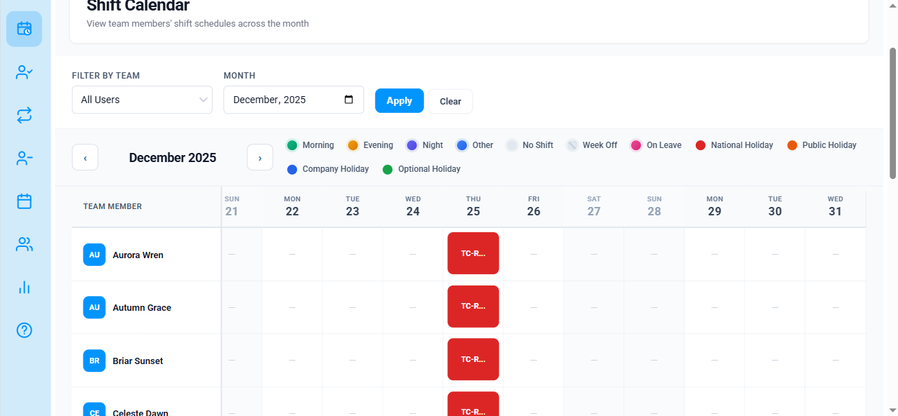
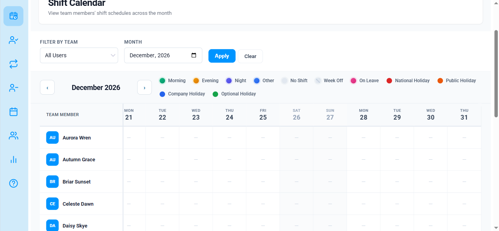
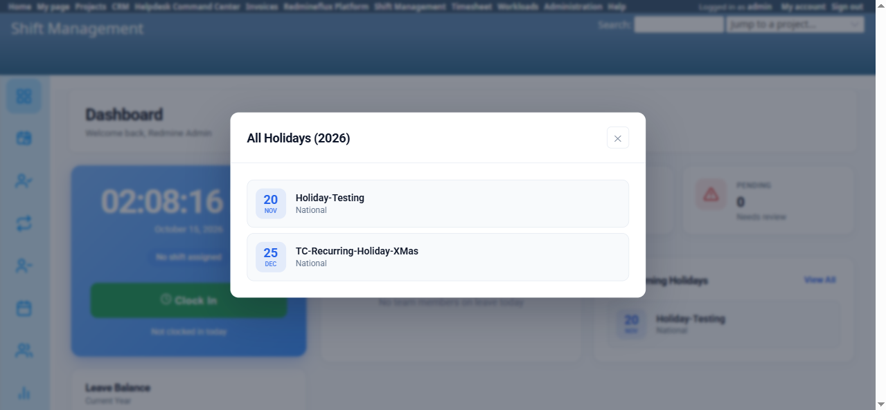
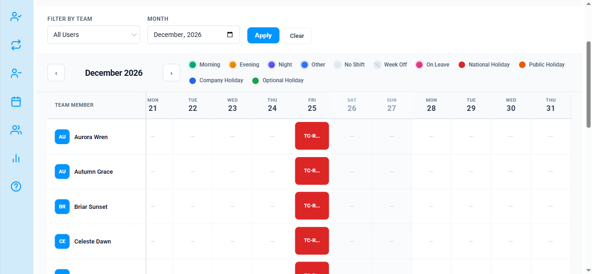

# Bug Report Template

- Bug ID: BUG-SFM-002
- Production Redmine Issue ID: #123755
- Title: Shift Calendar never highlights a recurring Holiday's occurrence in any year but the one it was originally created in
- Redmine version: 6
- Plugin name: redmineflux_shift_management
- Plugin version: current (2026-10-15)
- Environment: Local Docker (localhost:3013, `redmine6platform-redmine-1`)
- Browser: Chromium (Playwright MCP)
- User role: Admin
- Date: 2026-10-15

## Steps to reproduce

1. Create (or use) an active Platform Holiday Scheme.
2. Add a Holiday inside it dated in a **past** year (here: "TC-Recurring-Holiday-XMas", Start Date `12/25/2025`, Type National Holiday) with **Recurring = Yes** ("Repeats every year on this date").
3. Open Shift Management's own Shift Calendar for the holiday's literal month/year (`/shift_management/calendar?month=2025-12`) — confirm the Dec 25, 2025 cell shows the holiday badge/highlighting (baseline, works correctly).
4. Open the Shift Calendar for the **current** year's same date (`/shift_management/calendar?month=2026-12`) and check the Dec 25, 2026 cell.
5. Separately, open the Dashboard (`/shift_management/shift_dashboard`) → "Upcoming Holidays" → "View All" and check whether `TC-Recurring-Holiday-XMas` appears under "All Holidays (2026)".

## Expected result

- Per the Holiday's own "Recurring — Repeats every year on this date" setting, the Shift Calendar should highlight Dec 25 in **every** year the scheme stays active, not just 2025.

## Actual result

- Dec 25, 2025 (the literal creation date): correctly highlighted — cell class `sm-shift-cell sm-shift-holiday` with the "TC-Recurring-Holiday-XMas · National" badge.
- Dec 25, 2026 (the recurring year): **not highlighted at all** — cell class is plain `sm-shift-cell sm-shift-off`, identical to any ordinary non-working day, no badge.
- This is inconsistent with the plugin's own Dashboard: "Upcoming Holidays" → "View All" → "All Holidays (2026)" correctly lists `TC-Recurring-Holiday-XMas` on 25 DEC, proving the recurrence *is* computed correctly elsewhere in this same plugin.

**Root cause (confirmed from source):** `shift_dashboard_controller.rb`'s `calendar` action builds the month's `@holiday_data` with a raw literal-date query:
```ruby
active_schema.rf_holiday_managements.active
             .where(holiday_date: @start_date..@end_date)
```
This never considers the `recurring`/`recurrence_type` flag at all — it only matches a holiday whose literal `holiday_date` falls inside the displayed month. Meanwhile the plugin's own `HolidayEngine` service (`app/services/holiday_engine.rb`) already implements correct recurrence handling (`holiday_on?`, `holidays_for_year`, `generate_recurring` — used by the Dashboard's "Upcoming Holidays" panel), but the Shift Calendar controller never calls into it, so the two features disagree on the same data.

## Evidence

### Screenshot







### Retest screenshot



### Console / log

- N/A — confirmed via DOM inspection (`className`/`outerHTML` of the day-25 cell in both months) and source code (`shift_dashboard_controller.rb` lines ~144-155, `holiday_engine.rb`).

## Duplicate check

- Duplicate found: No
- Existing bug reference (if duplicate): —

## Retest — 2026-10-16 — PASS (FIXED)

- Environment: Local Docker (redmine6platform-redmine-1, localhost:3013), Redmine 6, Chromium (Playwright MCP), Admin.
- Fix under test: `git pull` on `redmineflux_shift_management` (branch `redmineflux_platform`, `ceed44a..b798f47`) touching `shift_dashboard_controller.rb` and `holiday_engine.rb`, plus the shared `redmineflux_platform` fix (`working_calendar.rb`, `holiday.rb`, `f4f7fbf..f91f233`). Container + Sidekiq restarted after pull (no new DB migration in either diff).

| # | Check | Result |
|---|-------|--------|
| 1 | Dec 25, 2026 (the recurring year) | Now correctly shows `sm-shift-cell sm-shift-holiday` with the "TC-R..." badge — PASS |
| 2 | Dec 25, 2025 (original/baseline year) | Still correctly `sm-shift-cell sm-shift-holiday` — PASS, no regression |
| 3 | Nov 20, 2026 ("Holiday-Testing", non-recurring holiday) | Still correctly `sm-shift-cell sm-shift-holiday` — PASS, no regression |
| 4 | Dec 26, 2026 (Saturday) | Still correctly `sm-weekend sm-shift-off`, not mistakenly marked holiday — PASS, no regression |

- Regression note (SENIOR_QA_STANDARDS §26): confirmed the fix didn't break the non-recurring-holiday code path (check 3) or weekend detection (check 4) — both unaffected.
