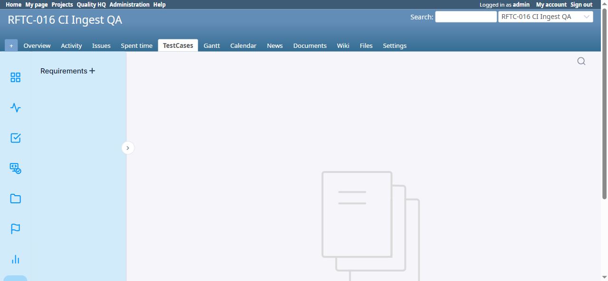

# BUG-TCM-072

- Bug ID: BUG-TCM-072
- Production Redmine Issue ID: #124008 (https://flux.zehntech.com/issues/124008) — assigned to Vaishnavi Bhawsar, priority High, Defect Type Security / Defect Severity High-severity / Defect priority High. Linked to production Testcase #124006 ("Requirements page issue-mention dropdown must not execute injected HTML/script from any test case subject (XSS)") in Run #612, environment Win + Chrome + Ver6, suite #443 (RFTC-011 — UI Modernization Wave 0).
- Title: Requirements page's issue-mention dropdown executes injected HTML/script from any test case subject in the project — fires automatically on page load, no user interaction required
- Redmine version: 6.x (Docker `localhost:3000`, Postgres)
- Plugin name: redmineflux_testcase_management
- Plugin version: master (post-7.1.0, pre-7.2.0 — rftc-011 Waves 0/2/4/5/6/7/8 merged)
- Environment: Docker `redmine6-redmine-1`, project `RFTC-016 CI Ingest QA` (id=2)
- Browser: Chrome (via Playwright)
- User role: Admin
- Date: 2026-10-19
- Severity: **High** (confirmed, reproducible stored/DOM XSS — `alert()` genuinely executes on every load of the page, not just a theoretical finding; strictly worse than the already-filed BUG-TCM-070 because it requires zero interaction beyond opening the page, and affects every test case in the project simultaneously)

## Steps to reproduce

1. In any project with the Testcase Management module enabled, create (or already have) a test case whose subject contains an HTML-tag-shaped string, e.g. ``.
2. Open that project's **Requirements** page (`/requirements?project_id=<id>`).
3. No further interaction is needed — the page immediately fires an `alert()` as soon as it finishes loading (confirmed twice in a row, reproducible every time the page is loaded while the test case exists).

## Expected result

The Requirements page's issue-mention/link picker must render every test case's subject as inert, escaped text — exactly like every other screen in the plugin (the ranked table in the Most Failed Tests report, the HTML report export, etc. all correctly escape the identical payload, confirmed in prior sessions). An HTML-tag-shaped test case subject must never execute as live markup anywhere in the product.

## Actual result

**FAIL, confirmed exploitable, requires no interaction.** On loading `/requirements?project_id=2`, the browser fires `alert('export-xss')` **immediately**, with the Requirements document list still empty (no requirement has even been opened) — confirming the trigger is unconditional page-load behavior, not something a user does by browsing into specific content.

Root-caused in `assets/javascripts/script.js`:

- Line 203 (top-level, runs unconditionally on every page load): `getAllIssues(true);`
- `getAllIssues()` (line 250) calls `GET /requirement/testcases?project_id=<id>&limit=100` — this endpoint's JSON response is correctly, safely encoded server-side (verified: the raw response contains `...`, i.e. properly unicode-escaped `<`/`>` inside valid JSON — **the server-side encoding is not the bug**, exactly the same pattern already confirmed safe in BUG-TCM-070's investigation).
- The data is then handed to `createIssues(data)` (line 2450), which builds the "mention an issue" dropdown's markup via **unescaped template-string interpolation**:
  ```js
  function createIssues(data) {
    let dropdown = document.getElementById("user-list");
    let li = "";
    for (let i = 0; i < data.length; i++) {
      li += `<li class="mention-issue" id="issue-${data[i].id}">#${data[i].id} ${data[i].subject}</li>`;
    }
    ...
    dropdown.innerHTML = li;
  }
  ```
  `data[i].subject` is spliced directly into an HTML string with **zero escaping**, then the whole string is assigned via `.innerHTML =`. Because this dropdown is populated **eagerly on page load** (not lazily on first keystroke of an "@"/"#" mention trigger), any test case in the project whose subject is HTML-tag-shaped executes immediately — confirmed via live DOM inspection:
  ```html
  <li class="mention-issue" id="issue-2063">#2063  export check</li>
  ...
  <li class="mention-issue" id="issue-35">#35  Remove item from cart</li>
  ```
  Both `` tags are genuinely live in the DOM (not escaped entities) — the browser parses them as real elements, attempts to load the broken `src="x"` (confirmed via a `GET /x` → `404` in the network log, once per injected image), and fires the `onerror` handler, executing the attacker-controlled JavaScript.

This is **structurally the same sink class as BUG-TCM-070** (server-side JSON/attribute encoding is correct; a client-side JS consumer re-parses the already-safe data and hands it to an unescaped HTML-building path) but on a **different page, different trigger condition (automatic vs. requires opening a chart), and a wider blast radius (every test case in the project, not just ones appearing in a specific report's run scope)**.

## Root cause

`assets/javascripts/script.js`:
- `getAllIssues(true)` (line 203) — called unconditionally at script load time, not gated behind any user action.
- `createIssues(data)` (lines 2450-2460) — the sink: `data[i].subject` is concatenated into an HTML template string with no escaping, then assigned via `dropdown.innerHTML = li`.

This file is the one the rftc-011 (UI modernization) Wave 4 spec itself explicitly flagged as a known-unverified risk ("the Requirements screen's 2,980-line exclusive `script.js`... no live browser to verify" — Wave 4 deliberately deferred any class-rename work on this file for exactly that reason). This finding is the risk that flag anticipated, now confirmed live.

## Suggested fix

In `createIssues()`, HTML-escape `data[i].id` and `data[i].subject` before interpolating them into the `<li>` template string (e.g. a small `escapeHtml()` helper applied to both fields, or build each `<li>` via `document.createElement`/`textContent` instead of a raw HTML template string). Audit `script.js`'s other `.innerHTML =`/`innerHTML +=` call sites for the same pattern (lines 788, 854, 1011, 1017, 1564, 1566, 1669, 1787, 2774 all interpolate server data into HTML template strings in the same file — not all confirmed exploitable in this pass, but each is the same anti-pattern and worth the same escaping audit before this file is next touched).

## Evidence

### Live DOM state (captured via `document.getElementById('user-list').innerHTML`, not the accessibility tree, so this reflects exactly what the browser parsed)

```html
<li class="mention-issue" id="issue-2063">#2063  export check</li>
<li class="mention-issue" id="issue-35">#35  Remove item from cart</li>
```

### Network log

```
GET /requirement/testcases?project_id=2&limit=100 → 200 OK (server response correctly JSON-escaped)
GET /x → 404 Not Found   (the broken  the injected payload creates, confirming it was parsed as a live element)
```

### Screenshot



## Duplicate check

- Duplicate found: No
- Checked `bugs/_index.md` and `bugs/_duplicates.md` — BUG-TCM-070 covers an XSS in the Most Failed Tests report's bar chart (a different page, different trigger — requires opening a specific report scoped to a run containing the payload). This bug is on the Requirements page's issue-mention dropdown, triggers automatically on every page load regardless of report/run scope, and is a distinct code path (`script.js`'s `createIssues()`, not the ApexCharts chart partial). Not a duplicate, though the same root-cause *class* (client-side JS re-parsing already-safe server data into an unescaped HTML sink) as BUG-TCM-070 — worth fixing both with the same discipline (prefer `textContent`/escaping helpers over template-string HTML building wherever user-controlled data reaches a client-side render path).

## Retest — 2026-10-21 (FIXED)

Retested against `localhost:3000` after the user pulled updated plugin code into `C:\redmine v6\plugins` and the
stack was restarted. Navigated to `/requirements?project_id=2` — **no `alert()` dialog fired on page load**
(confirmed no dialog needed handling during or after navigation). Inspected the live DOM directly
(`document.getElementById('user-list').innerHTML`):

```html
<li class="mention-issue" id="issue-2063">#2063 &lt;img src=x onerror=alert('export-xss')&gt; export check</li>
<li class="mention-issue" id="issue-35">#35 &lt;img src=x onerror=alert('export-xss')&gt; Remove item from cart</li>
```

Both entries are now HTML-escaped text, not live markup — confirmed **zero** live `` elements anywhere
inside `#user-list` (`el.querySelector('img')` → `null`). **Verdict: FIXED.** Moving this bug to `bugs/closed/`.
