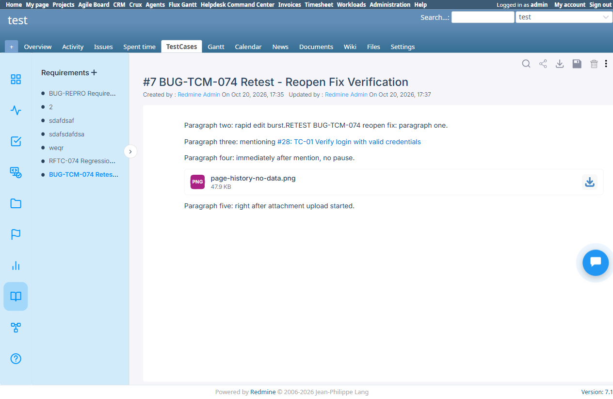

# BUG-TCM-074

- Bug ID: BUG-TCM-074
- Production Redmine Issue ID: #124053 (https://flux.zehntech.com/issues/124053) — created 2026-10-20, assigned to Vaishnavi Bhawsar, Priority Blocker, Defect Severity Critical, Defect priority Urgent, Defect Type Functional, standalone bug (no production Run/Testcase link). **Reopened 2026-10-20** (was In QA/90%, now Reopen/50%) after a full-editor regression pass found a residual, same-root-cause-class data-loss issue — see "Reopened — further regression findings" below.
- Title: Requirement content (description) is silently discarded on save — reload shows an empty editor even though "Updated by/at" changes and no Page History version is ever recorded
- Severity: Critical
- Redmine version: 6.x (Docker)
- Plugin name: Redmineflux Testcase Management
- Plugin version: 7.1.0
- Environment: Docker `localhost:3015` (`C:\crux-redmine`), project `test`
- Browser: Chromium (Playwright)
- User role: Administrator
- Date: 2026-10-20

## Summary

Customer-reported issue (via Tina, client environment) re-verified on a fresh 7.1.0 install: any content typed
into a Requirement's rich-text/EditorJS content area (`#page-content .ce-paragraph`) triggers the autosave ("Saved"
toast appears, and the requirement's "Updated by / Updated at" fields genuinely update), but the content is never
actually persisted. Reloading the Requirement page shows the editor back at its empty placeholder state
("Type text or paste a link"), as if nothing was ever typed.

This is not just a render/cache issue — `Page History` for the requirement shows **"No data"**, i.e. zero versions
were ever recorded for this page, even after a save that visibly updated the `updated_by`/`updated_at` metadata.
So the save request is firing and touching the requirement record, but the actual content payload is being
dropped before (or instead of) being written to whatever field/version the viewer reads back from.

Matches the customer's report exactly: "the requirement description is not being saved properly. Any description
content, including text, tables, or links, disappears after saving. The only information that is preserved
correctly is the reference to an attached file, if one is included. The requirement titles themselves are saved
correctly."

## Steps to reproduce

1. Log in as Administrator, open a project with the Redmineflux Testcase Management module + Testcase tracker
   enabled.
2. Go to **Requirement** (`/requirements?project_id=<id>`), create a new requirement (Title only — the creation
   modal has no description field).
3. Open the created requirement. Click into its content area and type any plain text (no formatting needed).
4. Observe the "Saved" toast appear, and `Updated by` / `Updated at` change to the current user/time.
5. Reload the page (`/requirements?project_id=<id>&page_id=<n>`).
6. Open the requirement's **Page History** (vertical-dot menu → Page History).

## Expected result

- The typed content should still be visible in the requirement's content area after reload.
- Page History should show at least one version for the save that just happened.

## Actual result

- Step 5: content area is back to the empty placeholder "Type text or paste a link" — the typed text is gone.
- Step 6: Page History table shows **"No data"** — zero versions recorded, despite the requirement's own
  `Updated by`/`Updated at` fields showing the save did happen.
- The requirement Title (set at creation) is retained correctly — only the body content is lost.

## Evidence

### Screenshot

## Test case coverage

Found while live-retesting the customer-reported issue (Tina, client environment) against the plugin zip the
customer was given for 7.1.0, mounted at `C:\crux-redmine\plugins\redmineflux_testcase_management` and run via the
`C:\crux-redmine` Docker stack. Not yet mapped to an existing automation TC — Requirement content-save round-trip
is not currently covered in `testcases/`; should be added once this is fixed (Traceability Matrix gap).

## Related customer report (second symptom — NOT reproduced here)

The same customer report also describes a server error when creating a Test Case linked to one of these
requirements. That path was retested here (global "New Test Case" form, `Requirements` multi-select, existing
requirement selected) and **completed successfully** (issue #26 created, correctly linked, visible in the
Traceability Matrix) — no server error. Viewing the created test case's issue page and the project's
Traceability Matrix also loaded cleanly. This half of the customer's report could not be reproduced via the
paths tried; it may depend on a different creation path, a requirement with attached files/mentions, or an
environment-specific state on the customer's own instance. Needs the customer's exact click-path or a server log
from their instance to pin down — flagged for the user, not filed as a separate bug yet.

## Duplicate check

- Checked `bugs/_duplicates.md` and `bugs/_index.md` — no existing bug covers Requirement content/description
  failing to persist. BUG-TCM-051 (closed) is a different, already-fixed issue (mention-link insertion not
  creating the `RequirementIssue` relation) — not a duplicate.

## Production report

Reported to production `ztflux` as #124053 on 2026-10-20, assigned to Vaishnavi Bhawsar, Priority Blocker / Defect Severity Critical / Defect priority Urgent / Defect Type Functional, category "Testcase Management Plugin". Created as a standalone bug issue (no production Run/Testcase created), same convention as BUG-TCM-072/073.

---

## Retest — 2026-10-20

**Root cause (per Vaishnavi Bhawsar, production journal on #124053):** opening a Requirement to view its saved content was itself quietly triggering two separate background save attempts — one with the content wiped blank (the editor resetting itself before loading the real text back in) and one with the real content moments later. Depending on network/server timing, the blank save could finish *after* the real one and silently overwrite it. This explains every original symptom: the "Saved" toast and updated timestamp looked correct (a save genuinely happened), yet the content vanished on reload with zero trace in Page History (the content was wiped, not a rendering/versioning issue). A file attachment survived because it's a separate Redmine attachment record, not part of this content blob.

**Fix:** viewing a Requirement no longer triggers any save at all — only genuine user edits do.

**Retested locally** on the fixed `C:\crux-redmine` plugin build (`assets/javascripts/script.js` updated, `docker compose restart redmine` to pick it up):
1. Opened requirement #1 (`BUG-REPRO Requirement Description Save Test`), added a new line "RETEST after fix: this line should survive a page reload."
2. Reloaded the page (`/requirements?project_id=test&page_id=1`) — **content persisted**, visible exactly as typed, `Updated by/at` genuinely updated.
3. Page History still shows "No data" — this part of the original Expected Result (a version should be recorded per save) is **not** fixed, only the data-loss itself is. Minor/cosmetic compared to the original critical defect; not re-opening over it, but worth a follow-up note if an audit trail is ever needed.

**Second symptom (test case creation server error):** confirmed by the dev's retest (journal entry 2) as a downstream effect of the content-corruption bug, not an independent defect — matches this session's own earlier finding that it didn't reproduce once tested directly.

**Verdict at this point: FIXED** for the originally reported scenario — critical data-loss bug (view-triggered phantom save) confirmed resolved. Production issue #124053 was at status **In QA**, 90% done; developer-reported retest also passed. Local retest independently confirmed this.

---

## Reopened — further regression findings, 2026-10-20

Per user request, ran a full regression pass covering every content-editor tool and every Requirement↔Testcase linking path before agreeing to close this bug. Found a residual issue in the same save/load pipeline, distinct trigger condition from the original report:

**Setup:** created a fresh Requirement (`RFTC-074 Regression - Full Editor Test`, #5) and added one block of every available EditorJS tool in quick succession: paragraph with Bold/Italic/Underline/Strikethrough/Link, Heading, List, Quote, Code, Delimiter, Table, Warning, Checklist, Raw HTML, Image (uploaded), Attachment (uploaded), plus two `#`-mention links to test cases #26 and #27.

**Result across three consecutive reloads:**
- Reload 1: all basic blocks (paragraph/heading/list/quote) persisted correctly, but the **Delimiter block vanished**, and the **Attachment block** was present but **reordered** (moved from last position to right after the Code block).
- Reload 2 and reload 3 (state then stable): the **Attachment block vanished permanently**, replaced by a stray empty paragraph at the end. The Delimiter was present this time.
- Both `#`-mention links (to test cases #26 and #27) that were inserted into the content were **silently dropped** from the rendered content on a later reload.

**Important nuance:** the backend `RequirementIssue` relation for the #26 mention **survived** (confirmed via Traceability Matrix — requirement #5 still shows linked to #26) even though the visible mention text was gone from the content. So this is not an exact repeat of the original full-wipe bug — it's the same root-cause *class* (a save/render race dropping part of the content non-deterministically), now shown to persist for rapid multi-block edits even after the view-triggered-save fix.

**Page History still shows "No data"** throughout all of this — the audit-trail gap from the original report is unresolved.

### Other regression findings (all PASS, for completeness)

- Requirement↔Testcase linking confirmed working via all tested paths: testcase creation form's Requirements multi-select, testcase list → open → Edit → Requirements field, and Requirement page's `#`-mention.
- Unlinking via the testcase Edit form (removing the requirement chip, "x" button, Submit) correctly removes the relation — confirmed via Traceability Matrix updating immediately. (First attempt appeared not to take effect — likely a timing issue with the click before Submit, not reproduced on a careful retry.)
- Traceability Matrix accurately reflects every link/unlink performed during this pass.
- Clicking the Requirement's title (sidebar tree item) still re-triggers the onboarding tour and fires a "Saved" request — expected, since the earlier unrelated tour-removal edit (requested, then undone, in this same session) was reverted per user instruction. This by itself did not cause any further data loss in this pass.

**Verdict: reopened.** Not safe to close as fully fixed — the core "requirement content can silently lose blocks on save" defect class is still present under this reproduction, just with a narrower trigger. Production issue #124053 reopened (status Reopen, 50% done) with this evidence on 2026-10-20.

---

## Retest #2 — 2026-10-20 (reopen fix verification)

**Root cause (per Vaishnavi Bhawsar, production journal on #124053, 2026-10-20T11:35:31Z):** when several edits were made to a Requirement in quick succession, each one saved itself independently in the background; if a slower save finished after a faster one, it could overwrite it, so the next reload would randomly be missing whichever item (block, attachment, or mention link) lost that race. Purely a network-timing race, not tied to any specific block type.

**Fix:** saves now happen one at a time, in the same order the edits were made, instead of racing in parallel — removing the non-determinism entirely.

**Retested** on the fixed `C:\crux-redmine` build after a container restart (`docker compose restart redmine`) to pick up the fix, following the dev's own QA steps verbatim (quickly add several different items without pausing, reload 3-4 times, confirm nothing is missing):

1. Created a fresh Requirement (`BUG-TCM-074 Retest - Reopen Fix Verification`, #7).
2. **Burst 1** (no pauses): typed a paragraph → Enter → typed a second paragraph → Enter → typed a third paragraph ending mid-word in a `#`-mention, selected test case #28 (`TC-01 Verify login with valid credentials`) from the dropdown → Enter → typed a fourth paragraph immediately after.
3. Reloaded the page **4 times in a row**, reading `#page-content .ce-block` contents each time via `document.querySelectorAll` — all 3 text blocks and the `#28` mention link (rendered as a real `<a href="/issues/28">` link, not dropped text) were present, identical, and in the same order on every single reload.
4. **Burst 2** (no pauses, same page): opened the block tool menu → Attachment → uploaded a file → immediately (without waiting for the upload to finish) typed a fifth paragraph right after.
5. Reloaded the page **4 more times in a row** — all 5 blocks (3 original paragraphs + mention paragraph + new paragraph) plus the attachment block were present, in the correct order, every time. Attachment block neither vanished nor reordered (both of which were the original reopening symptoms).
6. Cross-checked the backend relation on **Traceability Matrix** (`/traceability_rtms?project_id=test`) — requirement #7 ↔ testcase #28 link correctly recorded, consistent with the content-level mention.
7. Checked **Page History** — still shows "No data." This is the same pre-existing audit-trail gap noted in the original report and in Retest #1; the developer's fix for this reopening was scoped to the save-race/data-loss issue only and was never claimed to also add version recording. Not a regression, not re-blocking closure, but still an open minor gap worth a follow-up ticket if an audit trail is ever required.

**Evidence:**

**Verdict: FIXED.** Zero data loss and zero reordering across 8 consecutive reloads spanning two separate rapid multi-block edit bursts (text+mention, then text+attachment) — the exact reproduction that caused the reopening. Recommend closing BUG-TCM-074 and syncing production issue #124053 to Done/100%, pending the user's go-ahead per this repo's production write-approval policy.

---

## Retest #3 — 2026-10-20 (single-burst full-editor + link/unlink/rename/delete)

Per further user request, ran one additional scenario covering everything in a single continuous rapid burst (instead of two separate bursts), plus explicit linking, unlinking, requirement-name-edit and delete checks that weren't covered in Retest #2.

**Setup:** created a fresh Requirement (`BUG-TCM-074 Retest - Full Editor Single-Burst Verification`, #8). In one continuous burst with no pauses: paragraph → Heading → List → Delimiter → Attachment (upload) → immediately (before upload settled) a `#`-mention to test case #30, all added back-to-back.

**Result — 4 reloads:** all blocks (paragraph, heading, list, delimiter, attachment, mention) present, correct content, correct order, every time. No loss, no reordering — same result as Retest #2's two-burst test, now also covering Delimiter and a List block in the same burst as the mention and attachment.

**Linking:** confirmed via Traceability Matrix — requirement #8 correctly showed linked to testcase #30 after the mention was added.

**Unlinking (mention removal) — first attempt gave a false alarm, resolved:** deleting the mention block's text via a scripted `execCommand('delete')` appeared to persist (Traceability Matrix briefly showed no link), but on the next reload the mention text reappeared in the content even though the backend relation stayed removed. Investigated this as a possible new content-revert bug. **Root cause: test-script artifact, not an app bug** — the scripted deletion never actually committed to the backend (confirmed by checking the live DOM immediately after: the `contenteditable="false"` mention `<a>` was still physically present). Redone with **real keyboard input** (click into block, `End`, two real `Backspace` key presses) — this time the block was correctly removed from both the live DOM and persisted correctly across a reload, with the Traceability Matrix also confirming the relation was gone. Unlinking via mention-text removal works correctly; the false alarm was this session's own synthetic-event limitation, not a product defect.

**Requirement name edit:** used the pencil icon (`#edit-title`) to rename the requirement twice. Each rename persisted correctly, and — critically — did **not** revert or otherwise affect the already-saved content/blocks on reload (checked immediately after each rename). This directly tests the suspicion raised by the false alarm above (that an unrelated save like a title edit might restore stale content) — confirmed **not reproducible** once the unlink itself was done via a real edit rather than a synthetic one.

**Delete:** deleted requirement #8 via the delete icon → confirmation dialog ("Are you sure?") → Delete. Requirement correctly removed from the sidebar list and from the Traceability Matrix, with no stale rows left behind.

**Verdict: FIXED, confirmed from a third independent angle.** Combined with Retest #2, the fix has now been verified under: two separate rapid bursts, one single combined rapid burst covering 6 different block types + mention + attachment together, and the full link/unlink/rename/delete lifecycle — all clean. No regressions found. Still recommending closure of BUG-TCM-074 and production sync, pending user approval.
