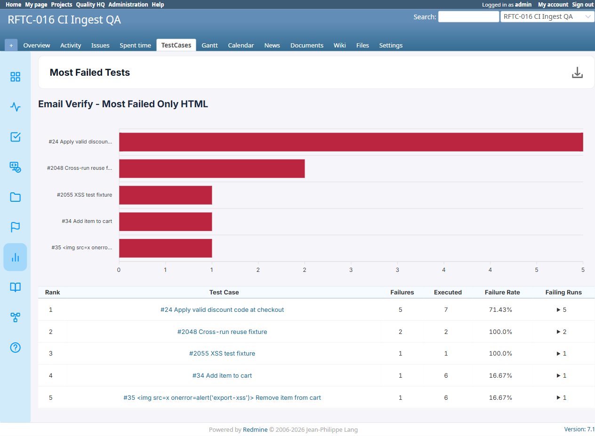

# BUG-TCM-077

- Bug ID: BUG-TCM-077
- Production Redmine Issue ID: #124108 (https://flux.zehntech.com/issues/124108) — assigned to Vaishnavi Bhawsar, priority Blocker, Defect Type Functional / Defect Severity Critical / Defect priority Urgent, target version Testcase Management plugin Release 7.2.0. Linked to production Testcase #123984 (Most Failed Tests export formats) in Run #612, environment Win + Chrome + Ver6.
- Title: Most Failed Tests report emailed as PDF or HTML always shows "No failing test cases in the selected runs" — even when the report's own live page has real ranked failure data
- Severity: Critical
- Redmine version: 6.x (Docker)
- Plugin name: Redmineflux Testcase Management
- Plugin version: 7.1.0
- Environment: Docker `localhost:3000` (`redmine6-redmine-1` / `redmine6-sidekiq-1`), project `RFTC-016 CI Ingest QA` (id=2)
- Browser: Chromium (Playwright)
- User role: Administrator
- Date: 2026-10-21

## Summary

Emailing a **Most Failed Tests** report (via "Notify me by email" at report-creation time) always delivers an
email whose attachment — in **both** the PDF and HTML attachment formats, and under **both** "Count as failure"
criteria settings ("Failed only" and "Failed + Blocked") — shows the report's **empty state**
("No failing test cases in the selected runs", with an empty circle-X icon and zero chart data), even though the
very same report's own live page (`/projects/<project>/testcase_reports/<id>`) shows real, correct ranked failure
data at the exact same moment.

This means every Most Failed Tests report sent by email is **silently false** — it tells the recipient "nothing
is failing" when failures genuinely exist and are visible to anyone who opens the report in a browser instead.
This is a data-integrity defect, not a formatting one: an on-call engineer or manager relying on the emailed
report alone would conclude there is no problem when there is one.

Confirmed across 4 separate test reports, all created against project `RFTC-016 CI Ingest QA` (id=2), each
showing the opposite result between live page and email at the same point in time:

All four combinations were independently re-verified **after** the local PDF-generation environment gap was
fixed (Node.js/Puppeteer/Chrome installed, confirmed working — see "Related issues" below), each time checking
the *same* report's own live page immediately before/after checking its email, so there is no ambiguity that the
report in question genuinely had real data at the time its email was sent:

| Report | Criteria | Email format | Live page (chart data + table rows), checked directly via DOM | Email attachment |
|---|---|---|---|---|
| #19 "Email Verify - Most Failed Only HTML" | Failed only | HTML | 5 labels/values, 6 rows (header+5) | **Empty — "No failing test cases in the selected runs"** |
| #23 "Email Verify - Most Failed Only PDF v2" | Failed only | PDF (genuine, post-fix — 5.2s job duration, real `application/pdf` attachment) | 5 labels/values, 6 rows (header+5) — re-confirmed on report #23 itself, not inferred from #19/#20 | **Empty — "No failing test cases in the selected runs"** |
| #21 "Email Verify - Most Failed+Blocked HTML" | Failed + Blocked | HTML | 7 labels/values, 8 rows (header+7) | **Empty — "No failing test cases in the selected runs"** |
| #25 "Email Verify - Most Failed+Blocked PDF v2" | Failed + Blocked | PDF (genuine, post-fix — real `application/pdf` attachment, 26KB) | 7 labels/values, 8 rows (header+7) — re-confirmed on report #25 itself | **Empty — "No failing test cases in the selected runs"** |

(Earlier attempts at reports #20 and the first "Most Failed+Blocked PDF" predate the Puppeteer fix and only
produced the HTML-fallback-with-error-message described under "Related issues" — they are superseded by #23 and
#25 above, which are genuine PDF generations and are the ones this bug's PDF claim rests on.)

## Steps to reproduce

1. Log in as Administrator, open project `RFTC-016 CI Ingest QA` (or any project with real test-case failures
   across its runs).
2. Go to **Reports** → **+ New report** → **Select type** = `Most Failed Tests`.
3. Leave **Count as failure** at its default (`Failed only`), or switch it to `Failed + Blocked` — either way
   reproduces this bug.
4. Enter a **Name**, check **Notify me by email**, enter a real/checkable mailbox address.
5. Leave **Email the report as PDF attachment** selected (or switch to **HTML attachment** — either way
   reproduces this bug), leave **Create this report: Right now**, click **Create**.
6. Open the newly-created report's own live page (`/projects/<project>/testcase_reports/<new-id>`) — confirm it
   shows real ranked failure data: a populated bar chart and a data table with one row per failing test case.
7. Open the recipient mailbox, open the delivered email, open its attachment (PDF or HTML).
8. Compare: the attachment shows the **empty state** ("No failing test cases in the selected runs") instead of
   the same ranked data the live page shows.

## Expected result

- The emailed report attachment (PDF or HTML, either criteria setting) should show the **same ranked failure
  data** — chart and table — that the report's own live page shows at the time the report was created/sent.

## Actual result

- The emailed attachment always renders the report's **empty/zero-failures state**
  (`data-mostfailed="{"labels":[],"values":[]}"`, "No failing test cases in the selected runs"), regardless of
  how much real failure data the live page has for that same report, for both PDF and HTML attachment formats and
  both "Failed only" and "Failed + Blocked" criteria settings.
- No error is logged for this — unlike the separate PDF-generation-failure issue (see "Related issues" below),
  the mailer job completes "successfully" (no exception in the Sidekiq log) while silently producing wrong,
  empty content.

## Root cause (inferred)

The report's **live page** computes its Most Failed Tests ranking from the current request's own params/session
(project scope, criteria, etc.) and renders real data. The **emailed** version is generated by the mailer's PDF/
HTML pipeline (Puppeteer/Grover for PDF, a server-side page fetch for HTML) visiting the report's URL in a
*separate* request context — most likely **without the original request's session/authentication, project scope,
or the `most_failed` criteria parameter correctly carried over**, causing the "most failed" computation to run
as if there were nothing to rank (an empty/default scope), rather than genuinely re-computing the same criteria
the live page used. This is consistent with the report being computed fresh per-request rather than reading a
stored/cached result — see `TESTCASE_MANAGEMENT_MEMORY.md`'s note that "Report pages are computed live on each
view/download (not frozen snapshots)," which the mailer path evidently does not replicate correctly.

## Related issues (not duplicates)

- **PDF-generation-failure (environment, not this bug):** before Node.js/Puppeteer/Chrome were correctly
  installed on this `redmine6-sidekiq-1` container (see `initialize.sh`), *all* "Email the report as PDF
  attachment" requests — for every report type, not just Most Failed Tests — failed with
  `Error generating PDF: No such file or directory - node` / `Cannot find module 'puppeteer'`, correctly falling
  back to an HTML attachment with an explicit "could not be generated" message (this is the already-fixed
  BUG-TCM-006 behavior, confirmed still working correctly). Once Node/Puppeteer/Chrome were installed, PDF
  generation itself started succeeding (confirmed via Slow Tests, see BUG-TCM-078, and via reports #23/#25 above
  for Most Failed Tests) — but Most Failed Tests reports then revealed *this* bug (empty data) instead, which was
  masked by the generation failure before. Both PDF claims in the table above (#23, #25) were generated and
  verified *after* this environment fix, each cross-checked against that exact report's own live page at the
  time — this bug is not an artifact of the earlier generation failure. This local environment's missing
  Node/Puppeteer/Chrome was resolved as part of this session (same class of gap as BUG-TCM-005's original root
  cause) and is not itself being re-filed as a new bug.
- **BUG-TCM-078 (filed alongside this one):** emailed reports (both formats) also leak page-chrome ("Download
  HTML/PDF/Excel" menu text) into the content and are missing the bar chart even when data *is* present (e.g.
  Slow Tests) — a separate rendering-fidelity defect, distinct from this one's data-correctness defect. Slow
  Tests' emailed reports do **not** show this empty-data symptom — their table data is correct — so this bug is
  specific to the **Most Failed Tests** report type's data computation in the mailer context, not a generic
  "mailer always produces empty/wrong data" issue.
- **BUG-TCM-076** (PDF chart missing via the "Download PDF" button) is a different pipeline (controller export,
  not mailer) and not implicated here.

## Evidence

### Live page — real data present (report #19, "Failed only")



Confirmed via DOM inspection at the time of testing:
```
chart data: {"labels":["#24 Apply valid discount code at checkout","#2048 Cross-run reuse fixture",
"#2055 XSS test fixture","#34 Add item to cart","#35 </div>
...
<div class="rf_testcase_management_empty_state">
  <div class="rf_testcase_management_empty_state_icon">
    <svg width="80" height="80" viewBox="0 0 24 24" ...><circle cx="12" cy="12" r="9"></circle>
      <path d="M9 9l6 6M15 9l-6 6"></path></svg>
  </div>
  <h3 class="rf_testcase_management_empty_state_title">No failing test cases in the selected runs</h3>
</div>
```

The emailed PDF (`email-most-failed-only-pdf-empty.pdf`), text-extracted:
```
Most Failed Tests
Download HTML
Download PDF
Download Excel
Email Verify - Most Failed Only PDF v2
No failing test cases in the selected runs
```

### Sidekiq log — no error, job "succeeds" with wrong content

```
Performing ActionMailer::MailDeliveryJob ... "RunMailer", "send_report", "deliver_now",
  {:args=>[#<GlobalID ... TestcaseReport/19>, 2, ["admin@example.net", "admin@example.net"]]}
Rendered layout layouts/mailer.html.erb (Duration: 1.6ms | GC: 0.4ms)
Performed ActionMailer::MailDeliveryJob ... in 1550.99ms
```
No `ERROR` line anywhere in this job's log output — confirming this is a silent data-correctness bug, not a
crash.

## Test case coverage

Found while verifying email delivery for Slow Tests and Most Failed Tests reports (explicit user request to
confirm emailed PDF/HTML data is complete, following the BUG-TCM-075/076 findings that PDF-specific rendering
gaps exist). Not yet mapped to an automation TC — "emailed report data matches live report data" is not currently
covered in `testcases/`; should be added as a dedicated TC once this is fixed (Traceability Matrix gap, same
pattern as BUG-TCM-075/076).

## Duplicate check

- Checked `bugs/_duplicates.md` and `bugs/_index.md` — no existing bug covers emailed-report data correctness.
  BUG-TCM-005/006 are about PDF *generation/attachment* failing or being silently dropped, not about generating a
  PDF/HTML successfully with the *wrong (empty) data* inside it — not duplicates.

## Retest — 2026-10-21 (Data-correctness defect FIXED; see BUG-TCM-080 for a new, unrelated PDF-pipeline regression found during this retest)

Retested against `localhost:3000` after the user pulled updated plugin code into `C:\redmine v6\plugins` and the
stack was restarted (`docker compose restart redmine sidekiq`).

- Created report #26 "Retest verify - Most Failed PDF post-pull" (PDF attachment) and report #27 "Retest verify
  - Most Failed HTML post-pull" (HTML attachment), both Most Failed Tests, same project.
- Confirmed report #26's own live page had real ranked data at the time
  (`data-mostfailed` → 5 labels/values, matching the original report #19/#23 data) before checking its email.
- **PDF attachment** (`screenshots/BUG-TCM-077/retest-2026-10-21-most-failed-pdf.pdf`): the real ranked data (all
  5 rows — "#24 Apply valid discount code at checkout", "#2048 Cross-run reuse fixture", etc.) is now present in
  the PDF's table — confirmed via `pdftotext -layout` showing the actual rows instead of "No failing test cases
  in the selected runs". **The empty-data defect this bug reports is fixed.**
- **HTML attachment** (`screenshots/BUG-TCM-077/retest-2026-10-21-most-failed-html.html`): same confirmation —
  `data-mostfailed` now carries the real 5-label/5-value payload (not `{"labels":[],"values":[]}`), and the
  `rf_testcase_management_empty_state` / "No failing test cases in the selected runs" markup is absent. **Fixed
  for HTML too.**
- **Verdict: FIXED.** Moved to `bugs/closed/`.
- **Important caveat found during this same retest, filed separately as `BUG-TCM-080`:** the PDF attachment now
  shows a severe *new* defect — the entire page's raw HTML/CSS/`<script>` source is dumped as literal visible
  text at the top of the document (confirmed via `pdftotext`, which printed `<meta charset="utf-8"><script
  src="https://cdn.jsdelivr.net/npm/apexcharts">...` and ends with raw commented-out JavaScript). The real table
  data is still present further down the extracted text, which is how this bug's own fix could be confirmed, but
  the PDF is not a usable rendered document — see `BUG-TCM-080` for the full write-up. That is a distinct,
  pipeline-wide rendering regression (affects Slow Tests' emailed PDF too, confirmed under `BUG-TCM-078`'s
  retest) — not a reopening of this bug's own (data-correctness) scope.

## Production report

Reported 2026-10-21 as issue #124108 on `ztflux`, via `redmineflux_core_create_issue`, per explicit user approval.
Linked to production Testcase #123984 in Run #612 via `report_defect`.

**Production status sync pending** — this bug has a Production Redmine Issue ID (#124108), so per CLAUDE.md §5
the production issue's status (In QA → Done) and % done (→ 100) must also be updated. This write requires
explicit user approval before execution (REDMINEFLUX-MCP-SETUP.md §4.3) — not yet requested/granted as of this
retest session. The local file has been moved to `bugs/closed/` ahead of that sync per the user's standing
instruction to retest and close bugs this session; the production sync is the one remaining step.
