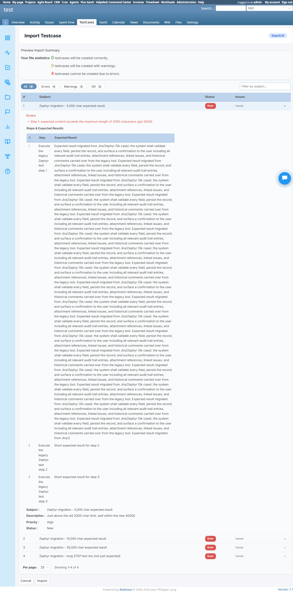
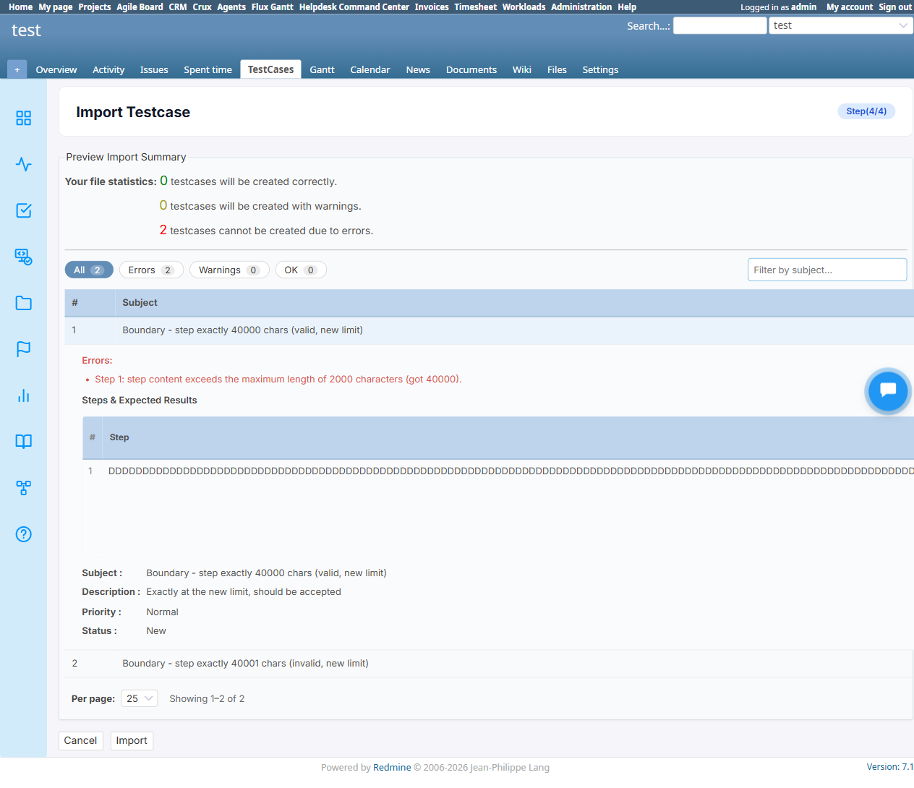

# BUG-TCM-079

- Bug ID: BUG-TCM-079
- Production Redmine Issue ID: #124155 (https://flux.zehntech.com/issues/124155) — created 2026-10-21, assigned to Vaishnavi Bhawsar, Priority High, Defect Type Functional, Defect Severity High-severity, Defect priority High, category Testcase Management Plugin. Standalone bug (no production Run/Testcase link), same convention as BUG-TCM-072/073/074.
- Title: CSV Import still hard-rejects any step/expected-result content over 2000 characters, even though the
  `step`/`expected` columns were migrated to a 40000-char limit
- Severity: High
- Redmine version: 6.x (Docker)
- Plugin name: Redmineflux Testcase Management
- Plugin version: 7.1.0 (fixed build, migration `20261021000000_increase_step_and_expected_column_length_in_steps.rb`)
- Environment: Docker `localhost:3015` (`C:\crux-redmine`), project `test`
- Browser: Chromium (Playwright)
- User role: Administrator
- Date: 2026-10-21

## Summary

A client reported that the `expected` column in the `steps` table was limited to 2000 characters, blocking
migration of existing Jira/Zephyr test cases (which often have long expected-result text) into Redmine. The dev
fixed this with migration `20261021000000_increase_step_and_expected_column_length_in_steps.rb`, which raises both
`steps.step` and `steps.expected` from `varchar(2000)` to `varchar(40000)` — confirmed applied and working
correctly for **manual** test case creation (direct UI entry of a 35,000-char expected result saves and persists
with zero truncation, verified against the live DB).

However, **CSV Import — the exact migration path the client's request is about — was never updated to match**.
`TestcaseImportController#step3` (the preview/validation step) still hard-codes the old 2000-char ceiling:

```ruby
if step_text.length > 2000 && expected_text.length > 2000
  row_summary[:errors] << "Step #{number}: step and expected result both exceed the maximum length of 2000 characters."
  has_errors = true
elsif step_text.length > 2000
  row_summary[:errors] << "Step #{number}: step content exceeds the maximum length of 2000 characters (got #{step_text.length})."
  has_errors = true
elsif expected_text.length > 2000
  row_summary[:errors] << "Step #{number}: expected content exceeds the maximum length of 2000 characters (got #{expected_text.length})."
  has_errors = true
end
```

Any row that trips this check gets `row_summary[:importable] = false` and is silently dropped from
`importable_data` — it never reaches the database at all, regardless of the column now being able to hold it.
So the fix works for manually-typed content but **completely fails to solve the client's actual reported
scenario**: importing a CSV of migrated Jira/Zephyr test cases with long expected-result text.

## Steps to reproduce

1. On the fixed build (DB confirms `steps.expected`/`steps.step` are `varchar(40000)`), go to **TestCases → Import
   Testcase**.
2. Upload a CSV containing a row whose `Expected Result 1` (or `Step 1`) column is longer than 2000 characters but
   well under 40000 — e.g. 5,000 characters, simulating a realistic migrated Jira/Zephyr test case.
3. Proceed through Step 2 (field mapping) and Step 3 (value mapping) to the Step 4 preview.

## Expected result

- The row should be accepted and imported, since the `steps.expected` column can now hold up to 40000 characters.

## Actual result

- The row is flagged **Error** and excluded from import, with the message:
  `Step 1: expected content exceeds the maximum length of 2000 characters (got 5000).`
- Reproduced with multiple lengths, including the exact new boundary itself:
  - 5,000 chars (expected only) — **rejected**
  - 15,000 chars (expected only) — **rejected**
  - 35,000 chars (expected only) — **rejected**
  - 12,000 chars (step only) — **rejected**
  - **Exactly 40,000 chars** (the new maximum the migration was built to support) — **still rejected**:
    `Step 1: step content exceeds the maximum length of 2000 characters (got 40000).`
  - 40,001 chars — correctly rejected (expected, now one char over the real new limit) — but for the wrong
    reported reason (message still cites "2000 characters" instead of 40000).
- Baseline regression confirmed clean: re-ran the pre-existing legacy-format CSV import test (5 rows, short
  content) — all 5 imported correctly (4 OK + 1 expected warning for a step with no expected result), confirming
  this is isolated to the length check itself, not a wider import regression.

## Evidence





## Suggested fix

Update the two `> 2000` checks in `TestcaseImportController#step3` (and the corresponding error message text) to
`> 40000`, matching the `steps.step` / `steps.expected` column migration. Ideally read the limit from the column
definition (`Step.columns_hash['expected'].limit`) rather than hard-coding it a second time, so the two can never
drift apart again the next time this limit changes.

## Test case coverage

Found while verifying the `expected`/`step` 40000-char-limit fix end-to-end, specifically testing the CSV Import
feature (the client's actual motivating use case — migrating Jira/Zephyr test cases). New test data added at
`automation/testdata/csv-test-data/21_boundary_40000_vs_40001_chars.csv` and
`automation/testdata/csv-test-data/22_jira_zephyr_migration_long_expected.csv` (generated via
`generate_40000_limit_csvs.js`, a companion to the existing `generate_test_csvs.py`). Not yet mapped to a
testcases/ TC — should be added to `testcases/TESTCASE_MANAGEMENT_CSV_IMPORT.md` once this is fixed.

## Duplicate check

- Checked `bugs/_duplicates.md` and `bugs/_index.md` — no existing bug covers CSV Import's step/expected length
  validation. The original `07_oversized_step_text_negative.csv` / `08_boundary_2000_vs_2001_chars.csv` test data
  (pre-existing, built against the old 2000-char limit) correctly described the *old*, intended behavior — not a
  duplicate of this bug, which is that the *same* check was never updated after the limit itself changed.

## Production report

Reported to production `ztflux` as #124155 on 2026-10-21, assigned to Vaishnavi Bhawsar, Priority High / Defect
Severity High-severity / Defect priority High / Defect Type Functional, category "Testcase Management Plugin".
Created as a standalone bug issue (no production Run/Testcase created), same convention as BUG-TCM-072/073/074.

---

## Retest — 2026-10-21

**Fix:** `TestcaseImportController#step3` no longer hard-codes `2000` — it now reads the real limit dynamically
from the column definition:

```ruby
step_limit = Step.columns_hash['step'].limit
expected_limit = Step.columns_hash['expected'].limit
```

and uses `step_limit`/`expected_limit` in both the `> 2000` comparisons and the error message text. This exactly
matches this bug's own Suggested Fix (read the limit from the column rather than hard-coding it a second time), so
it can never drift out of sync with the migration again.

**Retested** on the fixed `C:\crux-redmine` build after a container restart (`docker compose restart redmine`):

1. **Re-ran TC-TCM-275** (`22_jira_zephyr_migration_long_expected.csv` — 5,000/15,000/35,000-char expected, plus a
   12,000-char step): all 4 rows now show **OK**, 0 errors. Completed the import and confirmed via direct DB query
   (`length(step)`/`length(expected)`) that every value was saved at its exact original length — 5000, 15000,
   35000, and 12000 respectively — zero truncation.
2. **Re-ran TC-TCM-276** (`21_boundary_40000_vs_40001_chars.csv`): the exactly-40,000-char row is now **OK**
   (confirmed via DB: `length(step) = 40000` on the saved issue), and the 40,001-char row is still correctly
   **rejected** — but now with the corrected message: `Step 1: step content exceeds the maximum length of 40000
   characters (got 40001).` (previously incorrectly said "2000 characters" even for this exact scenario).
3. **Re-ran TC-TCM-277** (baseline regression, `01_legacy_single_step_format.csv`): unchanged — 4 correct / 1
   expected warning / 0 errors, identical to the pre-fix and original 2026-09-11 baseline. No regression.

**Verdict: FIXED.** The client's actual motivating use case (migrating long Jira/Zephyr test cases via CSV import)
now works end to end, at every length tested from 5,000 up to and including the exact new 40,000-char ceiling,
with zero truncation and zero regression to ordinary short-content imports.

Production issue #124155 synced to **Done / 100%** on 2026-10-21 with this retest summary.
