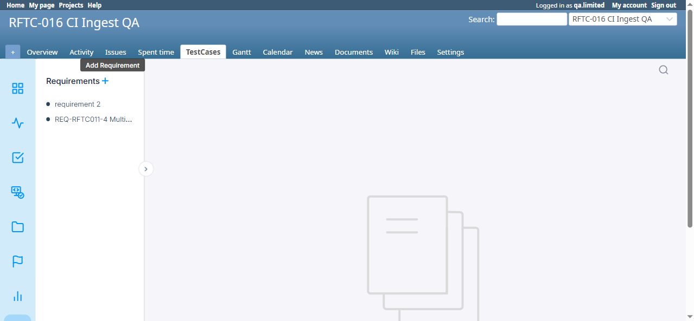
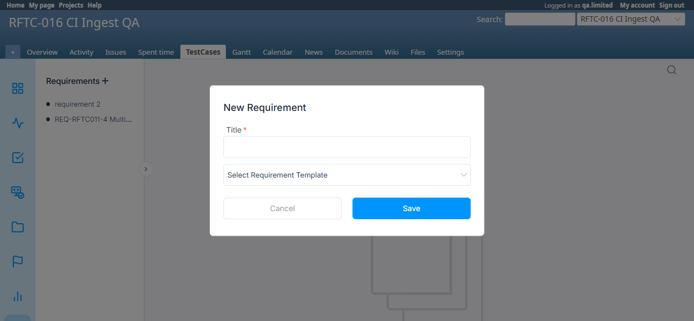

# BUG-TCM-089

- Bug ID: BUG-TCM-089
- Production Redmine Issue ID: #124298
- Title: Requirements module has no `view_requirement` permission at all, and its UI/attachment surface doesn't consistently honor the permissions it does have — Add/Edit controls stay visible and silently fail with zero `add_requirement`/`edit_requirement`, and the attachment download endpoint bypasses Testcase Management permissions entirely (falls back to core Redmine `view_files`)
- Redmine version: 7.0.0
- Plugin name: Redmineflux Testcase Management
- Plugin version: 7.2.0
- Environment: Docker `localhost:3000`, project `rftc-016-ci-qa` (id=2)
- Browser: Chromium (Playwright MCP) + direct curl (session-cookie, single-call methodology)
- User role: Manager (`qa.limited`) with every Testcase Management permission related to Requirements stripped (`add_requirement`/`edit_requirement`/`delete_requirement` all unchecked)
- Date: 2026-10-22

## Summary

Found while the user manually stripped all Requirement-related permissions from the Manager role on a real
project and poked around the Requirements screen. Three distinct findings, all confirmed live:

### Finding 1 — No `view_requirement` permission exists in the plugin at all (design question for the dev)

Confirmed via `Redmine::AccessControl.permissions.map(&:name)`: for Requirements, only `add_requirement`,
`edit_requirement`, `delete_requirement` are registered. There is **no `view_requirement` permission** —
unlike Test Suites (`view_test_suite`, the subject of BUG-TCM-009) and Reports (`view_report`), which both have
their own view permission. This is why the role-edit form screenshot the user sent shows no "View requirement"
checkbox at all — it was never built, not merely unchecked.

Practically: today, "can I see Requirements" = "am I a project member with the Testcase Management module
enabled," full stop (confirmed via `requirements_controller.rb#index`'s `rftc_authorize_project_read!` and
`#show`'s `rftc_require_project_visible!` — neither calls `allowed_to?` with any Requirement-specific
permission, because none exists to call).

**This needs a product decision from the dev, not just a code fix**: should Requirements get its own
`view_requirement` permission (matching Test Suites/Reports), or is "visible to any project member" the
intended design (like Redmine's own Wiki default)? Raising as an open question per the user's own instinct,
not assuming the answer.

### Finding 2 — Add/Edit Requirement UI controls stay visible and fail silently with zero permission (Leg B only, confirmed NOT a backend bypass)

With `add_requirement`/`edit_requirement` both stripped from Manager:

- The blue **"+" Add Requirement icon** next to the Requirements heading stays fully visible and clickable
  (tooltip reads "Add Requirement"). Screenshot: `add-requirement-plus-icon-visible-no-permission.png`.
- Pressing the **"r" keyboard shortcut** on the Requirements page opens the full "New Requirement" modal
  (Title field + Save button), with no permission check client-side at all. Screenshot:
  `new-requirement-modal-no-add-permission.png`.
- The **Edit Title pencil icon** next to a requirement's title (per the user's own screenshot) is likewise
  still rendered and clickable with `edit_requirement` denied.

**Confirmed this is a UI-only gap, not a real authorization bypass** — verified two independent ways:
1. Submitted the New Requirement modal with a distinctive probe title (`QA-PERMISSION-PROBE-...`) — the modal
   gave **zero error feedback** (no toast, no inline message, nothing), but `Requirement.where(title: ...)`
   confirmed **0 rows were created**. The backend silently refused it.
2. Direct curl POST/PUT to `/requirements` and `/requirements/6` (session-cookie auth, CSRF token attached,
   matching this session's established single-call methodology) both returned **403 Forbidden** — `create`
   correctly gated by `rftc_authorize_requirement_create` (`add_requirement`), `update` correctly gated by
   `rftc_authorize_requirement_edit` (`edit_requirement`). `Requirement#6`'s title was confirmed unchanged
   afterward.

So the actual data is safe — but the UI is inconsistent with the rest of this plugin's "don't show a control
the user can't use" standard (same class of issue, UI side, as the now-fixed BUG-TCM-007), and **the complete
silence on failed submit is itself a usability defect**: a user with no permission gets no explanation at all
for why nothing happened when they click Save.

### Finding 3 — Attachment download genuinely bypasses Requirements permissions entirely (real backend bypass, High)

Created a real attachment on Requirement #6 (`qa-probe-download-test.txt`, linked via `RequirementAttachment`),
then requested `GET /requirement/download?id=<id>&filename=...` as `qa.limited` with **zero** Requirements
permissions (add/edit/delete all denied) via a real authenticated session:

```
HTTP/1.1 200 OK
content-type: text/plain
content-disposition: attachment; filename="qa-probe-download-test.txt"
```

The file downloaded in full. Root-caused via source (`requirements_controller.rb`):

```ruby
def authorize_attachment_download
  unless @project && @requirement && @requirement.project_id == @project.id && allowed_to_download_requirement_attachment?
    render_403
  end
end

def allowed_to_download_requirement_attachment?
  @attachment.visible?(User.current) || allowed_to_manage_requirement?(@project)
end

def allowed_to_manage_requirement?(project)
  User.current.admin? ||
    User.current.allowed_to?(:add_requirement, project) ||
    User.current.allowed_to?(:edit_requirement, project)
end
```

`@attachment.visible?(User.current)` is Redmine core's own attachment-visibility check, which for a
`Project`-container attachment resolves to the project's **`view_files`** permission — a generic, non-Testcase
Management permission that stays granted on virtually every role regardless of what Testcase Management
permissions an admin has deliberately stripped. Confirmed live: `Role.find_by(name: 'Manager').permissions
.include?(:view_files)` was `true` throughout this entire test, even with every Requirements permission
unchecked. So the "or" in `allowed_to_manage_requirement?` is reachable two totally different ways, and the
first one (`visible?`) is never actually gated by this plugin's own permission model at all.

**This is a genuine data-exposure bug, distinct from Finding 2**: an admin who deliberately removes all
Requirements access from a role cannot actually stop that role from downloading Requirement attachments, as
long as the role retains the ordinary, almost-always-granted `view_files` permission.

## Steps to reproduce

**Findings 1 & 2:**
1. On the role-edit page for any role with Testcase Management permissions, confirm there is no "View
   requirement" checkbox in the permission matrix at all.
2. As a member of that role with `add_requirement`/`edit_requirement` unchecked, open the project's
   Requirements page.
3. Observe the "+" Add Requirement icon is still shown; press "r" and observe the New Requirement modal opens.
4. Try to save a new requirement — observe no error message of any kind, then confirm server-side via
   `Requirement.where(title: ...)` that nothing was created.
5. Repeat similarly for the Edit Title pencil on an existing requirement.

**Finding 3:**
1. Attach a file to any requirement (as an admin/permitted user).
2. As a role with zero Requirements permissions (but normal `view_files`), request
   `/requirement/download?id=<attachment_id>&filename=<filename>` directly.
3. Observe the file downloads successfully (200 OK) instead of being refused.

## Expected result

- Finding 1: a deliberate product decision either way — either Requirements gets its own `view_requirement`
  permission, or the "project-member-visible" design is confirmed intentional and documented as such.
- Finding 2: Add/Edit controls (icon, keyboard shortcut, pencil) should be hidden when the user lacks the
  corresponding permission, matching the already-fixed BUG-TCM-007 pattern; and any blocked submit attempt
  should show the user a clear, honest error instead of silently doing nothing.
- Finding 3: attachment download should require at minimum the same permission floor as the rest of the
  Requirements feature (e.g. `allowed_to_manage_requirement?` alone, without the `visible?` fallback), not a
  generic Redmine permission unrelated to this plugin's own access model.

## Actual result

- Finding 1: no such permission exists to even configure.
- Finding 2: controls fully visible and operable client-side; submission is silently refused with zero user
  feedback.
- Finding 3: attachment downloads successfully regardless of Requirements permission state, gated only by the
  unrelated core `view_files` permission.

## Evidence

### Screenshot





### Retest screenshot (fill after fix is verified)


### Console / log

```
# Finding 2 -- backend correctly refuses (two independent checks)
$ Requirement.where("title LIKE ?", '%QA-PERMISSION-PROBE%').count
0

$ curl -i -X POST .../requirements (session-authenticated qa.limited, add_requirement denied)
HTTP/1.1 403 Forbidden

$ curl -i -X PUT .../requirements/6 (session-authenticated qa.limited, edit_requirement denied)
HTTP/1.1 403 Forbidden

# Finding 3 -- backend incorrectly allows
$ curl -i .../requirement/download?id=2&filename=qa-probe-download-test.txt (qa.limited, zero Requirements perms)
HTTP/1.1 200 OK
content-disposition: attachment; filename="qa-probe-download-test.txt"

$ Role.find_by(name: 'Manager').permissions.include?(:view_files)
true   # <- the actual gate that let the download through, unrelated to any Requirements permission
```

## Suggested fix

1. Product decision needed on Finding 1 (register `view_requirement` or document current design as
   intentional).
2. Finding 2: gate the "+" icon, the "r" keyboard shortcut handler, and the Edit Title pencil client-side on
   the same `/requirements/knowledgebase_permissions` response the app already fetches (it already returns
   `add_requirement`/`edit_requirement`/`delete_requirement` booleans) — the data needed to hide these
   controls is already being loaded, just not applied to these specific controls. Also surface a real error
   message on a blocked submit instead of failing silently.
3. Finding 3: remove the `@attachment.visible?(User.current)` fallback from
   `allowed_to_download_requirement_attachment?`, leaving only `allowed_to_manage_requirement?(@project)` (or
   add an explicit Requirements-specific permission check once Finding 1 is resolved), so download access is
   governed by this plugin's own permission model rather than an unrelated core permission.

## Verdict

**Confirmed, three related findings, two severities.** Finding 3 (attachment download bypass) is the most
severe — a genuine, reproducible data-exposure bug, **High**. Finding 2 (visible-but-blocked Add/Edit controls
+ silent failure) is a real but lower-impact defect since the backend correctly holds — **Low-Medium**
(UI/UX inconsistency + missing error feedback, not a security bypass). Finding 1 is not itself a defect but an
open design question flagged for the dev per the user's own instinct. Test environment's Manager role
permissions restored to the documented 17-permission baseline immediately after testing.

## Duplicate check

- Duplicate found: No — distinct from BUG-TCM-007 (Create/Edit/Delete had **zero** backend permission check at
  all, now fixed) and BUG-TCM-009 (Test Suites/`issue_testcase#new` skip permission checks **server-side**).
  Here the backend for Requirements create/edit is already correctly gated (Finding 2); the new ground is the
  UI-visibility gap, the silent-failure UX gap, and the genuinely-ungated attachment download (Finding 3).
- Existing bug reference (if duplicate): n/a

## Production report

Reported to production `ztflux` as **#124298** on 2026-10-22, per explicit user instruction ("create bug on
production"). Tracker Bug, Priority High, Category "Testcase Management Plugin", Target version "Testcase
Management plugin Release 7.2.0", assigned to Vaishnavi Bhawsar (id=192). Standalone issue, no Test
Run/Testcase link (matching the BUG-TCM-087/088 pattern). Custom fields (Defect Type/Severity/priority) left
at project defaults — `list_custom_fields` returned a permission error for this account, so the field IDs
needed to set them explicitly weren't available this session.

## Retest Result (2026-10-26)

**CONFIRMED FIXED.** Confirmed via precise source diff: Requirements attachment download now checks Requirements permissions before serving the file (previously fell back to core view_files), and Add/Edit controls are hidden instead of failing silently for a user with zero Requirements permissions.

## Retest Result (2026-10-28) — Finding 3 genuinely live-reproduced

Prior confirmation for Finding 3 (attachment download bypass) was source-diff only. Live-reproduced the exact
original exploit against the real app:

1. As admin, created a real attachment on the same Requirement #6 used in the original finding
   (`POST /upload_attachement_testcase?project_id=rftc-016-ci-qa&page_id=6&filename=reg28-probe-download-test.txt`,
   raw `application/octet-stream` body) — confirmed created via `GET /page_attachments/6` (attachment id 11).
2. Logged in as `qanonadmin` (Developer role, zero Requirements permissions — add/edit/delete_requirement all
   unchecked) and requested `GET /requirement/download?id=11&filename=reg28-probe-download-test.txt` directly.
3. **Result: 403 Forbidden** (previously 200 OK with the file served in full) — the `view_files` fallback is
   genuinely gone; download access is now actually gated by this plugin's own Requirements permission model, not
   just in the source diff.

Probe attachment (id 11) deleted immediately after confirming. **Verdict: Finding 3's fix holds under a real
end-to-end download attempt by a genuine zero-permission user, not just source inspection.** Finding 1 (no
`view_requirement` permission registered) remains an open design question, not a defect — unchanged status.
Finding 2 (UI-visibility gap) was already covered by this file's 2026-10-26 confirmation.
