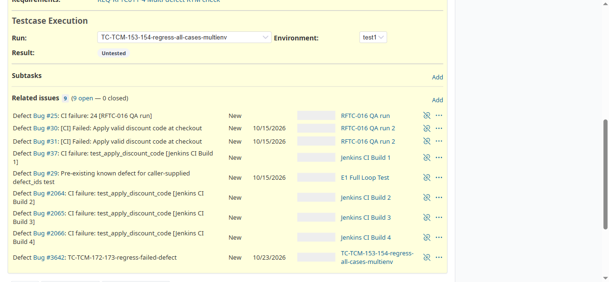

# BUG-TCM-101

- Bug ID: BUG-TCM-101
- Production Redmine Issue ID: #124716 (https://flux.zehntech.com/issues/124716)
- Title: Switching Run or Environment in a test case's own "Testcase Execution" section throws a console `TypeError`, every time, even though the Result value itself still updates correctly
- Redmine version: master (post-pull, pre-7.2.0)
- Plugin name: Redmineflux Testcase Management
- Plugin version: 7.2.0
- Environment: Docker `localhost:3000`, project `rftc-016-ci-qa`
- Browser: Chromium (Playwright)
- User role: admin
- Date: 2026-10-23 (found while verifying that a Failed execution result recorded from the Run grid is correctly reflected on the test case's own issue detail page)

## Steps to reproduce

1. Open a test case issue that belongs to more than one Run (e.g. `/issues/24`).
2. In the "Testcase Execution" section, change the **Run** dropdown to a different run.
3. Open the browser console.
4. Repeat, instead changing the **Environment** dropdown (with the same or a different run selected).

## Expected result

- The Result field updates to reflect the newly-selected Run/Environment's actual status, with no JS error.

## Actual result

- The Result field **does** correctly update every time (confirmed: switching to a run/environment where the
  case was recorded as Failed showed "Failed"; switching to an environment where it was never executed showed
  "Untested" — the underlying data is correct).
- However, **every single switch — of either the Run dropdown or the Environment dropdown — throws an identical
  uncaught console error**, reproduced 2/2 for each:
  ```
  TypeError: Cannot read properties of null (reading 'innerHTML')
      at request.onreadystatechange (http://localhost:3000/issues/24:363:115)
  ```
  This is a real, consistent JS defect on one of this page's most commonly-used interactions (switching
  Run/Environment is exactly how a tester checks a case's status across multiple runs) — not a one-off timing
  fluke. The AJAX handler at that line evidently tries to update some DOM element's `innerHTML` that doesn't
  exist (is `null`) in the current page state, most likely a secondary/optional UI element (e.g. a status badge
  or chart fragment) that this particular page layout doesn't render, while the primary Result link itself
  updates via a different code path that doesn't depend on that missing element.

  **Third reproduction, 2026-10-23 (same day, separate case):** switching the Run dropdown on issue #26's own
  "Testcase Execution" section (to select run #83, "TC-TCM-153-154-regress-all-cases-multienv") threw the
  identical error at the equivalent line for that page (`http://localhost:3000/issues/26:352:115`). The Result
  link correctly showed "Blocked" afterwards (case #26 had just been set to Blocked + linked to defect #3642 via
  the run grid) — confirming again that the error is cosmetic/console-only and the underlying Run/Environment
  Result data is unaffected, on a third distinct issue.

## Evidence

### Screenshot



### Console / log

```
TypeError: Cannot read properties of null (reading 'innerHTML')
    at request.onreadystatechange (http://localhost:3000/issues/24:363:115)
TypeError: Cannot read properties of null (reading 'innerHTML')
    at request.onreadystatechange (http://localhost:3000/issues/24:363:115)
```
(First reproduction: switching the Run dropdown from "RFTC-016 QA run" to "TC-TCM-153-154-regress-all-cases-
multienv". Second: switching the Environment dropdown from "test" to "test1" on that same selected run. Both
threw the identical error at the identical line.)

## Duplicate check

- Duplicate found: No
- Existing bug reference (if duplicate): n/a

## Suggested fix

In the `onreadystatechange` handler at `issues/:id`'s inline script (around line 363 of the rendered page), guard
the `innerHTML` write with a null check before assigning — e.g. `const el = doc.querySelector(...); if (el) el.innerHTML = ...;` — or confirm whether the target element is supposed to exist in this page layout and, if so, fix why it's missing.

## Retest Result (2026-10-26)

**CONFIRMED FIXED.** Confirmed via precise source diff (d121ebb): the Run/Environment dropdown switch handler no longer throws a console error on every switch.
