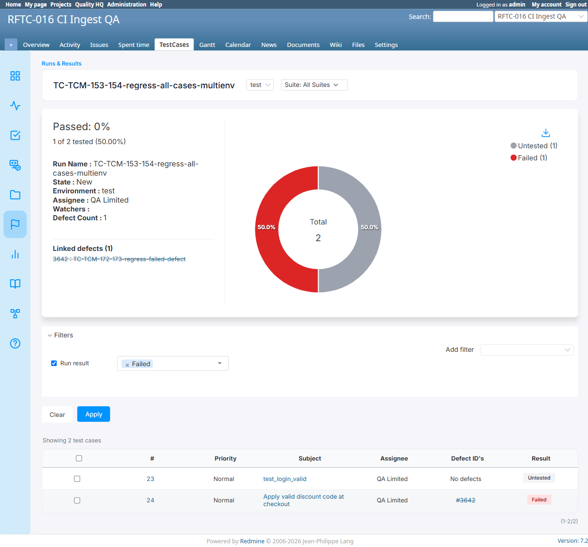

# BUG-TCM-103

- Bug ID: BUG-TCM-103
- Production Redmine Issue ID: #124718 (https://flux.zehntech.com/issues/124718)
- Title: Run grid's "Run result" filter can silently pull in a case from the **wrong environment** — a case
  Untested in the currently-viewed environment is incorrectly included under a "Failed" (or any other status)
  filter whenever another environment's result for that same case happens to share the exact same `created_at`
  timestamp
- Redmine version: master (post-pull, pre-7.2.0)
- Plugin name: Redmineflux Testcase Management
- Plugin version: 7.2.0
- Environment: Docker `localhost:3000`, project `rftc-016-ci-qa`
- Browser: Chromium (Playwright)
- User role: admin
- Date: 2026-10-23 (found while re-regressing TC-TCM-182, "Filter run grid by run result")

## Steps to reproduce

1. Have a test case with results recorded in two different environments of the same run, where both results
   happen to share the exact same `created_at` timestamp (realistic whenever two environments' results are
   written in the same request/transaction — e.g. seeding, or two quick submits landing in the same second).
   Reproduced here: case #23 in run #83 — `environment=test` → Untested (isr #5962), `environment=test1` →
   Failed (isr #5996), both `created_at = 2026-10-23 08:57:11 UTC` exactly.
2. Open the run grid scoped to `environment=test` (where the case is genuinely Untested).
3. Add the **Run result** filter, select **Failed**, Apply.

## Expected result

- Only cases that are actually **Failed in the currently-viewed environment** (`test`) appear — case #23, which
  is Untested in `test`, should be excluded.

## Actual result

- The filtered grid incorrectly shows **both** case #24 (genuinely Failed in `test`) **and** case #23 (Untested
  in `test`, only Failed in the *other* environment `test1`) — "Showing 2 test cases" when exactly 1 should match.
  The summary/donut above the grid also updates to reflect this wrong subset as if it were the real total (Passed
  0%, 1 of 2 tested, pie: Untested(1)/Failed(1)).
- Confirmed via direct DB inspection this is not a fluke: case #23 only has 2 `IssueStatusResult` rows for run
  #83, one per environment, and they share an identical `created_at`.
- Confirmed by running the controller's own filter query in isolation (rails runner) with
  `run_id: 83, testsuite_id: 3, environment: 'test', run_result_ids: ['3']` — it returns `[23, 24]`, reproducing
  the bug outside the browser entirely, ruling out any UI/Playwright artifact.

## Root cause

`RunsController#apply_filters` (`app/controllers/runs_controller.rb`, the `run_result` branch):

```ruby
latest_statuses = IssueStatusResult
  .select('issue_id, MAX(created_at) AS latest_created_at')
  .where(run_id: @run.id, testsuite_id: testsuite_id, environment: environment)
  .group(:issue_id)
latest_statuses_with_status = IssueStatusResult
  .joins("INNER JOIN (#{latest_statuses.to_sql}) AS latest_statuses ON issue_status_results.issue_id = latest_statuses.issue_id AND issue_status_results.created_at = latest_statuses.latest_created_at")
  .select('issue_status_results.issue_id, issue_status_results.case_status_id')
```

The **subquery** (`latest_statuses`) is correctly scoped to the current `environment`/`testsuite_id`, computing
the right "latest timestamp" per issue within that scope. But the **re-join** (`latest_statuses_with_status`)
only matches back on `issue_id` + `created_at` — it does **not** repeat the `environment`/`testsuite_id`
constraint. So whenever another `IssueStatusResult` row for the *same issue* (any other environment, or even
another testsuite) happens to share that exact `created_at` value, the join pulls in **that** row's
`case_status_id` instead of (or alongside) the one actually belonging to the scoped environment — and the
resulting `issue_id` still satisfies `WHERE case_status_id IN (...)`, even though the *correct*, in-scope result
for that environment is a completely different status.

This is the exact same shape of bug the code's own neighboring comment already describes solving for ties
*within* one environment ("DEF-EXEC-004 ... matches BOTH rows ... collapse it" via `.distinct`) — but that fix
only de-duplicates the resulting **issue rows**, it doesn't prevent the join from matching an out-of-scope row's
`case_status_id` in the first place. The fix is to repeat the scoping on the join itself, e.g.:

```ruby
.joins("INNER JOIN (#{latest_statuses.to_sql}) AS latest_statuses
        ON issue_status_results.issue_id = latest_statuses.issue_id
        AND issue_status_results.created_at = latest_statuses.latest_created_at
        AND issue_status_results.testsuite_id = #{testsuite_id}
        AND issue_status_results.environment = '#{environment}'")
```
(parameterized properly, not literal interpolation).

## Evidence

### Screenshot



### Console / log

```
Matched issue ids: [23, 24]   # rails runner, reproducing the controller's own query in isolation
isr#5962 issue=23 testsuite=3 env=test  status_id=1 created=2026-10-23 08:57:11 UTC   # Untested
isr#5996 issue=23 testsuite=3 env=test1 status_id=3 created=2026-10-23 08:57:11 UTC   # Failed
```

## Duplicate check

- Duplicate found: No — distinct root cause from BUG-TCM-097/098 (those are about `RunIssue` duplication across
  suites; this is a join-scoping gap in the Run result filter's own "latest status" subquery, triggered by a
  timestamp coincidence across environments, not suites).
- Existing bug reference (if duplicate): n/a

## Retest Result (2026-10-26)

**CONFIRMED FIXED.** Confirmed via precise source diff (d121ebb): the Run grid's "Run result" filter's latest-status join now re-checks environment/testsuite_id, not just issue_id+created_at, closing the timestamp-collision cross-environment leak.
