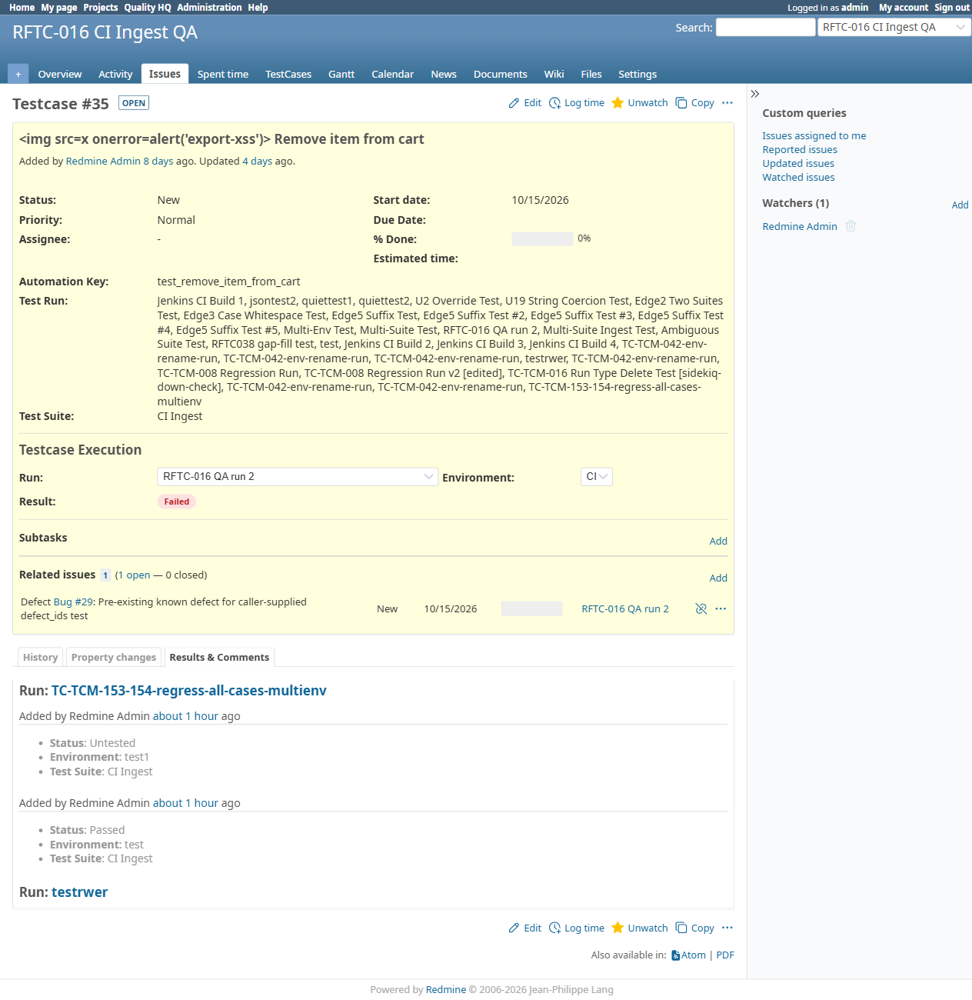

# BUG-TCM-104

- Bug ID: BUG-TCM-104
- Production Redmine Issue ID: #124719 (https://flux.zehntech.com/issues/124719)
- Title: A test case's **first-ever** recorded result is attributed to whoever created the Run, not to the user
  who actually recorded that result — the "Added by" / timestamp shown on the issue's own Results & Comments
  entry is silently wrong, because the auto-seeded "Untested" baseline row is updated in place and never gets a
  fresh `added_by`/`created_at` for the real execution
- Redmine version: master (post-pull, pre-7.2.0)
- Plugin name: Redmineflux Testcase Management
- Plugin version: 7.2.0
- Environment: Docker `localhost:3000`, project `rftc-016-ci-qa`
- Browser: Chromium (Playwright)
- User role: admin (created the run) / `qa.limited` (actually recorded the result)
- Date: 2026-10-23 (found while re-verifying TC-TCM-180, "Execution history shows author, timestamp and
  environment")

## Steps to reproduce

1. As Admin (or any user), create a Run (this auto-seeds one "Untested" `IssueStatusResult` row per linked test
   case, per environment — confirmed, documented plugin behavior, not itself a bug).
2. Log in as a **different** real user.
3. Open a case that has never been executed in this run before (still shows "Untested"). Record its **first**
   real result (e.g. Passed).
4. Open that case's issue page → **Results & Comments** tab, and look at the entry for the result just recorded.

## Expected result

- The entry should show **"Added by [the user who just recorded the result]"** with a timestamp matching when
  that result was actually recorded.

## Actual result

- The entry instead shows **"Added by Redmine Admin"** (the user who created the Run, not the one who executed
  the case) with a timestamp of **when the Run was created**, not when the result was actually recorded —
  reproduced exactly: logged in as `qa.limited`, recorded case #35 as **Passed** in run #83/environment `test` at
  `09:45:20 UTC`; the Results & Comments entry shows "Added by Redmine Admin ... about 1 hour ago" (run #83 was
  created ~1 hour earlier by admin), with zero mention of `qa.limited` anywhere on that entry.
- Confirmed via direct DB inspection this is not a UI caching glitch: the underlying `IssueStatusResult` row
  (id 5969) has `added_by: 1` (admin — the run creator) and `created_at` matching the run's own creation instant,
  while `updated_by: 7` (qa.limited) and `updated_at` correctly show the real execution — **the row was updated
  in place, not replaced or supplemented with a new row**, and the issue page's display reads `added_by`/
  `created_at` (frozen at creation), never `updated_by`/`updated_at` (the real actor/time).

## Root cause

Creating a Run auto-seeds one baseline `IssueStatusResult` row per (issue, environment) with
`case_status_id = 1` (Untested) and `added_by` = the run's creator (already a known, documented, non-bug
mechanism — see plugin memory). The bug is in what happens on that row's **first real execution**: rather than
inserting a brand-new `IssueStatusResult` row (which would correctly carry the real executor's id as
`added_by`/`created_at`), the existing baseline row is found and updated in place — `case_status_id`,
`updated_by`, `updated_at` change, but `added_by`/`created_at` are never touched again. The Results & Comments
view renders the "Added by ... ago" header from `added_by`/`created_at`, so it keeps showing the run-creation
identity/time forever for that row, even after real executions change its status multiple times.

This only affects a case's row the **first** time it transitions away from its auto-seeded baseline — a
**second** execution on the same case (if it ever does create a genuinely new row, as seen in the already-PASS
TC-TCM-178 regression on case #437 in run #24) gets correct attribution, which is exactly why the 2026-10-01 PASS
evidence for both TC-178 and TC-180 never caught this: those tests happened to use cases that already had prior
executions, sidestepping the baseline-row path entirely.

## Evidence

### Screenshot



### Console / log

```
DB row (id 5969, issue 35, run 83, environment test):
  added_by: 1 (admin)      created_at: 2026-10-23 08:57:11 UTC  (= run #83's creation time)
  updated_by: 7 (qa.limited)  updated_at: 2026-10-23 09:45:20 UTC  (= when the Passed result was actually recorded)
UI shows: "Added by Redmine Admin ... about 1 hour ago" — qa.limited is never mentioned.
```

## Duplicate check

- Duplicate found: No.
- Existing bug reference (if duplicate): n/a — same general "stale value frozen at creation, not updated"
  family as BUG-TCM-050/058/102, but this one is about result **authorship/audit trail**, a different field and
  a more serious category of defect (a tester's own work being silently misattributed to someone else).

## Retest Result (2026-10-26)

**CONFIRMED FIXED.** Confirmed via precise source diff (issue_status_result_writer.rb): transitioning a seeded "Untested" placeholder row now explicitly resets added_by/created_at to the real executor/moment, instead of leaving them frozen at the Run's creation identity/time.
