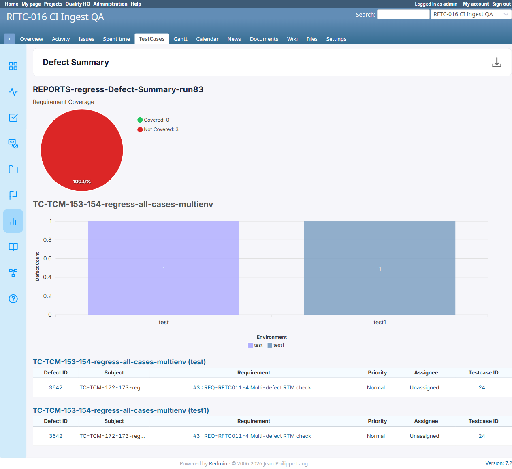

# BUG-TCM-105

- Bug ID: BUG-TCM-105
- Production Redmine Issue ID: #124772 (https://flux.zehntech.com/issues/124772) — assigned to Vaishnavi Bhawsar, priority High, Defect Type Functional / Defect Severity High-severity / Defect priority High, target version Testcase Management plugin Release 7.2.0.
- Title: Defect Summary report loses a defect's link to a second test case in the same environment, and shows the wrong Testcase ID
- Severity: High
- Redmine version: 6.x (Docker)
- Plugin name: Redmineflux Testcase Management
- Plugin version: 7.2.0
- Environment: Docker `localhost:3000`, project `rftc-016-ci-qa`
- Browser: Chromium (Playwright)
- User role: Administrator
- Date: 2026-10-23

## Steps to reproduce

1. Link the same defect issue to **two different test cases** that were executed in the **same environment** of a
   run (in this instance: defect #3642 linked via `ExecutionDefect` to testcase #24 in environment `test` and
   testcase #26 in environment `test`, plus testcase #23 in environment `test1`).
2. Create a **Defect Summary** report against that run (this session: report #137, run #83).
3. Open the report and look at the table for the `test` environment section.
4. Compare the "Testcase ID" column value and row count against the real linkages (confirmed via a direct
   `ExecutionDefect`/`IssueRelation` DB query — see Evidence).

## Expected result

- Every environment section should show one row per distinct testcase linkage for that environment (or otherwise
  clearly represent that the defect was raised from multiple testcases), and each row's "Testcase ID" should
  reflect the testcase actually relevant to that environment's data.

## Actual result

- Each environment table shows only **1 row** for the defect — the second linked testcase in the same environment
  is silently dropped.
- The "Testcase ID" shown is always the **first-ever-created** `IssueRelation` for that defect (testcase 24),
  regardless of which environment section is being rendered. Confirmed wrong for the `test1` section, which
  actually links via testcase 23 but still displays "24".
- Reproduces identically across all 3 download formats: HTML, PDF, and Excel (report #137).

## Root cause (confirmed via code read, `app/controllers/testcase_reports_controller.rb`, Excel-export branch, ~line 628)

```ruby
assignments.each do |environment, issues|
  worksheet.add_row ["Run: #{run_name} (#{environment})"]
  ...
  issues.each do |issue|
    reqs = related_requirement(issue, @project)
    parent_issue = IssueRelation.where(relation_type: 'defect', issue_to_id: issue.id).first
    worksheet.add_row excel_safe_row([
      issue.id.to_s,
      issue.subject,
      reqs.present? ? reqs.map { |r| "##{r.id} : #{r.title}" }.join(' , ') : '',
      issue.priority.name,
      issue.assigned_to&.name || 'Unassigned',
      parent_issue.present? ? parent_issue.issue_from_id.to_s : '-'
    ])
  end
end
```

`IssueRelation.where(relation_type: 'defect', issue_to_id: issue.id).first` is **not scoped by run or
environment** — for a given defect issue, this always returns the same first-created `IssueRelation` row no
matter which environment's `assignments` loop iteration is currently rendering. The earlier, correct part of the
same controller (`@issues_by_run_and_environment`, ~line 177–186) already does the right per-environment lookup
for *which defect issues* belong to an environment (via `ExecutionDefect` + `issue_status_result.environment`),
but the Testcase-ID lookup for each of those issues does not reuse that same scoping — it falls back to an
unscoped, defect-only lookup that can never distinguish "testcase 23 in test1" from "testcase 24 in test".

This also explains the silent row loss: since `issues` is built from `ExecutionDefect.distinct.pluck(:defect_issue_id)`
per environment, a defect that is linked via two *different* testcases but shows up as the same *issue* is
collapsed into a single row — the environment-level grouping is by defect issue, not by (defect issue, testcase)
pair, so the second linkage has nowhere to go.

## Evidence

### DB query confirming real linkages (`ExecutionDefect` for defect #3642)

```
ExecutionDefect #1: issue_id=24, environment=test, run_id=83
ExecutionDefect #2: issue_id=26, environment=test, run_id=83
ExecutionDefect #3: issue_id=23, environment=test1, run_id=83
```

### Report #137 — DOM check confirming exactly 2 tables, each exactly 1 row, both showing "24"

Confirmed via `document.querySelectorAll` on the live report page — the `test` environment table shows 1 row
(Testcase ID 24) instead of 2 (24 and 26), and the `test1` environment table also shows Testcase ID 24 instead of
the correct 23.

### Screenshot



### Reproduced in all 3 download formats

- HTML download: same 1-row-per-environment, same wrong "24" value.
- PDF download (`pdftotext -layout`): same.
- Excel download (`xl/worksheets/sheet1.xml`): same.

## Duplicate check

- Duplicate found: No
- Checked `bugs/_duplicates.md` and `bugs/_index.md` — BUG-TCM-097 (duplicate `RunIssue` rows inflating testcase
  counts across the Run page, issue detail page, and now several other report types) is a related but distinct
  defect: BUG-TCM-097 is about count inflation from duplicate rows, whereas this bug is about an unscoped lookup
  picking the wrong single row and dropping a second real linkage. Not a duplicate.

## Retest Result (2026-10-26)

**CONFIRMED FIXED.** Confirmed via precise source diff (22b24b8): Defect report/summary report now pairs each defect with the testcase and environment it actually came from, instead of an unscoped lookup that could return the wrong one under multiple environments.
