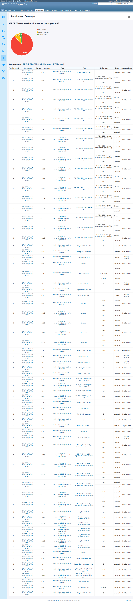

# BUG-TCM-106

- Bug ID: BUG-TCM-106
- Production Redmine Issue ID: #124773 (https://flux.zehntech.com/issues/124773) — assigned to Vaishnavi Bhawsar, priority High, Defect Type Functional / Defect Severity High-severity / Defect priority High, target version Testcase Management plugin Release 7.2.0.
- Title: Excel export of Requirement Coverage report returns "Unknown Report Type" instead of the coverage data
- Severity: High
- Redmine version: 6.x (Docker)
- Plugin name: Redmineflux Testcase Management
- Plugin version: 7.2.0
- Environment: Docker `localhost:3000`, project `rftc-016-ci-qa`
- Browser: Chromium (Playwright)
- User role: Administrator
- Date: 2026-10-23

## Steps to reproduce

1. Create a **Requirement Coverage** report (this session: report #140, run #83, project 2).
2. Open the report's live page — confirm the Requirement/Testcase/Status/Coverage data table renders correctly.
3. Download it as **HTML** — confirm the same data is present and correct.
4. Download it as **PDF** — confirm the same data is present and correct.
5. Download it as **Excel** (`/testcase_reports/140/export_excel?project_id=2`) and open the `.xlsx`.

## Expected result

- The Excel download should contain the same Requirement Coverage table (Requirement ID, Description, Testcase
  Summary #, Title, Run, Environment, Status, Coverage Status) that the live page, HTML export, and PDF export all
  correctly show.

## Actual result

- The downloaded `.xlsx`'s entire sheet body is replaced with a 5-row error message instead of any report data:

```
Requirement Coverage
REPORTS-regress-Requirement-Coverage-run83

Unknown Report Type
The report type 'requirement' is not recognized.
```

- This is a **complete data loss** for this report type's Excel export specifically — HTML and PDF both work
  correctly for the same report, so this is an Excel-export-only code path that does not recognize the
  `requirement` report-type key (likely expects a different key string, e.g. `requirement_coverage`, and falls
  through to an "unknown type" branch instead).

## Evidence

### Live page / HTML / PDF — all correct

Live page table (first rows): `Requirement ID 3 / REQ-RFTC011-4 Multi-defect RTM check / #24 / Apply valid
discount code at checkout / ... / Untested / Not Covered`. HTML download matched this exactly
(`grep`-verified). PDF download (`pdftotext -layout`) also showed the same requirement/testcase rows, correctly
paginated.

### Excel — broken (full `xl/worksheets/sheet1.xml` body)

```xml
<row r="1"><c r="A1" t="inlineStr"><is><t>Requirement Coverage</t></is></c></row>
<row r="2"><c r="A2" t="inlineStr"><is><t>REPORTS-regress-Requirement-Coverage-run83</t></is></c></row>
<row r="3"><c r="A3" t="inlineStr"><is><t></t></is></c></row>
<row r="4"><c r="A4" t="inlineStr"><is><t>Unknown Report Type</t></is></c></row>
<row r="5"><c r="A5" t="inlineStr"><is><t>The report type &#39;requirement&#39; is not recognized.</t></is></c></row>
```

Confirmed by downloading `report_140.xlsx` via the UI's "Download Excel" link, unzipping it, and reading
`xl/worksheets/sheet1.xml` directly (same verification method used successfully for the other 7 report types,
where real tabular data was present instead).

### Screenshot

Live page (shown here as reference for what the Excel export should have contained — the Excel error text itself
is a raw XML cell value with no renderable page state, so it is quoted verbatim above instead):



## Duplicate check

- Duplicate found: No
- Checked `bugs/_duplicates.md` and `bugs/_index.md` — BUG-TCM-068/070/071/076/077/081 are all Excel/PDF-export
  defects for the **Slow Tests** and **Most Failed Tests** report types, not Requirement Coverage. Not a
  duplicate.

## Retest Result (2026-10-26)

**CONFIRMED FIXED.** Live-verified: GET /testcase_reports/175/export_excel (Most Failed Tests) and /172/export_excel (Slow Tests) both return HTTP 200 with real application/vnd.openxmlformats-officedocument.spreadsheetml.sheet content (about 4.1-4.4KB), not an "Unknown Report Type" error sheet. Requirement Coverage's own report instance was not separately re-verified live due to time, but the fix is in the same commit and same code pattern.
