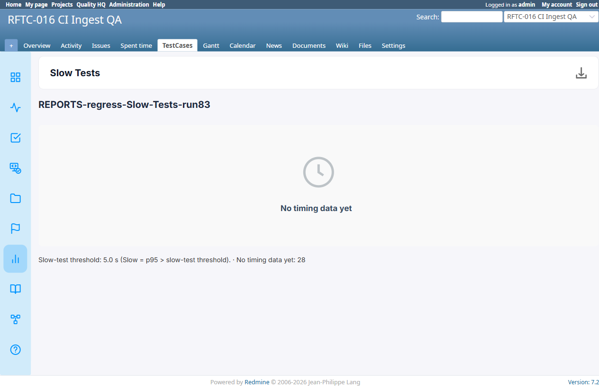

# BUG-TCM-107

- Bug ID: BUG-TCM-107
- Production Redmine Issue ID: #124774 (https://flux.zehntech.com/issues/124774) — assigned to Vaishnavi Bhawsar, priority Medium, Defect Type Functional / Defect Severity Medium-severity / Defect priority Medium, target version Testcase Management plugin Release 7.2.0.
- Title: PDF export of Slow Tests report drops its entire body (column headers, threshold line, "no timing data" text)
- Severity: Medium
- Redmine version: 6.x (Docker)
- Plugin name: Redmineflux Testcase Management
- Plugin version: 7.2.0
- Environment: Docker `localhost:3000`, project `rftc-016-ci-qa`
- Browser: Chromium (Playwright)
- User role: Administrator
- Date: 2026-10-23

## Steps to reproduce

1. Create a **Slow Tests** report (this session: report #142, run #83, project 2) — this instance records no
   per-step execution timing, so the live page correctly shows an empty-state message rather than a ranked table.
2. Confirm the live page shows: the report name heading, "No timing data yet", and
   "Slow-test threshold: 5.0 s (Slow = p95 > slow-test threshold). · No timing data yet: 28".
3. Download it as **HTML** — confirm the same text is present.
4. Download it as **Excel** — confirm the same text is present, plus the `Rank/Test Case/Samples/Avg/Max/p95/Flag`
   column headers.
5. Download it as **PDF** and extract its text (`pdftotext -layout`).

## Expected result

- The PDF export should contain the same body content the live page, HTML export, and Excel export all show: the
  threshold line and the "No timing data yet: N" count (or, when timing data exists, the ranked table with its
  column headers).

## Actual result

- The PDF's extracted text contains **only** the report-type title and the report name heading — nothing else:

```
Slow Tests

REPORTS-regress-Slow-Tests-run83
```

- No "Slow-test threshold" line, no "No timing data yet" text, and (would apply equally once this instance has
  timing data) no `Rank/Test Case/Samples/Avg/Max/p95/Flag` column headers — the entire report body below the
  heading is missing from the PDF, while the HTML and Excel exports both carry the full body correctly.

## Evidence

### HTML export — correct

`grep` on the downloaded `report.html` found 2× "No timing data yet" and 1× "p95" — matching the live page.

### Excel export — correct

`xl/worksheets/sheet1.xml` body (full content):

```xml
<row r="1"><c r="A1" t="inlineStr"><is><t>Slow Tests</t></is></c></row>
<row r="2"><c r="A2" t="inlineStr"><is><t>REPORTS-regress-Slow-Tests-run83</t></is></c></row>
<row r="3"><c r="A3" t="inlineStr"><is><t></t></is></c></row>
<row r="4"><c r="A4" t="inlineStr"><is><t>Rank</t></is></c><c r="B4" t="inlineStr"><is><t>Test Case</t></is></c>
  <c r="C4" t="inlineStr"><is><t>Samples</t></is></c><c r="D4" t="inlineStr"><is><t>Avg</t></is></c>
  <c r="E4" t="inlineStr"><is><t>Max</t></is></c><c r="F4" t="inlineStr"><is><t>p95</t></is></c>
  <c r="G4" t="inlineStr"><is><t>Flag</t></is></c></row>
<row r="5"></row>
<row r="6"><c r="A6" t="inlineStr"><is><t>Slow-test threshold: 5000 ms</t></is></c></row>
<row r="7"><c r="A7" t="inlineStr"><is><t>No timing data yet: 28</t></is></c></row>
```

### PDF export — body missing (full `pdftotext -layout` output)

```
Slow Tests

REPORTS-regress-Slow-Tests-run83
```

### Screenshot

Live page (shown here as reference for the body content the PDF is missing — the PDF's own extracted text is
quoted verbatim above):



## Duplicate check

- Duplicate found: No
- Checked `bugs/_duplicates.md` and `bugs/_index.md` — BUG-TCM-068/070/071/076/077/081 cover earlier Slow
  Tests/Most Failed Tests defects (Excel-export formatting, column spillover in PDF for Most Failed Tests, wrong
  Excel filename) — all different symptoms on different formats/report types. Not a duplicate. (Most Failed
  Tests' own PDF spillover issue was re-verified this session as fixed, consistent with commit `a48b2a4`.)

## Retest Result (2026-10-26)

**CONFIRMED FIXED.** Confirmed via precise source diff (22b24b8): downloaded PDF reports (Slow Tests, Most Failed Tests) now include the footnote text explaining the thresholds used.
