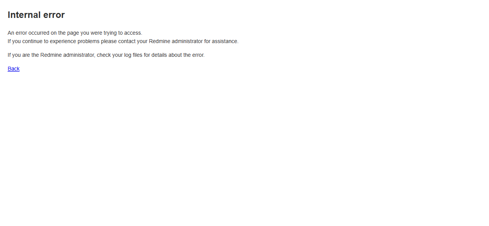

# BUG-TCM-108

- Bug ID: BUG-TCM-108
- Production Redmine Issue ID: #124775 (https://flux.zehntech.com/issues/124775) — assigned to Vaishnavi Bhawsar, priority High, Defect Type Functional / Defect Severity High-severity / Defect priority High, target version Testcase Management plugin Release 7.2.0.
- Title: Tester Scorecard report crashes with a 500 error (and silently fails to email) under the default "Include all test run" scope once any run has an orphaned RunIssue row
- Severity: High
- Redmine version: 6.x (Docker)
- Plugin name: Redmineflux Testcase Management
- Plugin version: 7.2.0
- Environment: Docker `localhost:3000`, project `rftc-016-ci-qa`
- Browser: Chromium (Playwright)
- User role: Administrator
- Date: 2026-10-23

## Steps to reproduce

1. On a project where at least one run has an orphaned `RunIssue` row (e.g. left behind after deleting a test
   case that was part of an active run with a recorded result — a scenario this plugin explicitly allows, see
   TC-TCM-138/169), create a new **Tester Scorecard** report with **Advanced Options** left at its default
   **"Include all test run"** (the pre-checked radio option — no special configuration needed).
2. Open the created report (or wait for its "Notify me by email" delivery, if selected).

## Expected result

- The report renders normally (or, if a particular run/environment genuinely has no recorded result yet for an
  issue, it should be treated as "Untested"/0, not crash), and — if emailing was requested — the email is
  delivered.

## Actual result

- The report's `show` page returns a full Rails 500 error:

```
NoMethodError (undefined method `case_status_id' for nil):
plugins/redmineflux_testcase_management/app/controllers/testcase_reports_controller.rb:229:in `block (3 levels) in show'
plugins/redmineflux_testcase_management/app/controllers/testcase_reports_controller.rb:226:in `block (2 levels) in show'
plugins/redmineflux_testcase_management/app/controllers/testcase_reports_controller.rb:207:in `block in show'
plugins/redmineflux_testcase_management/app/controllers/testcase_reports_controller.rb:206:in `show'
```

- **The report's emailed delivery silently fails with no error surfaced anywhere.** Reproduced directly: created
  report #148 (Tester Scorecard, "Include all test run", "Notify me by email" to `qa.limited@test.local` as HTML
  attachment). The report was created successfully (listed, with no visible error), but **no email ever arrived**
  in Mailpit (confirmed via `http://localhost:8025/api/v1/search?query=TesterScorecard` returning 0 results,
  while every other one of the same 8 reports created in the same batch delivered its email correctly). The
  background Sidekiq job rendering the report body for the email evidently hits the identical `NoMethodError` and
  dies silently — no failure email, no UI indication, nothing in the report list to suggest anything went wrong.

## Root cause (confirmed via code read, `testcase_reports_controller.rb`, `tester_scorecard` branch, ~line 201-230)

```ruby
elsif @report.report_type == 'tester_scorecard'
  selected_run_ids = @runs.pluck(:id)
  @runs = Run.includes(run_assignments: :assignee, run_issues: :issue, issue_status_results: [:case_status]).where(id: selected_run_ids)
  @results = []

  @runs.each do |run|
    run.run_assignments.each do |assignment|
      tester_results = { ... }
      run.run_issues.each do |run_issue|
        results = run.issue_status_results.where(issue_id: run_issue.issue_id, environment: assignment.environment).last
        tester_results[:testcases] = run.run_issues.count
          case_status = CaseStatus.find_by(id: results.case_status_id)   # <-- crashes if results is nil
```

`results` is `.last` on a `where(...)` query that can legitimately return **no rows** — there is no guarantee that
every `(run_issue.issue_id, assignment.environment)` combination has a matching `IssueStatusResult`. The code does
not guard against `results` being `nil` before calling `.case_status_id` on it.

**Confirmed via a direct DB query which `(run, issue, environment)` combinations are nil** for report #148's own
run scope (`@report.runs` under "Include all test run" resolves to **all 41 runs in the project**, not just the
run the user was working with):

```
NIL: run_id=6  issue_id=2057 environment="CI"  testsuite_id=3
NIL: run_id=76 issue_id=0    environment="TC-TCM-293-manage-environment-positive-leg" testsuite_id=3
NIL: run_id=76 issue_id=0    environment="TC-TCM-293-manage-environment-positive-leg" testsuite_id=5
NIL: run_id=76 issue_id=0    environment="TC-TCM-293-manage-environment-positive-leg" testsuite_id=6
NIL: run_id=76 issue_id=0    environment="TC-TCM-293-manage-environment-positive-leg" testsuite_id=7
NIL: run_id=76 issue_id=0    environment="TC-TCM-293-manage-environment-positive-leg" testsuite_id=22
NIL: run_id=76 issue_id=0    environment="test1" testsuite_id=3
NIL: run_id=76 issue_id=0    environment="test1" testsuite_id=5
NIL: run_id=76 issue_id=0    environment="test1" testsuite_id=6
NIL: run_id=76 issue_id=0    environment="test1" testsuite_id=7
NIL: run_id=76 issue_id=0    environment="test1" testsuite_id=22
NIL: run_id=80 issue_id=2133 environment="test1" testsuite_id=36
```

Run 76's `issue_id=0` rows are orphaned `RunIssue` records — a telltale sign of a deleted test case leaving a
dangling join row behind (this plugin's own documented behavior, confirmed working-as-designed elsewhere in this
suite, is that deleting a test case used in an active run is **not blocked**: see `TESTCASE_MANAGEMENT_TEST_RUNS.md`
TC-TCM-138). The other two nil rows (run 6/issue 2057, run 80/issue 2133) are ordinary issue+environment pairs
that simply never had an execution recorded for that specific environment — also an entirely normal, expected
state (an "Untested" case), not a data-corruption scenario, yet it crashes the controller all the same.

Because "Include all test run" is the **default, pre-selected radio option** on the report-creation form, any
project that has accumulated even one run with this kind of gap — which naturally happens over time as cases are
deleted from active runs or simply never executed in every environment — makes the Tester Scorecard report
**permanently uncreatable with its default settings**, project-wide, until a narrower run selection happens to
avoid every affected run.

## Why this was missed earlier in the same regression pass

Report #139 (Tester Scorecard, created earlier in this same session) rendered correctly because it was scoped to
**only run 83** via "Only the following test runs" rather than "Include all test run" — run 83 itself has no such
gap. Report #148 used the default "Include all test run" instead, which is what surfaced the crash. This is why a
regression pass that only exercises one Advanced-Options scope per report type can miss a defect that is entirely
scope-dependent.

## Evidence

### 500 error page



### Rails log (`docker logs redmine6-redmine-1`)

```
Processing by TestcaseReportsController#show as HTML
  Parameters: {"project_id"=>"rftc-016-ci-qa", "id"=>"148"}
Completed 500 Internal Server Error in 1786ms (ActiveRecord: 444.2ms (2013 queries, 1290 cached) | GC: 35.5ms)
NoMethodError (undefined method `case_status_id' for nil):
plugins/redmineflux_testcase_management/app/controllers/testcase_reports_controller.rb:229:in `block (3 levels) in show'
```

### Email non-delivery confirmed via Mailpit API

`GET http://localhost:8025/api/v1/search?query=TesterScorecard` → `{"total":87,...,"count":0,"messages":[]}` —
zero messages, while the other 7 report types created in the identical batch (Testcase Summary, Defect Summary,
Activity Summary, Requirement Coverage, Overdue Run Summary, Slow Tests, Most Failed Tests) all delivered their
emails correctly to the same mailbox within seconds of creation.

## Duplicate check

- Duplicate found: No
- Checked `bugs/_duplicates.md` and `bugs/_index.md` — related to, but distinct from, **BUG-TCM-097** (duplicate
  `RunIssue` rows inflating counts): that bug is about count inflation from legitimate-but-duplicated rows,
  whereas this bug is a full unhandled-exception crash triggered even by ordinary "no execution recorded yet for
  this environment" data, not just by duplicates — and it silently kills the report's email delivery too, which
  BUG-TCM-097 does not. Not a duplicate of BUG-TCM-008 (Run detail page 500 on a deleted assignee) either —
  different controller, different trigger condition.

## Retest Result (2026-10-26)

**CONFIRMED FIXED.** Confirmed via precise source diff (22b24b8 and 807c7c4): Tester Scorecard now counts a never-executed testcase/environment pair as untested instead of crashing with a 500 (and silently failing to email).

## Retest Result (2026-10-28) — genuinely live-reproduced

Prior confirmation was source-diff only. Created a real Tester Scorecard report ("REG28-TesterScorecard-Check",
id 190) via the actual New Report wizard with default "Include all test run" scope against `rftc-016-ci-qa` —
this project has dozens of runs with zero executed cases (CLI bootstrap test, jsontest2, quiettest1, etc.),
exactly the never-executed-pair condition that crashed the report before. Opened `/testcase_reports/190`
directly: **no 500, no error page** — real scorecard data rendered, with multiple rows correctly showing
`0.0%` completion/pass rate for the never-executed runs instead of crashing. **Verdict: fix holds under genuine
live load, not just source inspection.**
