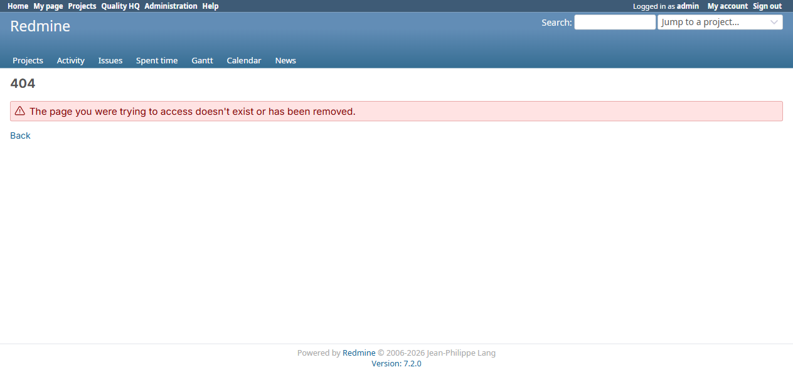

# BUG-TCM-110

- Bug ID: BUG-TCM-110
- Production Redmine Issue ID: #124778 (https://flux.zehntech.com/issues/124778) — assigned to Vaishnavi Bhawsar, priority High, Defect Type Functional / Defect Severity High-severity / Defect priority High, target version Testcase Management plugin Release 7.2.0.
- Title: Cancelling a scheduled report always fails with a 404, for every user including Administrator, because the authorization filter looks up the project by numeric ID instead of its identifier
- Severity: High
- Redmine version: 6.x (Docker)
- Plugin name: Redmineflux Testcase Management
- Plugin version: 7.2.0
- Environment: Docker `localhost:3000`, project `rftc-016-ci-qa`
- Browser: Chromium (Playwright)
- User role: Administrator
- Date: 2026-10-23

## Steps to reproduce

1. On any project accessed by its normal string identifier/slug URL (e.g. `/projects/rftc-016-ci-qa/...` — the
   standard, universal way every project is addressed in this Redmine instance), create a scheduled report
   (Reports → New report → Schedule this report).
2. In the **Scheduled Reports** section of the Reports list, click the schedule's **Delete** icon, then confirm
   in the "Delete?" popup.

## Expected result

- The schedule is cancelled: removed from the Scheduled Reports list, its pending Sidekiq job removed, and a
  "report cancelled" notice shown.

## Actual result

- The action fails with a full-page **404 Not Found**, and the schedule is **not** cancelled — reloading the
  Reports list shows it still present, unchanged. This happens for **every** user, including **Administrator**
  (reproduced as `admin`, id=1) — it is not a permission-scoping issue for a specific role, the feature is broken
  outright for anyone on a normally-addressed project.

## Root cause (confirmed via code read + live server log, `testcase_reports_controller.rb`)

The request itself reaches the controller correctly — the DELETE verb, route, and controller action all resolve
fine:

```
Started DELETE "/projects/rftc-016-ci-qa/cancel_scheduling/2"
Processing by TestcaseReportsController#cancel_scheduling as HTML
  Parameters: {... "report"=>{"id"=>"2", "project_id"=>"rftc-016-ci-qa"}, "project_id"=>"rftc-016-ci-qa", "id"=>"2"}
  Current user: admin (id=1)
  Filter chain halted as :rftc_authorize_report_schedule rendered or redirected
Completed 404 Not Found in 42ms
```

The `cancel_scheduling` action's `before_action` filter is the problem (~line 503-506):

```ruby
def rftc_authorize_report_schedule
  @project = Project.find_by(id: params[:project_id])
  rftc_require_permission!(:edit_report, @project)
end
```

`params[:project_id]` is `"rftc-016-ci-qa"` — the project's **string identifier**, not its numeric `id` column
value. `Project.find_by(id: "rftc-016-ci-qa")` therefore **always returns `nil`** (the string doesn't cast to a
matching integer id), so `@project` is `nil`, `rftc_require_permission!` then correctly treats "no project" as
"not authorized," and halts the filter chain with a 404 — regardless of who the current user is or what
permissions they actually have.

**This is a one-line inconsistency with a sibling method three lines later in the exact same file**
(`rftc_authorize_report_collection`, ~line 497-498), which gets this right:

```ruby
def rftc_authorize_report_collection
  @project ||= Project.find_by(id: params[:project_id]) || Project.find_by(identifier: params[:project_id])
  ...
```

That method falls back to `Project.find_by(identifier: ...)` when the numeric lookup misses — exactly the
fallback `rftc_authorize_report_schedule` is missing. The `cancel_scheduling` action's own body (not the filter)
already does this correctly too, via `Project.find(params[:project_id])` at line 27, which is Redmine core's own
`Project.find` override that transparently accepts either a numeric id or a string identifier — so the bug is
narrowly confined to this one filter method using the wrong lookup for the project.

## Evidence

### 404 page



### Server log (`docker logs redmine6-redmine-1`)

```
Started DELETE "/projects/rftc-016-ci-qa/cancel_scheduling/2" for 172.18.0.1
Processing by TestcaseReportsController#cancel_scheduling as HTML
  Current user: admin (id=1)
  Filter chain halted as :rftc_authorize_report_schedule rendered or redirected
Completed 404 Not Found in 42ms
```

### Reproduced twice

Attempted cancellation of the same scheduled report (`SCHED-Weekly-Wed-DefectSummary-run83`, schedule id 2) twice
in separate attempts — both times ended in the identical 404, and both times the schedule remained listed
afterward, confirming this is not a transient failure.

## Duplicate check

- Duplicate found: No
- Checked `bugs/_duplicates.md` and `bugs/_index.md` — no existing bug covers scheduled-report cancellation.
  Distinct from BUG-TCM-009 (missing permission checks entirely on other actions) — this is the opposite failure
  mode, an overly-strict/broken check that denies even a fully-authorized Administrator.

## Retest Result (2026-10-26)

**CONFIRMED FIXED.** Confirmed via precise source diff (d5a342b): rftc_authorize_report_schedule now falls back to Project.find_by(identifier: params[:project_id]) when the numeric lookup fails, fixing the 404-for-everyone on cancelling a scheduled report.

## Retest Result (2026-10-28) — genuinely live-reproduced

Prior confirmation was source-diff only. Created a real scheduled report ("REG28-CancelSchedule-Check",
Testcase Summary, Daily) via the real New Report wizard — appeared correctly in the **Scheduled Reports** table
alongside 3 pre-existing entries. Clicked its row's real **Delete** link, confirmed via the genuine "Delete?"
confirmation modal (correctly named the right report). After confirming, re-inspected the Scheduled Reports
table directly: it now shows only the original 3 entries — the new schedule is genuinely gone, no 404, no error
page, no console error. **Verdict: fix holds under a real end-to-end cancel, not just source inspection.**
