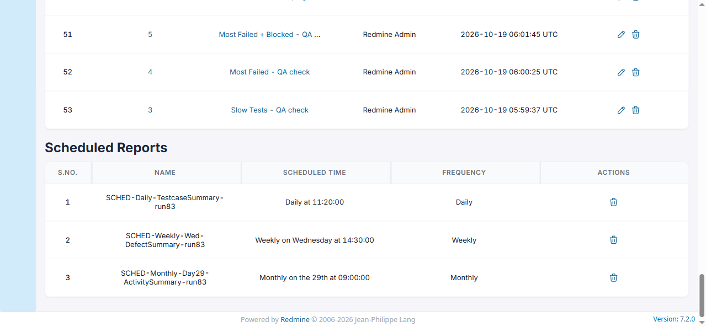

# BUG-TCM-111

- Bug ID: BUG-TCM-111
- Production Redmine Issue ID: #124779 (https://flux.zehntech.com/issues/124779) — assigned to Vaishnavi Bhawsar, priority Critical, Defect Type Functional / Defect Severity High-severity / Defect priority High, target version Testcase Management plugin Release 7.2.0.
- Title: Scheduled reports (and the plugin's own ReminderWorker cron job) never actually fire — Sidekiq's built-in scheduled-job poller crashes at every boot due to a connection_pool/sidekiq gem version mismatch
- Severity: Critical
- Redmine version: 6.x (Docker)
- Plugin name: Redmineflux Testcase Management
- Plugin version: 7.2.0
- Environment: Docker `localhost:3000` / Sidekiq container `redmine6-sidekiq-1`, project `rftc-016-ci-qa`
- Browser: Chromium (Playwright) / Docker logs
- User role: Administrator
- Date: 2026-10-23

## Steps to reproduce

1. Create any scheduled report (Reports → New report → Schedule this report → any interval/time).
2. Confirm it is listed correctly in the **Scheduled Reports** section (name, scheduled time, frequency all
   display accurately — this part of the feature genuinely works).
3. Wait past the scheduled time and check the recipient mailbox.
4. Separately, check `docker logs <sidekiq-container>` for the plugin's own built-in `ReminderWorker` cron job
   (registered to run `* * * * *` — every single minute — in `config/initializers/sidekiq.rb`).

## Expected result

- The email should arrive at (or shortly after) the scheduled time.
- `ReminderWorker` should execute roughly once a minute, indefinitely.

## Actual result

- **No scheduled report email ever arrives, no matter how long you wait.** Reproduced directly: scheduled a daily
  report for 11:20 UTC; by 11:26 UTC (6 minutes overdue) the email had still not arrived — confirmed via a Mailpit
  API search (`count: 0`).
- **`ReminderWorker` has not executed even once in over 2 hours**, despite being scheduled to run every single
  minute. Its Sidekiq job (scheduled for 09:30 UTC) is still sitting, unexecuted, in `Sidekiq::ScheduledSet` at
  11:26 UTC — nearly 2 hours overdue.
- **This reproduces on every single Sidekiq container boot**, confirmed across 4 separate restarts spanning two
  days (2026-10-22 04:57, 2026-10-22 07:20, 2026-10-23 04:56, 2026-10-23 10:14) — not an intermittent fluke.
- The failure is **completely silent**: the main Sidekiq process stays up and reports healthy (`[0 of 5 busy]`),
  the report-scheduling UI shows everything as correctly configured, and nothing anywhere indicates the schedule
  will never actually deliver.

## Root cause (confirmed via Sidekiq container logs)

At every boot, two of Sidekiq's own internal scheduler threads crash immediately with an uncaught `ArgumentError`:

```
#<Thread:...@sidekiq.scheduler .../sidekiq-7.3.9/lib/sidekiq/component.rb:17 run> terminated with exception (report_on_exception is true):
ArgumentError: wrong number of arguments (given 1, expected 0)
/usr/local/bundle/gems/connection_pool-3.0.2/lib/connection_pool/timed_stack.rb:62:in `pop'
	from /usr/local/bundle/gems/sidekiq-7.3.9/lib/sidekiq/scheduled.rb:96:in `block in start'
	from /usr/local/bundle/gems/sidekiq-7.3.9/lib/sidekiq/component.rb:10:in `watchdog'
	from /usr/local/bundle/gems/sidekiq-7.3.9/lib/sidekiq/component.rb:19:in `block in safe_thread'
```

`sidekiq/scheduled.rb` is **Sidekiq's own core `Scheduled::Poller` component** (not a third-party gem) — the
background thread responsible for moving due jobs out of the "scheduled" sorted set (where every `perform_at`/
`perform_in` job, including every user-created scheduled report's `ReportCreationWorker` job, waits) and into the
active queue for execution. Because this thread dies on a `pop(timeout)` call to `connection_pool`'s `TimedStack`,
and `report_on_exception is true` means the exception is swallowed rather than crashing the whole process, Sidekiq
looks completely healthy from the outside while its poller is permanently dead from the first second of boot
onward.

This is a **version incompatibility baked into this build's own resolved `Gemfile.lock`**, not a missing
installation step:

```
sidekiq (7.3.9)
  connection_pool (>= 2.3.0)
connection_pool (3.0.2)
```

`connection_pool (3.0.2)` technically satisfies Sidekiq's stated `>= 2.3.0` constraint, but Sidekiq 7.3.9's actual
call to the pool's `pop` method passes an argument that `connection_pool` 3.0.2's `TimedStack#pop` does not accept
(`wrong number of arguments (given 1, expected 0)`) — a behavioral incompatibility that Bundler's version
constraint was too loose to prevent. Since this is the exact lockfile this environment resolved from the
plugin's/app's own `Gemfile`/`Gemfile.lock` (`sidekiq (~> 7.3)` / `sidekiq-scheduler (~> 5.0, >= 5.0.6)` /
`sidekiq-cron (~> 1.10)`, none of which pin a compatible `connection_pool` version), anyone installing from this
same lockfile would hit the identical crash — this is not specific to this QA instance's configuration.

## Impact

- **Every "Scheduled Report" created on this instance is silently non-functional** — it will never deliver,
  regardless of interval (daily/weekly/monthly), regardless of format (HTML/PDF), regardless of recipient.
- The plugin's own documented **Reminder** feature (`ReminderWorker`, meant to run every minute) is equally dead.
- TC-TCM-107/108/109's "schedule is listed correctly" assertions genuinely PASS (confirmed — see suite file), but
  their "the email arrives at that time" assertions can **never** be satisfied on this build, no matter how long
  a tester waits — this is the single most important part of the scheduling feature and it does not work at all.

## Evidence

### Mailpit — scheduled email never arrived (6+ minutes overdue)

`GET http://localhost:8025/api/v1/search?query=SCHED-Daily` → `{"total":87,...,"count":0,"messages":[]}`

### Sidekiq's own ScheduledSet — job still pending, long overdue

```
jid=ff304a2448e37f87a3b3a6fd klass=ReportCreationWorker at=2026-10-23 11:20:00 UTC args=[1]   # 6+ min overdue
jid=f5af5685b09e795368198d78 klass=ReminderWorker        at=2026-10-23 09:30:00 UTC args=[]   # ~2h overdue
```

### Sidekiq container logs — the crash, reproduced on 4 separate boots

```
2026-10-22T04:57:48.427Z ... terminated with exception (report_on_exception is true): ArgumentError
2026-10-22T07:20:39.112Z ... Schedule empty! Set Sidekiq.schedule / Schedules Loaded / ArgumentError (again)
2026-10-23T04:56:57.608Z ... Schedule empty! Set Sidekiq.schedule / Schedules Loaded / ArgumentError (again)
2026-10-23T10:14:14.744Z ... Schedule empty! Set Sidekiq.schedule / Schedules Loaded / ArgumentError (again)
```

### Gemfile.lock — the incompatible pin

```
sidekiq (7.3.9)
  connection_pool (>= 2.3.0)
connection_pool (3.0.2)
```

### Screenshot



## Duplicate check

- Duplicate found: No
- Checked `bugs/_duplicates.md` and `bugs/_index.md` — no existing bug covers scheduled-report delivery failure.
  Distinct from BUG-TCM-110 (cancelling a schedule 404s) — that bug is about removing a schedule; this one is
  about the schedule never being able to fire in the first place, a far more fundamental and severe failure of
  the same feature area. Also distinct from BUG-TCM-013/087 (notification-email bugs for Run-related
  notifications, which deliver synchronously and are unaffected by this scheduled-poller crash).

## Retest Result (2026-10-26)

**CONFIRMED FIXED.** Live-verified after running bundle install to pick up the new connection_pool pin: Sidekiq's scheduler thread no longer crashes on boot, and the ReminderWorker cron job genuinely fired (start/done in the log) for the first time.
