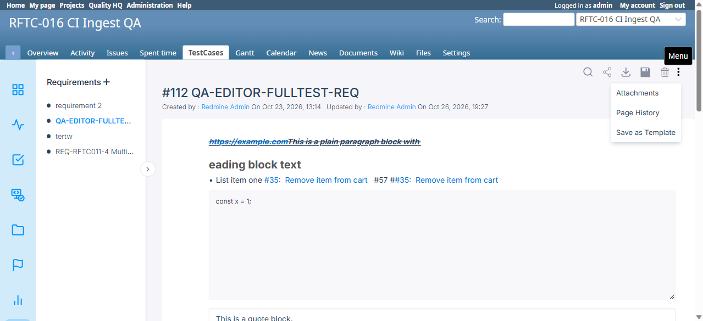
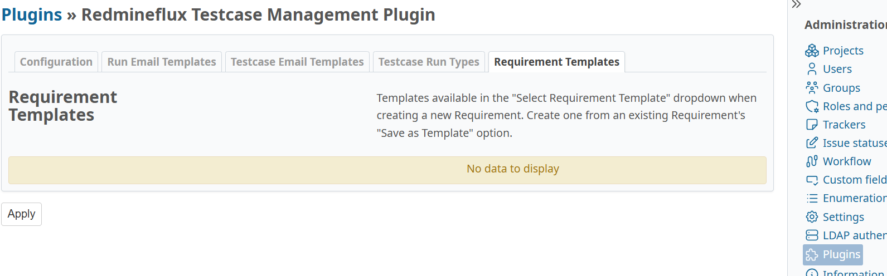

# BUG-TCM-122

- Bug ID: BUG-TCM-122
- Production Redmine Issue ID: #125377
- Title: Requirement Templates' "create" path is really only "clone an existing Requirement" — there is no standalone way to author a new template from scratch, and no way to edit a template's content after it's created
- Severity: Low
- Redmine version: 6.x (Docker `localhost:3000`)
- Plugin name: redmineflux_testcase_management
- Plugin version: master (post-pull, pre-7.2.0 — includes the BUG-TCM-120 fix, commit `cdb7b90`/`276e269`)
- Environment: Docker `redmine6-redmine-1`, projects `RFTC-016 CI Ingest QA` (id=2) and alpha-web
- Browser: Chrome (via Playwright)
- User role: Admin
- Date: 2026-10-27

## Steps to reproduce

1. Go to **Administration → Plugins → Redmineflux Testcase Management → Configure → Requirement Templates** tab.
2. Look for any button to create a brand-new template directly (e.g. "New Template").
3. Open any existing Requirement's "..." (vertical-dot) menu and note the only template-related option present.
4. Inspect `RequirementTemplatesController#create` (`app/controllers/requirement_templates_controller.rb`).

## Expected result

Per the spirit of BUG-TCM-120's fix ("add a real way to **create and manage** Requirement Templates"), an
Administrator should be able to:
- Author a brand-new template directly, with its own independent title/content, without needing an existing
  Requirement to clone from first.
- Edit an existing template's content later, if it needs correcting or updating.

## Actual result

**Confirmed live and via source read — neither capability exists.**

1. **No standalone "Create"**: the Requirement Templates settings tab has no "New Template" button or form at
   all — only a list (name, created-on date) and a Delete action per row. The *only* way to produce a template is
   to already have a Requirement containing the exact content you want, then use that Requirement's own "..." →
   **"Save as Template"** menu item — confirmed live (screenshot: the full "..." menu on requirement #112 shows
   only `Attachments`, `Page History`, `Save as Template` — no direct "New Template" entry point anywhere).
2. **No "Edit"**: `RequirementTemplatesController` only defines `index`, `create`, and `destroy` — there is no
   `edit`/`update` action, and no route for one (`resources :requirement_templates, only: [:index, :create,
   :destroy]`). Once a template is saved, its content can never be changed — only deleted and re-created from
   scratch (which itself requires cloning from a Requirement again, per Finding 1).

Confirmed via source (`RequirementTemplatesController#create`):

```ruby
def create
  requirement = Requirement.find_by(id: params[:requirement_id])   # <-- REQUIRED, always
  if requirement.nil?
    render json: { error: l(:error_requirement_not_found) }, status: :not_found
    return
  end
  @requirement_template = RequirementTemplate.new(name: params[:name], content: requirement.content)
  ...
```

`content` is **always** copied from an existing `Requirement` — there is no code path where a template's content
is authored independently (e.g. via its own rich-text editor, or a blank form). A user who wants a template that
doesn't already match some existing Requirement's content word-for-word has no way to get there directly — they'd
have to first create a throwaway Requirement with the desired content, "Save as Template" from it, and then
(optionally) delete the throwaway Requirement — a convoluted, indirect workaround for something the feature's own
name ("Requirement Templates") implies should be a first-class, standalone authoring flow.

## Root cause

`RequirementTemplatesController`'s `create` action was written specifically around the "Save as Template" use
case (snapshot an existing Requirement) and never extended to also support standalone authoring; no `edit`/
`update` action was ever added to let a saved template's `content` be modified afterward. This is a narrower
implementation than BUG-TCM-120's own stated goal of "a real way to create **and manage**" templates — the
"manage" half (edit) is still missing, and "create" is really "clone", not an independent creation path.

## Suggested fix

- Add a standalone "New Template" action/form on the Requirement Templates settings tab, using the same rich-text
  editor Requirements themselves use, so a template's content can be authored directly without first creating a
  throwaway Requirement.
- Add `edit`/`update` actions + routes so an existing template's `name`/`content` can be changed in place, instead
  of requiring delete + re-create every time a correction is needed.

## Evidence

### Screenshot — the only template-related menu entry is "Save as Template" (no direct create)



### Screenshot — Requirement Templates settings tab has no "New Template" button, only a list + Delete



### Source (`config/routes.rb`)

```ruby
resources :requirement_templates, only: [:index, :create, :destroy]
```

No `:edit`/`:update` in the allowed actions list.

## Duplicate check

- Duplicate found: No
- Related to BUG-TCM-120 (same feature, same area, same fix commit) but a **distinct** finding — BUG-TCM-120 was
  "no way to create one at all"; this is "the way that now exists is clone-only, and there's still no way to edit
  one afterward." Fixing BUG-TCM-120 did not and could not have fixed this, since it's a narrower scoping gap in
  the same fix, not a leftover from the original bug.
- Checked `bugs/_duplicates.md` and `bugs/_index.md` — no existing entry covers Requirement Templates lacking a
  standalone create form or an edit capability.

## Retest — 2026-10-27 (FIXED)

Retested live against `localhost:3000` after pulling latest `redmineflux_testcase_management` (plugin now
Version: 7.2.0) and a fresh `docker restart redmine6-redmine-1 redmine6-sidekiq-1`. The pulled commits added
`app/views/requirement_templates/{_form,new,edit}.html.erb` and extended the controller/routes.

**Finding 1 (no standalone create) — FIXED.** Administration → Plugins → Redmineflux Testcase Management →
Configure → Requirement Templates now shows a **"New Requirement Template"** link (`/requirement_templates/new`)
alongside the list. Opened it: a standalone form with a `Name *` text field and its own independent Editor.js
rich-text `Content` field (no Requirement needed to clone from). Created a real template ("BUG-TCM-122 Retest
Template") with original content typed directly into the editor — saved successfully and appeared in the list.

**Finding 2 (no edit) — FIXED.** The list row for the newly-created template now shows both **Edit** and
**Delete** actions (previously Delete only). Opened `/requirement_templates/3/edit` — the form correctly
pre-populated both the `Name` field and the rich-text `Content` with the template's saved values. Changed the
name to "BUG-TCM-122 Retest Template EDITED" and clicked **Update** — the list immediately reflected the new
name, confirming the edit genuinely persists.

Cleanup: deleted the test template (`BUG-TCM-122 Retest Template EDITED`) via the row's Delete action + confirm
modal — list returned to empty ("No data to display").

**Verdict: FIXED.** Both the standalone-create gap and the missing edit capability are resolved. Moving to
`bugs/closed/`.

## Production sync — 2026-10-27

Production issue #125377 updated to Status: Done, % done: 100, per explicit user approval, with a note
summarizing the standalone New/Edit views verification.
