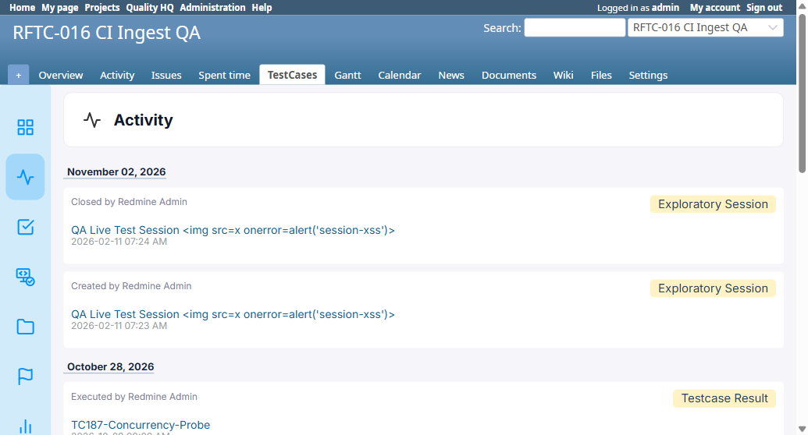

# BUG-TCM-126

- Bug ID: BUG-TCM-126
- Production Redmine Issue ID: #127358 — "BUG-TCM-126: Activity feed's per-event timestamp swaps month and day whenever both are ≤12", assigned Vaishnavi Bhawsar (linked to testcase #127289, Run #659 "Testcase Release 7.3.0 Sign-off", RFTC-029 suite #522)
- Title: Activity feed's per-event timestamp swaps month and day whenever both are ≤12 (e.g. shows "2026-02-11" for an event that actually happened on Nov 2, 2026)
- Redmine version: 6.x (Docker)
- Plugin name: Redmineflux Testcase Management
- Plugin version: branch `release/7.3.0`, commit `329311d` — but this is a **pre-existing** bug in the general Activity feed, not something rftc-029 introduced; it was simply newly noticed while live-verifying rftc-029's "sessions appear in the Activity feed" requirement, and it affects every activity row type (Run, Test Case Result, Test Suite, etc.), not just the new Exploratory Session rows
- Environment: Docker `localhost:3000`, project `rftc-016-ci-qa`
- Browser: Chromium (Playwright MCP)
- User role: Administrator
- Date: 2026-11-02

## Steps to reproduce

1. Create or close any activity-tracked record (e.g. start/close a Testcase Session) on a date where the day-of-month is ≤12 (so both month and day components are ambiguous, e.g. November 2 → `11`/`02`).
2. Open the project's Activity page: `/testcase_activities?project_id=<id>`.
3. Compare the per-event timestamp shown under the event (e.g. "2026-02-11 07:24 AM") against the actual event time shown elsewhere on the same page (e.g. the "November 02, 2026" date-group heading directly above it, or the record's own detail page which shows the correct "11/02/2026 07:23 AM").

## Expected result

- The per-event timestamp should show the real event date/time, matching the date-group heading above it and the record's own detail page (e.g. "2026-11-02 07:23 AM" / "Nov 2, 2026").

## Actual result

- The per-event timestamp shows month and day **swapped**: "2026-02-11 07:23 AM" and "2026-02-11 07:24 AM" for two events that actually happened at 07:23/07:24 AM on **November 2, 2026** — correctly grouped under the "November 02, 2026" heading just above them, and correctly shown as "11/02/2026" on the session's own detail page. Only this feed's own per-row timestamp is wrong.
- Root cause (confirmed by reading the code): `app/views/testcase_activities/index.html.erb` renders every row's timestamp via `format_date_string(format_time(activity.created_at))`. `TestcaseActivitiesHelper#format_date_string` (`app/helpers/testcase_activities_helper.rb`) takes the pre-formatted time STRING (not the raw `Time` object) and re-parses it against an ordered list of candidate formats, trying **day-first formats before month-first ones**:
  ```ruby
  formats = [
    '%d/%m/%Y %I:%M %p',   # tried first
    '%d-%m-%Y %I:%M %p',
    '%Y/%m/%d %H:%M',
    '%Y-%m-%d %H:%M',
    '%m/%d/%Y %H:%M',
    ...
  ]
  ```
  `format_time(...)` produces a US-style `MM/DD/YYYY hh:mm AM/PM` string (e.g. `"11/02/2026 07:23 AM"`). Because the FIRST format tried is day-first (`%d/%m/%Y %I:%M %p`), and `11` and `02` are both syntactically valid as either a day or a month, that format matches successfully and wins — parsing `11` as the day and `02` as the month, silently swapping them, before the correct month-first format later in the list is ever tried. This only produces a visibly wrong date when both components are ≤12 (any date from the 1st–12th of a month); dates with a day ≥13 are unaffected since the day-first format can't match a day >12 on numeric validity, so they fall through to a later, correct format.
- This is not isolated to the new Exploratory Sessions feature — the exact same `format_date_string(format_time(...))` call is used uniformly for every tracked type in this same view (Run, Test Case Result, Test Suite, Environment, etc.), so any activity event occurring on the 1st–12th of a month is affected identically.

## Evidence

### Screenshot



Shows the "November 02, 2026" date-group heading directly above two rows ("Closed by Redmine Admin" / "Created by Redmine Admin" for a Testcase Session), each displaying "2026-02-11 07:24 AM" / "2026-02-11 07:23 AM" — month and day visibly swapped relative to the heading's own correct date.

### Console / log

- N/A — purely a view/helper-level string formatting bug, no server error.

## Duplicate check

- Duplicate found: No
- Existing bug reference (if duplicate): —

## Retest (2026-11-03)

- **Result: FIXED** — retested against branch `release/7.3.0`, commit `eefc0a4`, on a freshly-rebuilt PostgreSQL instance (`localhost:3000`, project `rftc-016-ci-qa`).
- Created a Test Suite, Test Case, Run, and 2 execution results on 2026-11-03 — day=03, month=11, both ≤12, exactly the ambiguous case this bug affected.
- Opened `/testcase_activities?project_id=rftc-016-ci-qa`: all 6 activity rows show `2026-11-03 07:5X AM`, correctly matching the "November 03, 2026" date-group heading above them — no month/day swap (previously would have shown `2026-03-11`).
- Production issue #127358 updated: status In QA → Done, % done → 100.
