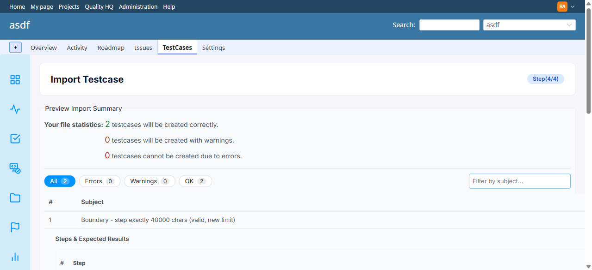

# BUG-TCM-133

- Bug ID: BUG-TCM-133
- Production Redmine Issue ID: #127416 — "BUG-TCM-133: On MySQL, a step longer than 40000 characters passes the import preview as OK and is silently not created", assigned Vaishnavi Bhawsar, Target Version "Testcase Management plugin Release 7.3.0"
- Title: On MySQL, a step longer than 40000 characters passes the import preview as OK and is rejected only while importing — the error is on the progress page for under a second, and the case is silently not created
- Severity: Medium
- Redmine version: 7.0 (Docker `redmine:7.0-bookworm`), MySQL 8.0.46 (utf8mb4)
- Plugin name: Redmineflux Testcase Management
- Plugin version: branch `release/7.3.0`, commit `eefc0a4` (the same code is in `release/7.2.0` @ `b1a6c79` and `master` @ `983556e`)
- Environment: Docker `localhost:3002` (MySQL stack rebuilt from an empty database, project `asdf`)
- Browser: Chromium (Playwright MCP)
- User role: Administrator
- Date: 2026-11-02
- Found via: native spec `TESTCASE_MANAGEMENT_CSV_IMPORT.spec.ts`, **TC-TCM-276** (40000 vs 40001 characters) failed on MySQL; confirmed with Playwright MCP

## Steps to reproduce

1. On a MySQL-backed instance, import `automation/testdata/csv-test-data/21_boundary_40000_vs_40001_chars.csv` (row 1: a 40000-character step; row 2: a 40001-character step).
2. Step 4: read the preview.
3. Press Import and watch the progress page.
4. Open the project's test cases.

## Expected result

- The preview marks row 2 as an **Error** ("Step 1: step content exceeds the maximum length of 40000 characters (got 40001)") — which is what PostgreSQL does with the same file — so the user knows before importing.

## Actual result

- The preview says "**2** testcases will be created correctly, 0 with warnings, **0** cannot be created due to errors"; both rows are OK.
- The import runs; the progress page shows `success=1 failed=1` and the line "Row 2: Step save failed for 'Boundary - step exactly 40001 chars (invalid, new limit)': Exceeds the maximum length of 40000 characters".
  That page redirects to the suites list about 0.6 seconds after the last batch, so the message is easy to miss.
- Only row 1 is created. Row 2 is gone with no message left anywhere.

## Root cause (confirmed)

- `app/controllers/testcase_import_controller.rb` (step 4): `step_limit = Step.columns_hash['step'].limit || Step::STEP_TEXT_MAX_LENGTH`. The 40000 fallback only applies when the column has no limit
  (PostgreSQL `text`, limit `nil`). On MySQL the column is `mediumtext` with limit **16777215**, so that number is used and a 40001-character step passes the check.
- The 40000 rule is applied later by the `Step` model validation when the row is saved during the import, which fails the row after the user has already confirmed.
- `app/views/testcase_import/import_run.js.erb` redirects to the suites list shortly after the last batch even when `failed > 0`.

## Impact

- Different behaviour on the two supported databases for the same file, and a row can be lost with no durable message. A user migrating long test cases (the use case behind the 40000-character work) would believe all rows were imported.

## Suggested fix (not verified)

- Use the business limit in the preview regardless of the column: `[Step.columns_hash['step'].limit, Step::STEP_TEXT_MAX_LENGTH].compact.min` (or just the constant).
- Do not auto-redirect from the progress page when rows failed; keep the failed-rows list on screen.

## Evidence

### Screenshot

The preview on MySQL for the file above: 2 will be created correctly, 0 errors.

### Retest screenshot (fill after fix is verified)

### Console / log

- Playwright MCP, captured from the progress page: `success=1 failed=1`; "Row 2: Step save failed for 'Boundary - step exactly 40001 chars (invalid, new limit)': Exceeds the maximum length of 40000 characters".
- Native spec on MySQL (two runs, existing and rebuilt database): TC-TCM-276 fails with "row 2 (…40001 chars…) should have been created" — the row was not an Error in the preview but was not created. The same spec passes on PostgreSQL.

## Duplicate check

- Duplicate found: No
- Checked `bugs/_index.md` titles for import / 40000 / length. BUG-TCM-079 (hard-coded 2000 limit, closed) is a different defect; the PostgreSQL nil-limit crash was fixed by the developers without a bug file here.

## Retest (2026-11-04)

- **Result: FIXED** — retested against branch `release/7.3.0`, commit `a67d393` ("Fix 5 bugs: step order, Quality HQ speed, Requirements freeze, CSV import data loss"), on a freshly-rebuilt MySQL 8.0.46 instance (Redmine 7.0.2, `localhost:3002`, project `tcm133-mysql`), using the exact same repro CSV (`21_boundary_40000_vs_40001_chars.csv`).
- Step 4 preview now correctly shows row 2 as **Error**: "Step 1: step content exceeds the maximum length of 40000 characters (got 40001)." — matching the Expected Result verbatim. Row 1 (40000 chars) shows OK.
- First retest attempt (same day) incorrectly looked FIXED-but-not on this exact file because the `C:\redmine v7\plugins\redmineflux_testcase_management` checkout used by this MySQL stack was still one commit behind (`eefc0a4`, before the fix). Re-pulled to `a67d393` and restarted the container; the fix then reproduced correctly on the first try.
- Production issue #127416 updated: status In QA → Done, % done → 100.
