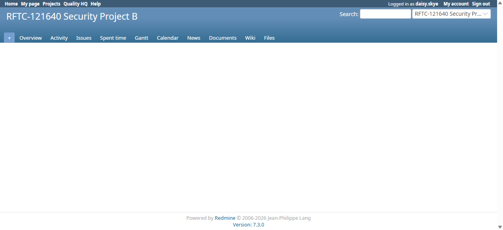

# Bug Report

- Bug ID: BUG-TCM-134
- Production Redmine Issue ID: #127712
- Title: `GET /runs/:id/edit` returns HTTP 200 (not 403/404) and discloses the foreign project's name/nav when a non-member opens another project's run
- Redmine version: 6.0.11 (Docker, localhost:3000)
- Plugin name: Redmineflux Testcase Management
- Plugin version: branch `release/7.3.0`, commit `a67d393`
- Environment: Local Docker (Postgres)
- Browser: Chromium (Playwright)
- User role: Developer on Project A (`rftc-016-ci-qa`) only — zero membership on Project B
- Date: 2026-11-04

## Steps to reproduce

1. Log in as `daisy.skye` (Developer on Project A only, no membership on Project B).
2. Request `GET /runs/2/edit` (run id 2 belongs to Project B, `rftc-121640-project-b`), with or without a
   `project_id=rftc-016-ci-qa` query param — same result either way.

## Expected result

- Per ticket #121640 / finding TCM-04 ("`GET /runs/:id/edit` is scoped to the run's OWN project, not just the
  URL's project"): refused with 403 or 404. The edit form (name, notes, assignees) of Project B's run must not be
  rendered, and no Project B identifying information should reach a caller with zero membership on Project B.

## Actual result

- HTTP response is `200 OK` (confirmed via response headers, not a redirect — `curl -i` shows `HTTP/1.1 200 OK`
  with no `Location` header).
- The page renders the full Redmine layout scoped to **Project B** — page `<title>`, the `<h1>` project name
  ("RFTC-121640 Security Project B"), and the top project-switcher nav (which lists Project B as the current/
  recently-used project and exposes its Overview/Activity/Issues/Wiki/etc. links) — all shown to a user who is not
  a member of Project B at all.
- The actual run data (name "Project B IDOR Fixture Run", notes, assignees) is correctly NOT rendered — `#content`
  is empty — so this is not a full data leak of the run's fields, but it is:
  1. A genuine deviation from the finding's own stated fix (expected 403/404, got 200 with an empty body), and
  2. A minor information disclosure: a non-member now knows Project B's exact display name/identifier and gets
     working navigation links into its Overview/Issues/Wiki/etc. (those downstream pages have their own
     permission checks, but the project's existence/name is leaked here regardless).
- Reproduced identically via raw `curl` (session cookie only, valid CSRF not required for a GET) and via a live
  Playwright browser session as `daisy.skye` — see screenshot.
- Found while executing **TC-TCM-343** (`TESTCASE_MANAGEMENT_SECURITY_REVIEW_121640.md`, finding TCM-04).

## Evidence

### Screenshot

### Console / log

- `curl -i` response: `HTTP/1.1 200 OK`, `content-length: 66316`, no `Location` header, no flash/error text in
  the body — just the standard layout with `
` empty.
- Confirmed with and without a `project_id` query param; same 200 response either time.

## Duplicate check

- Duplicate found: No
- Existing bug reference (if duplicate): N/A — checked `bugs/_duplicates.md` and `bugs/_index.md`, nothing
  matching `/runs/:id/edit` or TCM-04.

## Retest (2026-11-11, after `master` pull to commit `9785d2c`)

**CONFIRMED FIXED.** Pulled latest `master` (`911b8fe` → `9785d2c`), restarted `redmine6-redmine-1`, retested live
as `daisy.skye` (Developer, Project A only) via a real logged-in Playwright session (not just `curl`):

- `GET /runs/2/edit` (Project B's run) → **403 Forbidden**, no Project B name/nav/content rendered.
- `GET /runs/2/edit?project_id=rftc-016-ci-qa` → **403 Forbidden**, same result regardless of the query param.

Both cases confirmed clean — no trace of "RFTC-121640 Security Project B" anywhere in the page title, heading, or
navigation this time. Matches developer's journal comment on production issue #127712 (fix already on `master`
from the original security review, re-verified live, not a new code change this pull). Developer's own regression
test file `test/functional/bug_tcm_134_135_authorization_test.rb` is present and covers this.
